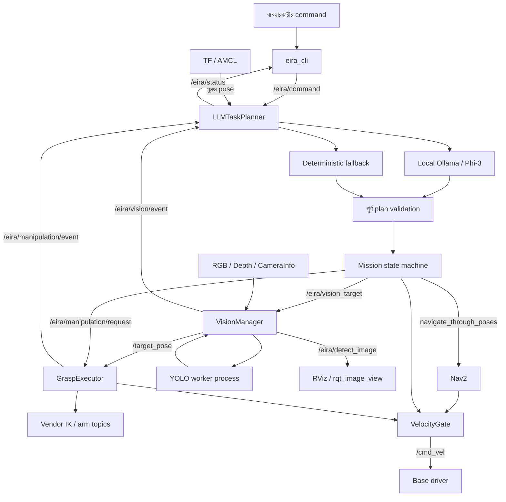
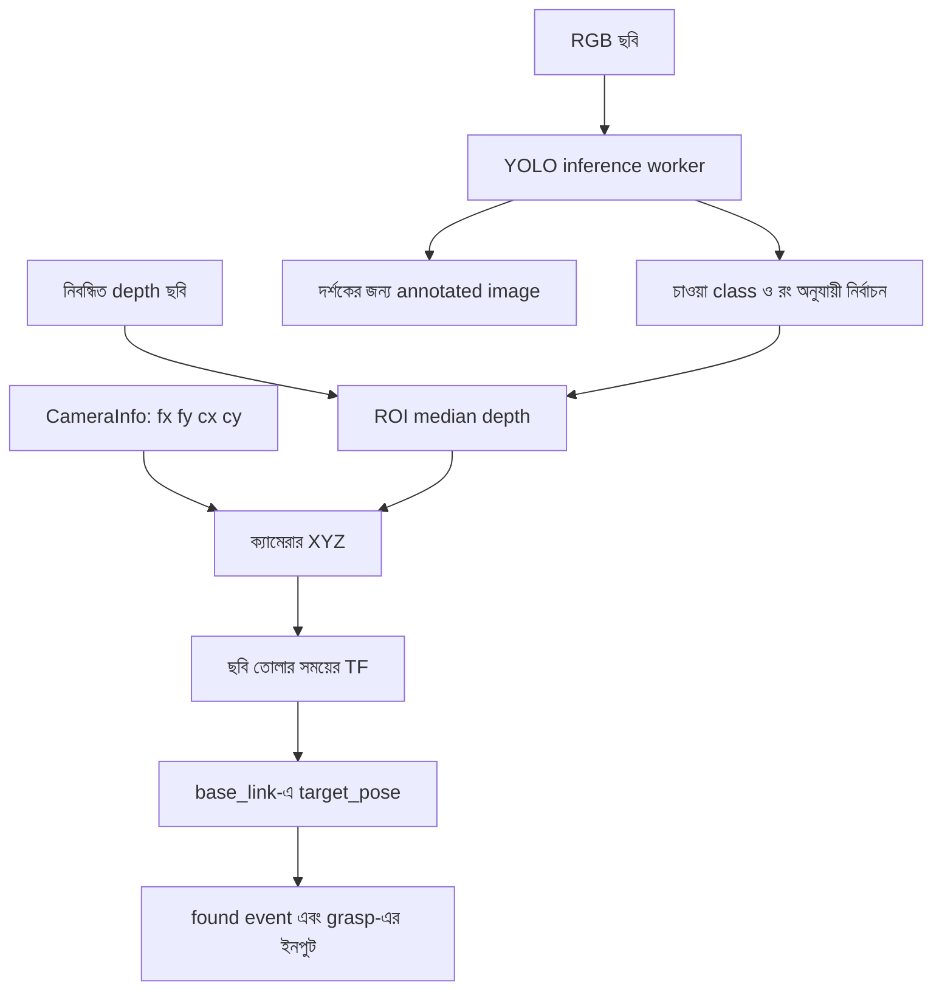
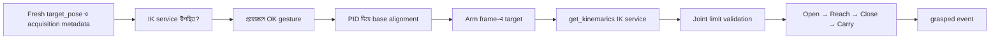

# E-AIRA (`eira_ws`): নতুনদের জন্য সম্পূর্ণ বাংলা কোড ও পরীক্ষার নির্দেশিকা

**কোডের অবস্থান:** `/home/shariful/NeuroBotics/eira_ws`  
**লক্ষ্য পরিবেশ:** ROS 2 Humble, Python 3.10, ROSMASTER M3 Pro, Jetson Orin NX, Dabai RGB-D camera।  
**নথি প্রস্তুতের তারিখ:** ১৬ নভেম্বর ২০২৬।

এই নির্দেশিকা পড়তে ROS আগে থেকেই জানা প্রয়োজন নেই। প্রথমে আমরা সমস্যাটি ও ব্যবহৃত ধারণাগুলো বুঝব। তারপর একটি নির্দেশ কীভাবে CLI থেকে planner, camera, YOLO, navigation এবং arm পর্যন্ত পৌঁছায়, তা কোডসহ দেখব। শেষে থাকবে পরীক্ষা করার কমান্ড, সমস্যা ধরার উপায় এবং বর্তমান সোর্সের পূর্ণ পাঠ।

পড়ার সুবিধার জন্য বাংলা ব্যাখ্যার পাশে প্রকৃত identifier, topic ও command ইংরেজিতেই রাখা হয়েছে। যেমন `mission_start` কোনো অনুবাদযোগ্য প্রদর্শন-শব্দ নয়; এটি কোডে ব্যবহৃত সংরক্ষিত navigation target। তাই কমান্ডে তার বানান বদলাবেন না।

কোডের উদাহরণে `L123` বা `123:` লেখা থাকলে সেটি **মূল Python ফাইলের লাইন নম্বর**, নতুন কোডের অংশ নয়। চলমান রোবটের কোড হিসেবে কপি করার সময় এই নম্বর লিখবেন না। ৫–১০ অধ্যায়ের দেখানো কার্যকর কোড-লাইনগুলোর অর্থ আলাদাভাবে ব্যাখ্যা করা হয়েছে। পূর্ণ সোর্স-পরিশিষ্টে runtime, launch, configuration ও test ফাইলগুলোর সম্পূর্ণ পাঠ আছে; সেখানে নিজের প্রয়োজনের ফাইল খুঁজে পড়তে পারবেন।

এই নথির shell command-গুলো মূলত Bash-এর জন্য। মূল Python সোর্সের বাংলা অনুবাদ আলাদা executable হিসেবে তৈরি করা হয়নি; ব্যাখ্যা ও সোর্স-পাঠ একই Markdown নথিতে রাখা হয়েছে।

<!-- CONTENTS -->

## 1. আমরা কী তৈরি করেছি এবং কেন

ধরুন আপনি বললেন:

```text
bring me a bottle from kitchen
```

আপনার প্রত্যাশা হলো:

1. রোবট এখন কোথায় দাঁড়িয়ে আছে, সেটি মনে রাখবে।
2. `kitchen` নামে সংরক্ষিত স্থানের দিকে যাবে।
3. সেখানে গিয়ে `bottle` খুঁজবে।
4. প্রয়োজনীয় অবস্থান ঠিক করে বোতল ধরার প্রক্রিয়া চালাবে।
5. এই mission-এর শুরুর অবস্থানে ফিরে আসবে।
6. বস্তু ছাড়ার প্রক্রিয়া চালাবে।

একটি Python script দিয়ে সব কাজ একসঙ্গে চালালে camera processing, network request এবং motor control একে অন্যকে আটকে দিতে পারে। তাই `eira_ws`-এ কাজগুলো আলাদা ROS node ও package-এ ভাগ করা হয়েছে। তারা message দিয়ে যোগাযোগ করে।

### 1.1 আগের সমস্যাটি কী ছিল

| সমস্যা | বর্তমান ব্যবস্থা | কেন প্রয়োজন |
|---|---|---|
| Fetch শেষে নির্দিষ্ট `home`-এ ফেরা | mission শুরুর live pose ধরে `mission_start`-এ ফেরা | ব্যবহারকারী অন্য জায়গা থেকে নির্দেশ দিলেও সেই জায়গায় ফিরতে হবে |
| `cell phone`, `wine glass`-এর মতো নাম বাদ পড়া | multiword object parsing ও validation | object-এর পুরো class name অক্ষুণ্ণ থাকে |
| Vision-এর idle default `cup` | default target খালি; request থেকে object নির্বাচন | বারবার parameter edit না করেই ভিন্ন বস্তু চাওয়া যায় |
| বৈধ JSON হলেও ভুল object বা অসম্পূর্ণ fetch | সম্পূর্ণ requested fetch sequence মিলিয়ে দেখা | ভাষার model যেন `bottle`-এর বদলে `cup` এনে না দেয় |
| Model বা camera সমস্যা শুধু আলাদা log-এ দেখা | correlated failure-এর কারণ Brain/CLI পর্যন্ত পৌঁছানো | ব্যবহারকারী কোথায় ব্যর্থ হয়েছে বুঝতে পারেন |
| ধরা আছে এমন অনুমান দিয়ে cup-height ranging | default measured depth; size estimate আলাদা opt-in | arbitrary class-এর ওপর একই cup-height অনুমান প্রয়োগ হয় না |
| Test-এর পরে simulation build ভেঙে যাওয়া | package resource collection-এ শুধু regular file নেওয়া | `__pycache__` directory-কে data file হিসেবে copy করা হয় না |

### 1.2 “যেকোনো object” কথাটির সঠিক অর্থ

Object-এর নাম command থেকে আসে। কিন্তু detector যে label-গুলো শিখেছে, তার বাইরে নতুন বস্তু শুধু নাম বললেই চেনা সম্ভব নয়। সাধারণ COCO model-এ `bottle`, `cup`, `apple`, `cell phone` ইত্যাদি label থাকে। `wood block`-এর মতো custom class চাইলে সেই class-এ trained weights এবং Brain-এর `known_object_classes` configuration মিলতে হবে।

একইভাবে `kitchen` বললে system নিজে আপনার বাড়ির রান্নাঘর আবিষ্কার করে না। `waypoints.yaml`-এ measured approach pose হিসেবে সেই নাম সংরক্ষিত থাকতে হবে। পুরো ঘর ঘুরে সব তাক খোঁজা বর্তমান `find`-এর কাজ নয়; camera-র সামনে দেখা ও bounded scan-এর মধ্যে অনুসন্ধান হয়।

কোনো class detector চিনতে পারলেও arm সেটি তুলতে পারবে কি না, তা আকার, ওজন, দূরত্ব ও calibration-এর ওপর নির্ভর করে। উদাহরণস্বরূপ model-এর class list-এ `chair` থাকলেই এই ছোট arm দিয়ে চেয়ার তোলা সম্ভব হয় না।

### 1.3 `home` এবং `mission_start` আলাদা

ধরা যাক:

```text
saved home:       x = 0.0,  y = 0.0
mission-এর শুরু: x = -1.2, y = 0.8
kitchen:          x = 2.0,  y = 3.0
```

`bring me a bottle from kitchen` শেষে ফেরার লক্ষ্য হবে `(-1.2, 0.8)` এবং তখনকার starting heading। পরে `go home` বললে লক্ষ্য হবে saved `(0.0, 0.0)`।

`mission_start` একটি mission চলাকালে স্থির snapshot। Navigation শেষ করে নতুন pose আসলেই সেটি বদলে যায় না। Queue-তে অপেক্ষমাণ পরের mission বাস্তবে শুরু হলে তার জন্য নতুন snapshot নেওয়া হয়। প্রয়োজনীয় fresh localization না থাকলে fetch-এর executable plan গৃহীত হয় না।

## 2. কোড পড়ার আগে প্রয়োজনীয় ভিত্তি

### 2.1 ROS 2-এর ছয়টি মূল ধারণা

| শব্দ | সহজ অর্থ | এই project-এ উদাহরণ |
|---|---|---|
| Workspace | সম্পর্কিত ROS package রাখার ও build করার জায়গা | `eira_ws` |
| Package | নির্দিষ্ট দায়িত্বের software unit | `eira_perception` |
| Node | চালু থাকা ROS program/component | `vision_manager` |
| Topic | named message channel | `/eira/vision_target` |
| Publisher / subscriber | message পাঠানো / গ্রহণ করা | Brain target পাঠায়; Vision গ্রহণ করে |
| Parameter | node চালুর configuration | `confidence: 0.4` |

আরও কয়েকটি ধারণা:

- **Service:** একটি request দিয়ে একটি response নেওয়া। Arm-এর inverse kinematics এই ধরনের interface ব্যবহার করে।
- **Action:** দীর্ঘ কাজের goal, feedback, result ও cancel। Nav2 navigation একটি action।
- **Callback:** message বা timer এলে যে function চলে। `_on_target()` target message-এর callback।
- **Executor:** callbacks চালানোর ব্যবস্থা। অনেক callback একসঙ্গে তৈরি হলেও shared state-এ lock দরকার হতে পারে।
- **QoS:** message delivery-র নীতি। Camera সাধারণত Best Effort sensor QoS ব্যবহার করে; control/event topic-এ নির্ভরযোগ্য delivery বেশি গুরুত্বপূর্ণ।
- **TF:** এক coordinate frame থেকে আরেক frame-এ অবস্থান/দিক বদলানোর সময়ভিত্তিক ব্যবস্থা।
- **Pose:** অবস্থান এবং orientation। এই base navigation-এ সাধারণত `x`, `y`, `yaw` ব্যবহৃত হয়।
- **Heartbeat:** “controller এখনো সাড়া দিচ্ছে” এমন periodic message।

### 2.2 Python-এর ব্যবহৃত গঠন

```python
class Example:
    def __init__(self):
        self.target = "bottle"

    def show(self):
        return self.target
```

| লাইন | ব্যাখ্যা |
|---|---|
| `class Example:` | একই ধরনের data ও আচরণ এক জায়গায় রাখার class তৈরি করে। |
| `def __init__(self):` | class থেকে object বানালে initialization-এর সময় চলে। |
| `self.target = "bottle"` | এই object-এর ভেতর `target` নামে একটি value রাখে। এটি Python শেখানোর উদাহরণ; Eira-র idle target খালি। |
| `def show(self):` | object-এর আরেকটি method তৈরি করে। |
| `return self.target` | রাখা value caller-এর কাছে ফেরত দেয়। |

প্রকৃত সোর্সে আরও যা দেখবেন:

| লেখা | অর্থ |
|---|---|
| `_name` | internal ব্যবহারের নাম; leading underscore Python-এ পরামর্শমূলক convention |
| `dict`, `{...}` | key/value mapping; JSON message বানাতে সুবিধা |
| `list`, `[...]` | ordered item collection; plan-এর action order থাকে |
| `tuple`, `(...)` | সাধারণত পরিবর্তন না করার উদ্দেশ্যে রাখা ordered collection |
| `None` | value/measurement এখনো নেই |
| `if ...:` | শর্ত সত্য হলে ভেতরের indented অংশ চলে |
| `for ... in ...:` | প্রতিটি item-এর জন্য একই কাজ করে |
| `try` / `except` | ব্যর্থ operation-এর নির্দিষ্ট error সামলে program চালু রাখে |
| `raise ValueError(...)` | ভুল input স্পষ্টভাবে reject করে |
| `getattr(obj, name, default)` | attribute থাকলে নেয়; না থাকলে default দেয় |
| `@staticmethod` | class method হলেও object-এর `self` প্রয়োজন হয় না |
| `@synchronized` | এই project-এর decorator; shared mission state-এর lock নিয়ে method চালায় |
| `future.add_done_callback(...)` | asynchronous কাজ শেষ হলে পরের callback চালানোর ব্যবস্থা |
| `-> bool` | return type-এর hint; নিজে নিজে runtime validation নয় |

Indentation গুরুত্বপূর্ণ। একই column-এ থাকা line একই block-এর অংশ হতে পারে। `return` শুধু value দেয় না, বর্তমান function-এর execution-ও শেষ করে। তাই success-এর পরে দ্রুত `return` করা পুরোনো timeout logic আবার চলা ঠেকাতে পারে।

### 2.3 JSON কেন ব্যবহার করা হয়েছে

ROS-এর `std_msgs/msg/String` message-এর `data` field-এ JSON লেখা পাঠানো হয়:

```json
{
  "mission_id": "example-mission",
  "action_id": "1:1",
  "target": "bottle",
  "refresh_id": 1
}
```

প্রথমে এটি string; `json.loads()` করলে Python dictionary হয়। `json.dumps()` উল্টো পথে dictionary-কে JSON string বানায়। ROS নিজে এই String-এর ভেতরের custom JSON field বোঝে না; প্রতিটি consumer নিজের decoder/validator দিয়ে পরীক্ষা করে।

`mission_id` পুরো কাজকে চিহ্নিত করে। `action_id` ওই কাজের একটি action attempt চিহ্নিত করে। একটি পুরোনো find-এর result যেন নতুন find বা অন্য ব্যবহারকারীর mission শেষ না করে, তাই দুটোই মেলানো হয়। `refresh_id` একই target-এর নতুন একবারের measurement চাওয়ার token; একই keepalive আবার এলে search অনন্তকাল দীর্ঘ হয় না।

### 2.4 সময় ও একক

| Data | একক/ধরন | কেন খেয়াল করবেন |
|---|---|---|
| Base distance | metre | `0.19` মানে ১৯ সেন্টিমিটার |
| Base yaw/bearing | radian | প্রায় `1.5708` মানে ৯০ ডিগ্রি |
| Servo angles | vendor degree convention | base yaw-এর radian-এর সঙ্গে গুলিয়ে ফেলবেন না |
| `16UC1` depth | সাধারণত millimetre input, code-এ metre-এ conversion | `1000` থেকে `1.0 m` |
| `32FC1`/`64FC1` depth | metre | সরাসরি metric হিসাব |
| Sensor timestamp | ROS clock | TF lookup ও measurement age বোঝার জন্য |
| Deadline/duration | monotonic wall clock | system clock বদলালেও timeout হিসাব স্থিতিশীল |

Simulation-এ sensor এবং node-এর ROS clock-এর জন্য `use_sim_time=true` রাখা হয়। Deadline-এর wall-clock সীমা আর simulator timestamp এক বিষয় নয়। পুরোনো frame আবার publish করলেই তার সত্যিকারের capture time নতুন হয়ে যায় না।

## 3. `eira_ws`-এর ফাইল ও package মানচিত্র

```text
eira_ws/
├── src/
│   ├── eira_brain/          # command, planning, orchestration, safety, reports
│   ├── eira_perception/     # camera, YOLO, depth, tracking, gesture
│   ├── eira_manipulation/   # alignment, IK, servo sequence
│   ├── eira_bringup/        # launch, shared config, visualization, exercises
│   ├── eira_evaluation/     # mission evidence, benchmark, metrics
│   └── eira_simulation/     # Gazebo scene, sensor/arm adapters, oracle
├── docs/                   # পরীক্ষা ও ব্যাখ্যা
├── build/                  # build-এর intermediate ফল
├── install/                # ROS চালানোর installed overlay
└── log/                    # colcon build/test log
```

`src`-এর প্রথম package directory-তে `setup.py`, `package.xml`, `test/` এবং একই নামের Python module directory থাকে। যেমন:

```text
src/eira_brain/                     ← ROS package root
src/eira_brain/eira_brain/           ← import করার Python package
src/eira_brain/eira_brain/eira_cli.py ← CLI implementation
```

### 3.1 Packaging ফাইলের ভূমিকা

| ফাইল | কাজ |
|---|---|
| `package.xml` | ROS dependencies এবং package metadata ঘোষণা করে। |
| `setup.py` | Python module, resource এবং executable entry point install করে। |
| `setup.cfg` | ROS executable-এর install location ইত্যাদি নির্ধারণ করে। |
| `resource/<package>` | ament index-এ package discover করার marker। |
| `__init__.py` | Python package initialization/module boundary। |
| `test/conftest.py` | source থেকে test import করার সহায়তা দেয়। |

`eira_brain/setup.py`-এর entry point উদাহরণ:

```python
'eira_cli = eira_brain.eira_cli:main'
```

এই এক লাইনটি তিন ভাগে পড়ুন:

| অংশ | অর্থ |
|---|---|
| `eira_cli` | ROS-এ চালানোর executable নাম। |
| `eira_brain.eira_cli` | Python module। |
| `:main` | ওই module-এর `main()` function চালাতে হবে। |

তাই এই command কাজ করে:

```bash
ros2 run eira_brain eira_cli "find a bottle"
```

এখানে প্রথম `eira_brain` package; দ্বিতীয় `eira_cli` executable; শেষে quoted অংশ program-এর input। এটি Brain না চললে নিজে পুরো system তৈরি করে না।

### 3.2 Configuration কোথায়

- [eira_params.yaml](../src/eira_bringup/config/eira_params.yaml): node-গুলোর parameter।
- [waypoints.yaml](../src/eira_bringup/config/waypoints.yaml): named navigation pose-এর উদাহরণ database।
- [vision_debug.rviz](../src/eira_bringup/config/vision_debug.rviz): raw এবং annotated camera image দেখার preset।
- [gripper_calibration.example.yaml](../src/eira_bringup/config/gripper_calibration.example.yaml): measured width/angle mapping-এর example।
- [marker_map.example.yaml](../src/eira_bringup/config/marker_map.example.yaml): visual relocalization-এর known marker map-এর example।

`example` configuration মানেই আপনার রোবটের calibration নয়। `waypoints.yaml`-এর example coordinate-ও measured environment data দিয়ে বদলাতে হবে।

## 4. একটি mission ভেতরে কীভাবে চলে

### 4.1 পুরো যোগাযোগের চিত্র



Diagram না দেখালে এটি পড়ুন: CLI শুধু instruction পাঠায়। Brain পরিকল্পনা ও sequencing করে। Nav2 base-কে স্থানে নিয়ে যায়। Vision object চিনে pose প্রকাশ করে। Arm সেই pose নিয়ে alignment ও ধরার sequence চালায়। Gate অনুমোদিত source-এর velocity-ই base driver-এর দিকে দেয়।

### 4.2 গুরুত্বপূর্ণ topic-এর অভিধান

| Topic/interface | কে পাঠায় | কে ব্যবহার করে | মূল data |
|---|---|---|---|
| `/eira/command` | CLI / authorized frontend | Brain | instruction + mission identity |
| `/eira/voice` | voice adapter | Brain | wake-word-এর পর পাওয়া command |
| `/eira/plan` | Brain | observer/logger | validated action sequence |
| `/eira/status` | Brain | CLI/logger/reporter | progress, result, error |
| `/eira/vision_target` | Brain বা standalone operator | Vision | requested class/color + IDs |
| `/camera/color/image_raw` | camera driver | Vision/viewer | raw RGB image |
| `/camera/depth/image_raw` | camera driver | Vision | depth raster |
| `/camera/color/camera_info` | camera driver | Vision | color intrinsics |
| `/camera/depth/camera_info` | camera driver | Vision | depth intrinsics |
| `/eira/detect_image` | Vision | viewer | boxes ও labels-সহ image |
| `/target_pose` | Vision | arm/visualization | stamped 3D object pose |
| `/eira/vision/event` | Vision | Brain/logger | found/lost/timeout/failed + metadata |
| `/eira/manipulation/request` | Brain | arm | grasp/release/home/stop + IDs |
| `/eira/manipulation/event` | arm | Brain/logger | grasped/released/homed/failed |
| `/navigate_through_poses` | Brain goal পাঠায় | Nav2 action server | destination pose এবং result |
| `/eira/motion_owner` | Brain/exercise owner | gate | কে এখন base velocity দিতে পারবে |
| `/eira/cmd_vel/nav` | navigation path | gate | Nav2 velocity |
| `/eira/cmd_vel/brain` | Brain | gate | bounded scan velocity |
| `/eira/cmd_vel/arm` | arm | gate | alignment velocity |
| `/cmd_vel` | gate | base driver | final allowed velocity |
| `/eira/heartbeat` | Brain | gate/watchdog | controller liveness |
| `/get_kinemarics` | arm request দেয় | vendor service | IK/FK; নামের বানান legacy interface অনুযায়ী |
| `/arm6_joints`, `/arm_joint` | arm | vendor driver | servo request |
| `/Curjoints` | native feedback / sim bridge | arm | joint report; provenance যাচাই দরকার |

কিছু source code-এ topic-এর শুরুতে `/` নেই। সেগুলো relative ROS নাম। Default namespace-এ ফল একই root topic হতে পারে; namespace/remapping ব্যবহার করলে resolution বদলাতে পারে। Master launch-এর remapping দেখে প্রকৃত runtime graph যাচাই করবেন।

### 4.3 Plan হলো ছোট action-এর তালিকা

```json
[
  {"action": "navigate", "target": "kitchen"},
  {"action": "find", "target": "bottle"},
  {"action": "grasp"},
  {"action": "navigate", "target": "mission_start"},
  {"action": "release"}
]
```

| Step | কাজ | পরের step-এ যাওয়ার প্রমাণ |
|---|---|---|
| 1 | kitchen approach pose-এ navigation | current Nav2 action-এর succeeded result, তারপর settle |
| 2 | bottle acquisition | matching mission/action/target-এর `found` |
| 3 | grasp sequence | current manipulation request-এর `grasped` |
| 4 | captured start pose-এ navigation | current Nav2 succeeded result, তারপর settle |
| 5 | release sequence | current request-এর `released` |

এখানে plan লেখা মানেই কাজ শেষ নয়। প্রতিটি action-এর পরে সংশ্লিষ্ট asynchronous result আসতে হয়। কোনো result পুরোনো বা অন্য action-এর হলে তা দিয়ে বর্তমান কাজ সম্পূর্ণ হয় না।

### 4.4 Controller completion এবং বাস্তব delivery

`grasped` event বা `Mission complete` দেখার অর্থ হলো software-এর প্রত্যাশিত sequence/result পাওয়া গেছে। বস্তু সত্যি gripper-এ ছিল, পথে পড়ে যায়নি, এবং আপনার কাছে পৌঁছেছে—এই physical observation আলাদাভাবে যাচাই করতে হয়। Code-এর `physical_contact_verified=False` এবং held-object evidence-এর পৃথক ব্যবস্থা এই পার্থক্য রাখে।

একইভাবে `found` বলতে এখানে শুধু image-এ label দেখানো বোঝায় না; usable geometry-সহ requested acquisition প্রয়োজন। তাই bounding box দেখা গেলেও depth বা TF না থাকলে পূর্ণ find ব্যর্থ হতে পারে।
## 5. নির্দেশ বোঝা থেকে কাজ শেষ: `eira_brain`

এই প্যাকেজ রোবটের সমন্বয়কারী। ক্যামেরায় ছবি কীভাবে চিনতে হয়, তা Brain শেখায় না; চাকা বা servo-ও সরাসরি নিজে নিয়ন্ত্রণ করে না। ব্যবহারকারীর নির্দেশকে ছোট কাজের তালিকায় রূপান্তর করে উপযুক্ত ROS interface-এ পাঠায় এবং প্রতিটির ফলাফলের অপেক্ষা করে।

একটি উদাহরণ ধরে পুরো অধ্যায় পড়ি:

```text
bring me a bottle from kitchen
```

এখানে `bottle` হলো চাওয়া detector class এবং `kitchen` হলো আগে মাপ নিয়ে সংরক্ষিত navigation waypoint। `kitchen` শব্দ শুনে রোবট নিজে ঘরের মানচিত্র তৈরি বা রান্নাঘরের অবস্থান আবিষ্কার করে না।

```json
[
  {"action": "navigate", "target": "kitchen"},
  {"action": "find", "target": "bottle"},
  {"action": "grasp"},
  {"action": "navigate", "target": "mission_start"},
  {"action": "release"}
]
```

এখানে একই `target` key দুই কাজে ভিন্ন অর্থ নেয়: `navigate`-এ জায়গার নাম, `find`-এ বস্তুর class। `grasp` ও `release`-এর আলাদা textual target নেই; grasp আগের সফল find-এর মাপ ও পরিচয় ব্যবহার করে।

এই অধ্যায়ের code block মূল source থেকে নেওয়া। প্রতিটি টেবিলের নম্বর মূল `.py` ফাইলের নম্বর; code block-এর প্রথম লাইনকে ১ ধরে মিলাবেন না। দীর্ঘ method-এর শিক্ষণীয় executable অংশ দেখানো হয়েছে; বাদ দেওয়া docstring/import বা অন্য method আছে কি না, source link খুলে দেখা যাবে। এখানে দেখানো প্রতিটি nonblank লাইনের ব্যাখ্যা টেবিলে আছে। source পরিবর্তন হলে লাইন নম্বর বদলাতে পারে।

### 5.1 Python পড়ার ছোট প্রস্তুতি

| লেখা | অর্থ |
|---|---|
| `self._command` | এই node object-এর নিজের মধ্যে রাখা command |
| `def run(self)` | `run` নামের method তৈরি |
| `if ...:` | শর্ত সত্য হলে পরের indented block চলে |
| `return` | বর্তমান function থেকে বের হওয়া |
| `None` | এখনো কোনো মান নেই বা ফল পাওয়া যায়নি |
| `dict` | key দিয়ে তথ্য রাখা; যেমন `{"target": "bottle"}` |
| `list` | ক্রম রাখা; যেমন plan-এর প্রথম, দ্বিতীয় কাজ |
| `json.dumps(...)` | Python data থেকে topic-এ পাঠানোর JSON text |
| `json.loads(...)` | পাওয়া JSON text থেকে Python data |
| `try` / `except` | ব্যর্থ হতে পারে এমন কাজ ও ব্যর্থ হলে বিকল্প আচরণ |
| `getattr(x, "name", default)` | attribute থাকলে তার মান, না থাকলে default |
| `time.monotonic()` | সময়সীমা মাপার ঘড়ি; system date পাল্টালেও পিছিয়ে যায় না |
| `with self._mission_lock:` | এক সময়ে এক callback-কে shared mission state বদলাতে দেওয়া |
| `lambda` | ছোট callback function লেখার সংক্ষিপ্ত রূপ |

একটি code block পড়তে গিয়ে indentation এড়িয়ে যাবেন না। Python-এ একই স্তরের indentation দেখায় কোন statement কোন শর্ত বা loop-এর অন্তর্ভুক্ত।

### 5.2 CLI এবং Brain আলাদা কেন

[eira_cli.py](../src/eira_brain/eira_brain/eira_cli.py) হলো command পাঠানো এবং ফল দেখা terminal interface। [llm_task_planner.py](../src/eira_brain/eira_brain/llm_task_planner.py) হলো চালু থাকা ROS node, যে আসল mission পরিচালনা করে। CLI শেষ হয়ে গেলেও Brain-এর mission চলতে পারে।

CLI-এর constructor-এ `uuid.uuid4().hex` দিয়ে একটি `mission_id` তৈরি হয়। এটি একটি অনন্য পরিচয়, যেমন পার্সেলের tracking number। CLI `eira/command`-এ প্রকাশ করে এবং `eira/status`-এ তার নিজের mission-এর খবর শোনে। default namespace-এ এদের পূর্ণ নাম `/eira/command` ও `/eira/status`।

### 5.3 CLI command পাঠায় এবং ফলের অপেক্ষা করে

এটি `CliFrontend.run()`-এর executable অংশ। method-এর return code `0` মানে এই CLI পর্যবেক্ষণে সফলতা, আর `2` মানে ব্যর্থতা বা উত্তর না পাওয়া।

উৎস: [eira_cli.py](../src/eira_brain/eira_brain/eira_cli.py), লাইন 185–214।

```python
if self._plan_only:
    _print_preview(preview_plan(self._command),
                   json_output=getattr(self, "_json_output", False),
                   color=getattr(self, "_color", None))
    return 0
discovery_deadline = time.monotonic() + min(5.0, self._timeout_s)
while (self._command_pub.get_subscription_count() == 0
       and time.monotonic() < discovery_deadline and rclpy.ok()):
    rclpy.spin_once(self, timeout_sec=0.1)
if self._command_pub.get_subscription_count() == 0:
    _print_error("planner_unavailable", "No planner subscription discovered",
                 json_output=self._json_output, color=self._color)
    return 2
self._command_pub.publish(String(data=json.dumps({
    "command": self._command, "mission_id": self._mission_id})))
if self._quiet:
    rclpy.spin_once(self, timeout_sec=0.1)
    return 0
if not self._json_output:
    print(format_line("CLI", f"Command sent: {sanitize_text(self._command)}",
                      color=self._color), flush=True)
deadline = time.monotonic() + self._timeout_s
while rclpy.ok() and not self._settled and time.monotonic() < deadline:
    rclpy.spin_once(self, timeout_sec=min(0.5, max(0.0, deadline - time.monotonic())))
if not self._settled:
    _print_error("mission_response_timeout",
                 "Timed out waiting; the mission may still be active. "
                 "Send 'stop' to cancel it.",
                 json_output=self._json_output, color=self._color)
return self._exit_code
```

| মূল ফাইলের লাইন | সহজ ব্যাখ্যা |
|---|---|
| 185 | `plan_only` হলে preview দেখানোর শাখায় ঢোকে। |
| 186 | command থেকে nonexecuting preview বানিয়ে terminal formatter-এ দেয়। |
| 187 | JSON output চাওয়া হয়েছে কি না নেয়; attribute না থাকলে false। |
| 188 | রঙ ব্যবহারের preference নিয়ে preview print call শেষ করে। |
| 189 | preview শেষ; কোনো live command পাঠানোর অংশে যায় না। |
| 190 | planner খোঁজার জন্য সর্বোচ্চ পাঁচ সেকেন্ডের deadline রাখে; CLI budget ছোট হলে সেটিই মানে। |
| 191 | command topic-এ কোনো subscriber পাওয়া যাচ্ছে না কি না দেখে। |
| 192 | সময় বাকি ও ROS সচল থাকলে discovery loop চালায়। |
| 193 | ০.১ সেকেন্ড করে ROS callback চালায়, যাতে discovery/status আসতে পারে। |
| 194 | অপেক্ষা শেষে আবার subscriber নেই কি না দেখে। |
| 195 | planner পাওয়া যায়নি—এই অর্থের error তৈরি করে। |
| 196 | error কোন display format-এ হবে তা দেয়। |
| 197 | command না পাঠিয়ে failure exit code ফেরত দেয়। |
| 198 | `String` message-এর ভিতর JSON envelope তৈরি করে publish শুরু করে। |
| 199 | envelope-এ আসল command ও অনন্য mission ID রাখে। |
| 200 | `--quiet` mode হলে ফলের দীর্ঘ অপেক্ষা বাদ দেয়। |
| 201 | প্রকাশের পরে অল্প সময় ROS callback চালায়। |
| 202 | quiet CLI ফেরত যায়; এটি mission সফল হওয়ার প্রমাণ নয়। |
| 203 | raw JSON mode না হলে মানুষের পড়ার message দেখায়। |
| 204 | command-এর control character সরিয়ে “Command sent” লাইন বানায়। |
| 205 | রঙের পছন্দ দেয় এবং output দ্রুত flush করে। |
| 206 | mission-এর ফল শোনার wall-clock deadline তৈরি করে। |
| 207 | ROS চলছে, terminal result আসেনি এবং সময় বাকি—তিন শর্তে অপেক্ষা করে। |
| 208 | সর্বোচ্চ অর্ধ সেকেন্ড করে callback চালায়; deadline-এর পরে অতিরিক্ত অপেক্ষা এড়ায়। |
| 209 | loop শেষে terminal result না এলে timeout জানাবে। |
| 210 | timeout-এর স্থির diagnostic event name দেয়। |
| 211 | CLI অপেক্ষা শেষ হলেও mission চলতে পারে—এ কথা message-এ রাখে। |
| 212 | আসল cancellation-এর জন্য `stop` পাঠাতে বলে। |
| 213 | error-এর JSON/color format বেছে নেয়। |
| 214 | status callback যে exit code স্থির করেছে সেটি ফেরত দেয়। |

### 5.4 অন্য mission-এর success আমার success নয়

এটি `_on_status()`-এর executable অংশ। এক ROS graph-এ একাধিক operator থাকলেও এই filter ভুল mission-এর DONE দেখে CLI বন্ধ হতে দেয় না।

উৎস: [eira_cli.py](../src/eira_brain/eira_brain/eira_cli.py), লাইন 222–241।

```python
try:
    status = json.loads(msg.data)
except json.JSONDecodeError:
    return
if not isinstance(status, dict) or status.get("mission_id") != self._mission_id:
    return
if getattr(self, "_json_output", False):
    print(json.dumps(status), flush=True)
else:
    line = format_status(status, component="CLI", color=getattr(self, "_color", None))
    terminal = status.get("state") in ("DONE", "FAILED") or (
        "rejected" in str(status.get("detail", "")))
    if line != getattr(self, "_last_output", None) or terminal:
        print(line, flush=True)
        self._last_output = line
if "rejected" in str(status.get("detail", "")):
    self._settled, self._exit_code = True, 2
elif status.get("state") in ("DONE", "FAILED"):
    self._settled = True
    self._exit_code = 0 if status["state"] == "DONE" else 2
```

| মূল ফাইলের লাইন | সহজ ব্যাখ্যা |
|---|---|
| 222 | JSON decode ব্যর্থ হওয়ার সম্ভাবনা সামলানোর block শুরু। |
| 223 | `String.data` থেকে status dictionary পড়ার চেষ্টা। |
| 224 | text valid JSON না হলে এই exception ধরে। |
| 225 | invalid message উপেক্ষা করে; CLI বন্ধ হয় না। |
| 226 | status dictionary কি না এবং mission ID এই CLI-এর কি না যাচাই। |
| 227 | অন্য mission বা ভুল schema হলে কিছুই করে না। |
| 228 | `--json` চাওয়া হয়েছে কি না দেখে। |
| 229 | হলে structured status অক্ষত JSON হিসেবে দেখায়। |
| 230 | নইলে মানুষের পড়ার display শাখা। |
| 231 | status-এর অর্থকে ছোট terminal বাক্যে রূপ দেয়। |
| 232 | DONE বা FAILED terminal state কি না পরীক্ষা শুরু। |
| 233 | command rejected হলেও terminal হিসেবে ধরবে। |
| 234 | আগের একই output হলে কমায়; তবে terminal result অবশ্যই দেখায়। |
| 235 | readable লাইন print করে সঙ্গে সঙ্গে flush। |
| 236 | পরে duplicate শনাক্ত করতে শেষ দেখানো লাইন মনে রাখে। |
| 237 | rejection আছে কি না আলাদাভাবে পরীক্ষা। |
| 238 | rejection হলে অপেক্ষা শেষ এবং exit code 2। |
| 239 | নইলে DONE/FAILED এসেছে কি না দেখে। |
| 240 | terminal status হলে অপেক্ষা শেষের flag দেয়। |
| 241 | DONE হলে 0, FAILED হলে 2 দেয়। |

### 5.5 `--plan-only`: কী হবে বোঝা, কাজ চালানো নয়

সাধারণ CLI command-এর আগে `--plan-only` দিলে `main()` ROS initialization-এর আগেই preview তৈরি করে। নিচের helper-এ `object.__new__` শুধু planner-এর parsing/validation method ব্যবহারের জন্য object তৈরি করে; `Node.__init__` চালায় না। তাই ROS publisher, navigation goal বা arm request তৈরি হয় না।

```bash
ros2 run eira_brain eira_cli --plan-only \
  --waypoints-file /absolute/path/to/waypoints.yaml \
  "bring me a bottle from kitchen"
```

preview-তে `mission_start` প্রতীকী নাম হিসেবে থাকে। live pose নেই বলে preview সেটির coordinate জানে না। পরে আসল mission শুরু হলে চালু Brain নতুন করে pose ধরে এবং নতুন করে plan validate করে। preview-এর তালিকা live mission-কে স্থির করে দেয় না।

### 5.6 Preview helper-এর ভিতর

এখানে waypoint file এবং detector class vocabulary দিয়েই preview grounded করা হয়। অজানা জায়গার নামকে valid destination বলে দেখানো হয় না।

উৎস: [eira_cli.py](../src/eira_brain/eira_brain/eira_cli.py), লাইন 129–150।

```python
planner = object.__new__(LLMTaskPlanner)
try:
    planner._waypoints = load_waypoints(waypoints_file or _default_waypoints_file())["waypoints"]
except (OSError, ValueError) as exc:
    raise ValueError(f"cannot load preview waypoints: {exc}") from exc
planner._object_classes = object_classes
planner._target_colors = TARGET_COLORS
places = tuple(name for name in planner._waypoints if name != MISSION_START) + (MISSION_START,)
source, plan = "llm", None
reason = "no valid plan"
try:
    raw = OllamaClient(url, model, timeout_s).generate_plan(
        command, waypoints=places, object_classes=object_classes, colors=TARGET_COLORS)
    plan, reason = planner._validate_command_plan(command, extract_json(raw), places)
except OllamaError:
    pass
if plan is None:
    source = "fallback"
    plan, reason = planner._validate_command_plan(command, planner._fallback_plan(command), places)
if plan is None:
    raise ValueError(f"no valid plan: {reason}")
return {"source": source, "command": command, "actions": plan, "execute": False}
```

| মূল ফাইলের লাইন | সহজ ব্যাখ্যা |
|---|---|
| 129 | ROS constructor না চালিয়ে কেবল planner method ব্যবহারের object বানায়। |
| 130 | waypoint file পড়ার error সামলানোর block। |
| 131 | দেওয়া file অথবা default file থেকে validated waypoint mapping নেয়। |
| 132 | file access বা validation error ধরবে। |
| 133 | কেন preview বানানো যাচ্ছে না, সেই কারণসহ নতুন error দেয়। |
| 134 | preview-তে অনুমোদিত object classes রাখে। |
| 135 | সমর্থিত color prefixes রাখে। |
| 136 | saved reserved name বাদ দিয়ে symbolic `mission_start` যোগ করে। |
| 137 | প্রথম চেষ্টা LLM; plan এখনো নেই। |
| 138 | শুরুতে একটি সাধারণ failure reason রাখে। |
| 139 | LLM call-এর error সামলানোর block। |
| 140 | স্থানীয় Ollama client দিয়ে plan চাইতে শুরু করে। |
| 141 | command, বাস্তব জায়গা, class এবং color vocabulary পাঠায়। |
| 142 | model text থেকে JSON বের করে command-এর অর্থসহ plan যাচাই করে। |
| 143 | Ollama unavailable হলে সেই error ধরে। |
| 144 | error-এ helper বন্ধ না করে fallback-এর সুযোগ রাখে। |
| 145 | LLM থেকে usable plan পাওয়া যায়নি কি না দেখে। |
| 146 | planning source-কে fallback বলে চিহ্নিত করে। |
| 147 | deterministic parser-এর plan-ও একই validator দিয়ে যাচাই করে। |
| 148 | fallback-ও ব্যর্থ কি না দেখে। |
| 149 | শেষ validation reason-সহ caller-কে failure জানায়। |
| 150 | plan ও provenance ফেরত দেয়; `execute: False` বলে এটি preview। |

### 5.7 LLM আসলে কী করে

[ollama_client.py](../src/eira_brain/eira_brain/ollama_client.py)-এর `OllamaClient.generate_plan()` স্থানীয় `http://localhost:11434/api/chat` endpoint-এ HTTP POST পাঠায়। default model tag `phi3`। `build_system_prompt()` প্রতিবার তখনকার waypoint, detector class ও color prefix দিয়ে prompt তৈরি করে।

LLM-কে বলা হয় JSON action array ফেরত দিতে। তার output কোনো Python script হিসেবে `eval` বা `exec` দিয়ে চালানো হয় না। `parse_plan_json()` JSON array উদ্ধার করে; validator সঠিক action, target এবং ordering যাচাই করে। code fence বা ব্যাখ্যামূলক prose থাকলেও parser সম্পূর্ণ array উদ্ধার করার চেষ্টা করে; অস্পষ্ট একাধিক array গ্রহণ করে না।

| action | অর্থ | target |
|---|---|---|
| `navigate` | base-কে জায়গায় নেওয়া | waypoint বা captured `mission_start` |
| `find` | নির্দিষ্ট class/color খুঁজে মাপা | যেমন `bottle`, `red wine glass` |
| `grasp` | arm skill দিয়ে grasp sequence | আগের find-এর context |
| `release` | gripper release sequence | নেই |
| `home` | arm home sequence | নেই |
| `speak` | text announcement | উচ্চারণের text |
| `stop` | চলমান কাজ থামানোর primitive | নেই |

বিশেষভাবে মনে রাখুন: `home` action arm-এর জন্য। base-কে saved home-এ নিতে `{"action":"navigate","target":"home"}` লাগে। `mission_start` ও saved `home`-এর coordinate এক হওয়ার কোনো বাধ্যবাধকতা নেই।

`_plan_worker()` প্রথম unusable LLM response পেলে validation reason দিয়ে একবার repaired response চায়। সেটিও কাজ না করলে deterministic fallback চেষ্টা করে। HTTP transport-এর নিজস্ব retry এবং invalid output repair আলাদা স্তর। report-এ source ও fallback reason রাখা হয়, তাই fallback চালিয়ে সফল হলেও সেটিকে LLM-এর সফলতা বলে গোনা উচিত নয়।

LLM call worker thread-এ চলে; মূল ROS callbacks এতক্ষণ আটকে থাকে না। worker ফিরে এলে generation মিলিয়ে দেখা হয়—এর মধ্যে stop এসে পুরোনো কাজ বাতিল হলে সেই উত্তর আর চালানো হয় না।

### 5.8 প্রতিটি action-এর basic validation

`validate_actions()` আগে পুরো plan পরীক্ষা করে। এক ধাপও invalid হলে সম্পূর্ণ plan বাতিল হয়; valid prefix আগে চালানো হয় না।

উৎস: [ollama_client.py](../src/eira_brain/eira_brain/ollama_client.py), লাইন 182–224।

```python
if isinstance(parsed, dict):
    parsed = [parsed]
if not isinstance(parsed, list) or not parsed or len(parsed) > max_steps:
    return None, "response must contain a nonempty bounded JSON action array"
places = None if waypoints is None else {name.lower() for name in waypoints}
classes = {name.lower() for name in object_classes}
prefixes = {name.lower() for name in colors}
valid = []
found = False
for index, item in enumerate(parsed):
    if not isinstance(item, dict) or set(item) - {"action", "target"}:
        return None, f"step {index}: action must contain only action/target fields"
    if not isinstance(item.get("action"), str):
        return None, f"step {index}: action must be a string"
    action = item["action"].strip().lower()
    target = item.get("target", "")
    if action not in KNOWN_ACTIONS or not isinstance(target, str):
        return None, f"step {index}: unknown action or non-string target"
    target = " ".join(target.strip().lower().split()) if action != "speak" else target.strip()
    if action in ACTIONS_WITH_TARGET and not target:
        return None, f"step {index}: {action} requires a target"
    if action == "navigate" and places is not None and target not in places:
        return None, f"step {index}: unknown waypoint {target!r}"
    if action == "find":
        label = target
        prefix, separator, suffix = target.partition(" ")
        if separator and prefix in prefixes:
            label = suffix
        if label not in classes:
            return None, f"step {index}: unsupported detector class {target!r}"
    if target and action not in (*ACTIONS_WITH_TARGET, "speak"):
        return None, f"step {index}: {action} does not accept a target"
    if action == "grasp" and not found:
        return None, f"step {index}: grasp requires a preceding find"
    if action in ("navigate", "release", "home", "grasp", "stop"):
        found = False
    if action == "find":
        found = True
    entry = {"action": action}
    if target:
        entry["target"] = target
    valid.append(entry)
return valid, "validated complete action sequence"
```

| মূল ফাইলের লাইন | সহজ ব্যাখ্যা |
|---|---|
| 182 | response একটি একক dictionary কি না দেখে। |
| 183 | legacy একক action-কে এক-element list বানায়। |
| 184 | list নয়, খালি, বা steps limit-এর বেশি হলে reject করবে। |
| 185 | invalid plan size/schema-এর কারণ ফেরত দেয়। |
| 186 | valid waypoint-এর lowercase set বানায়; explicit validation list না থাকলে None। |
| 187 | allowed detector class-এর lowercase set বানায়। |
| 188 | allowed color prefix-এর set বানায়। |
| 189 | normalized valid actions জমার খালি list তৈরি। |
| 190 | এখনো usable find নেই—এই prerequisite flag রাখে। |
| 191 | index-সহ প্রতিটি step একে একে পরীক্ষা। |
| 192 | step dict কি না এবং শুধু action/target field আছে কি না পরীক্ষা। |
| 193 | অচেনা field বা schema হলে পুরো plan reject। |
| 194 | action-এর নাম string কি না পরীক্ষা। |
| 195 | না হলে step number-সহ কারণ জানায়। |
| 196 | action-এর বাইরের whitespace সরিয়ে lowercase করে। |
| 197 | target না থাকলে empty string নেয়। |
| 198 | action পরিচিত কি না ও target string কি না দেখে। |
| 199 | ভুল action/type হলে reject। |
| 200 | target-এর case/space স্বাভাবিক করে; speech-এর ভাষা/case অকারণে বদলায় না। |
| 201 | navigate/find-এর মতো কাজের target খালি কি না দেখে। |
| 202 | প্রয়োজনীয় target না থাকলে reject। |
| 203 | navigate target দেওয়া waypoint তালিকায় আছে কি না দেখে। |
| 204 | map-এ নেই এমন named destination reject। |
| 205 | find action হলে detector class যাচাই শুরু। |
| 206 | target-এর পুরো text প্রথমে label হিসেবে ধরে। |
| 207 | প্রথম শব্দ, space এবং বাকি text আলাদা করে। |
| 208 | প্রথম শব্দ allowed color কি না দেখে। |
| 209 | color হলে বাকি text-কে আসল class ধরে। |
| 210 | label allowed object classes-এ আছে কি না পরীক্ষা। |
| 211 | অজানা detector class হলে reject। |
| 212 | targetless action-এ অপ্রয়োজনীয় target দেওয়া হয়েছে কি না দেখে। |
| 213 | যেমন `grasp`-এর target field থাকলে reject। |
| 214 | usable find ছাড়া grasp এসেছে কি না দেখে। |
| 215 | বস্তুর অবস্থান না জেনে grasp করা reject। |
| 216 | navigate/release/home/grasp/stop পুরোনো find prerequisite শেষ করে। |
| 217 | ফলে তার পরে আবার grasp চাইলে নতুন find লাগবে। |
| 218 | বর্তমান action find কি না দেখে। |
| 219 | পরের grasp-এর জন্য find prerequisite পূর্ণ বলে রাখে। |
| 220 | normalized action dictionary বানায়। |
| 221 | target nonempty হলে সেটিও রাখবে। |
| 222 | normalized target entry-তে যোগ করে। |
| 223 | যাচাইকৃত step valid list-এ যোগ করে। |
| 224 | সব step valid হলে পুরো normalized plan এবং কারণ ফেরত দেয়। |

### 5.9 নির্দিষ্ট বস্তু ও জায়গার জন্য নতুন পরিবর্তন

আগের fallback fetch chain-এ `home`-এ ফেরার নির্দেশ ছিল। নতুন flow mission শুরুর map pose একবার ধরে এবং return goal হিসেবে সেটি ব্যবহার করে। বহু শব্দের object, যেমন `cell phone` বা `wine glass`, parser-এ অক্ষত থাকে।

শুধু vocabulary valid হলেই plan-এর অর্থ ঠিক হয় না। “bottle আনো” বলার পরে model যদি valid class `cup` খোঁজার plan দেয়, basic validator সেটিকে class-এর দিক থেকে valid বলতে পারে। তাই `_validate_command_plan()` fetch instruction-এর জন্য source, object এবং সম্পূর্ণ action order-ও মিলিয়ে দেখে। এটি fallback grammar যে fetch শনাক্ত করে, তার জন্য প্রয়োগ হয়; সব সম্ভাব্য মানবভাষার অর্থ বোঝার দাবি নয়। এই প্রকল্পের পরীক্ষিত command grammar ইংরেজিভিত্তিক; বাংলা command বোঝার আলাদা নিশ্চয়তা নেই।

### 5.10 Fetch plan-এর অর্থ যাচাই

এটি `_validate_command_plan()`-এর body। LLM বা fallback—দুই source-এর plan-ই এই পথ দিয়ে যায়।

উৎস: [llm_task_planner.py](../src/eira_brain/eira_brain/llm_task_planner.py), লাইন 501–524।

```python
places = self._planning_places() if waypoints is None else waypoints
classes = getattr(self, "_object_classes", COCO_CLASSES)
colors = getattr(self, "_target_colors", TARGET_COLORS)
fetch = self._RX_FETCH.search(command.lower().strip())
expected = None
if fetch:
    if MISSION_START not in places:
        return None, ("cannot fetch: initial robot pose unavailable or stale; "
                      "provide fresh map-to-base TF or a localized AMCL pose before retrying")
    source = self._fallback_waypoint(fetch.group("wp"))
    if source == MISSION_START:
        return None, "mission_start is reserved for the captured return pose"
    expected = [step for step in self._fallback_plan(command) if step["action"] != "speak"]
    grounded, reason = validate_actions(expected, places, classes, colors)
    if grounded is None:
        return None, reason
plan, reason = validate_actions(parsed, places, classes, colors,
                                getattr(self, "_max_plan_steps", 64))
if plan is not None and expected is not None:
    primitives = [step for step in plan if step["action"] != "speak"]
    if primitives != expected:
        return None, ("fetch must navigate to the requested place, find the requested "
                      "object, grasp, return to mission_start, and release in that order")
return plan, reason
```

| মূল ফাইলের লাইন | সহজ ব্যাখ্যা |
|---|---|
| 501 | runtime-এ valid places নেয়; preview caller দিলে তার explicit places নেয়। |
| 502 | configured class vocabulary নেয়, না থাকলে default COCO classes। |
| 503 | configured color vocabulary নেয়। |
| 504 | command normalize করে fetch pattern আছে কি না খোঁজে। |
| 505 | এই command-এর জন্য বাধ্যতামূলক fetch sequence এখনো নেই। |
| 506 | fetch ধরা পড়লে অতিরিক্ত semantic validation শুরু। |
| 507 | captured return target valid places-এ নেই কি না দেখে। |
| 508 | fresh starting pose ছাড়া fetch দেওয়া যায় না—error text শুরু। |
| 509 | map-to-base TF বা localized AMCL প্রয়োজন—কারণ সম্পূর্ণ করে। |
| 510 | command-এর source place-কে saved waypoint alias-এ মেলায়। |
| 511 | source-কে reserved return-name হিসেবে ব্যবহার করা হচ্ছে কি না দেখে। |
| 512 | হলে reject; file-এর ভুল coordinate দিয়ে reserved return বদলানো যাবে না। |
| 513 | command-এর expected primitive sequence বানায়; speech helper বাদ দেয়। |
| 514 | expected sequence-ও real places/classes দিয়ে যাচাই করে। |
| 515 | expected plan-এ অজানা resource পাওয়া গেছে কি না দেখে। |
| 516 | সেই কারণেই command reject করে। |
| 517 | এখন আসা model/fallback plan-এর basic validation চালায়। |
| 518 | configured maximum step limit প্রয়োগ করে। |
| 519 | plan valid এবং fetch expectation আছে—তখন order মিলায়। |
| 520 | received plan থেকে speech বাদ দিয়ে actual primitives নেয়। |
| 521 | পুরো primitive list expected list-এর সঙ্গে হুবহু মেলে কি না দেখে। |
| 522 | ভুল object/place/order বা বাড়তি destination হলে error message শুরু। |
| 523 | source→find→grasp→captured start→release ordering-এর প্রয়োজন জানায়। |
| 524 | valid plan অথবা rejection reason caller-কে ফেরত দেয়। |

### 5.11 Fallback-এর fetch অংশে কোনো নির্দিষ্ট object স্থির নেই

এটি `_fallback_plan_single()`-এর fetch branch। method-এর আগে sorting branch এবং পরে find/go/pick/release-এর অন্য grammar রয়েছে। এখানে example-এর `bottle` code-এর মধ্যে স্থায়ী করে লেখা হয়নি।

উৎস: [llm_task_planner.py](../src/eira_brain/eira_brain/llm_task_planner.py), লাইন 645–653।

```python
fetch = self._RX_FETCH.search(text)
if fetch:
    plan += [
        {"action": "navigate", "target": self._fallback_waypoint(fetch.group("wp"))},
        {"action": "find", "target": " ".join(fetch.group("obj").split())},
        {"action": "grasp"},
        {"action": "navigate", "target": MISSION_START},
        {"action": "release"},
    ]
```

| মূল ফাইলের লাইন | সহজ ব্যাখ্যা |
|---|---|
| 645 | text-এ fetch regular expression মেলে কি না খোঁজে। |
| 646 | মিললে fetch sequence তৈরি করে। |
| 647 | বর্তমান plan list-এ নিচের ordered steps যোগ করে। |
| 648 | command-এর `wp` group থেকে source waypoint নেয় ও alias resolve করে। |
| 649 | command-এর `obj` group থেকে object নেয়; অতিরিক্ত whitespace সরায়। |
| 650 | find সফল হলে grasp step রাখে। |
| 651 | saved home নয়, এই mission-এর captured start-এ navigation রাখে। |
| 652 | return navigation সফল হওয়ার পরে release step রাখে। |
| 653 | fetch steps-এর list শেষ করে। |

`_RX_FETCH`-এ `(?P<obj>...)` ও `(?P<wp>...)` হলো নাম দেওয়া regex group। যেমন `bring me a red wine glass from lab table`-এ `obj` হয় `red wine glass`, `wp` হয় `lab table`। `_fallback_waypoint()` saved `lab_table` থাকলে spoken spaces মিলিয়ে সেটি ফেরত দিতে পারে।

`_fallback_plan()` `and`, `and then`, `then` দিয়ে compound instruction ভাগ করে। fetch শেষে “come back” বা “return to the initial position” বললে অপ্রয়োজনীয় আরেকটি home trip যোগ করে না। explicit “go home” আলাদা request হিসেবে saved home-এ navigation যোগ করতে পারে। কোনো imperative stop clause থাকলে stop অন্য কাজকে অগ্রাধিকার দিয়ে বাতিল করে; `find a stop sign`-এর object name-কে emergency stop বলে ভুল করে না।

“Hardcoded object নেই” মানে command-এর class ব্যবহার করা হয়। এর মানে YOLO সব বাস্তব বস্তু চিনতে পারে নয়। default COCO model-এর ৮০ class vocabulary রয়েছে; custom trained model হলে Brain-এর `known_object_classes`-ও তার class list অনুযায়ী দিতে হবে। Perception loaded model labels দিয়ে আরেকবার যাচাই করে। class চিনতে পারা ও arm দিয়ে নিরাপদে ধরা সম্ভব হওয়া ভিন্ন ক্ষমতা।

### 5.12 Starting pose কখন ধরা হয়

`_reserve_mission()` waypoint file reload করার পরে `_capture_start_pose()` ডাকে। mission queue-এ থাকা command পরে যখন সত্যি শুরু হয়, তখনই তার pose ধরা হয়। queue-এ ঢোকার পুরোনো pose ফেরার জন্য রাখা হয় না।

`_mission_start_pose` একটি নতুন dictionary: `x`, `y`, `yaw`। TF/AMCL message পরে update হলেও captured return coordinate বদলে যায় না। নাম `mission_start` waypoint file-এ লেখা থাকলে Brain সেটি সরিয়ে দেয়; captured pose-এর জায়গায় file-এর coordinate ব্যবহার করে না।

### 5.13 Fresh map pose সংগ্রহ

এটি `_capture_start_pose()`-এর body। default `base_frame=base_link` এবং `start_pose_max_age_s=2.0`। frame/age ভুল হলে old coordinate ধরে fetch শুরু না করে fail হয়।

উৎস: [llm_task_planner.py](../src/eira_brain/eira_brain/llm_task_planner.py), লাইন 548–575।

```python
max_age = float(self.get_parameter("start_pose_max_age_s").value)
now_ns = self._ros_stamp_ns()

def fresh(header: Any) -> bool:
    stamp = header.stamp.sec * 1_000_000_000 + header.stamp.nanosec
    return (header.frame_id == self._map_frame and stamp > 0 and now_ns is not None
            and 0 <= (now_ns - stamp) * 1e-9 <= max_age)

buffer = getattr(self, "_tf_buffer", None)
if buffer is not None:
    try:
        transform = buffer.lookup_transform(
            self._map_frame, self.get_parameter("base_frame").value, Time())
        if fresh(transform.header):
            return self._planar_pose(transform.transform.translation,
                                     transform.transform.rotation)
    except (tf2_ros.TransformException, AttributeError, TypeError, ValueError):
        pass
pose = getattr(self, "_amcl_pose", None)
received = getattr(self, "_amcl_received_at", None)
try:
    if (pose is not None and received is not None and fresh(pose.header)
            and 0 <= time.monotonic() - received <= max_age
            and self._check_amcl_convergence()):
        return self._planar_pose(pose.pose.pose.position, pose.pose.pose.orientation)
except (AttributeError, TypeError, ValueError):
    pass
return None
```

| মূল ফাইলের লাইন | সহজ ব্যাখ্যা |
|---|---|
| 548 | starting measurement কত সেকেন্ড পুরোনো হতে পারে, তা parameter থেকে নেয়। |
| 549 | ROS clock-এর current nanoseconds নেয়; simulation-এ ROS clock-ই প্রাসঙ্গিক। |
| 551 | header valid ও recent কি না দেখার ছোট inner helper ঘোষণা। |
| 552 | seconds এবং nanoseconds একত্র করে পূর্ণ timestamp বানায়। |
| 553 | map frame মেলে, timestamp positive এবং current clock পাওয়া যায়—যাচাই শুরু। |
| 554 | measurement ভবিষ্যতের নয় এবং allowed age-এর মধ্যে—এই শর্ত যোগ করে। |
| 556 | TF buffer থাকলে নেয়; legacy/mock অবস্থায় না থাকলে None। |
| 557 | buffer পাওয়া গেছে কি না দেখে। |
| 558 | TF lookup-এর সম্ভাব্য error সামলানোর block। |
| 559 | transform lookup শুরু করে। |
| 560 | map থেকে configured base frame-এর latest available transform চায়। |
| 561 | returned transform header fresh কি না দেখে। |
| 562 | valid translation থেকে planar pose বানিয়ে ফেরত দেওয়া শুরু। |
| 563 | rotation-ও দেয়, যাতে yaw একই capture-এর হয়। |
| 564 | lookup বা malformed pose-এর প্রত্যাশিত error ধরে। |
| 565 | TF না পেলে সঙ্গে সঙ্গে crash না করে AMCL বিকল্পে যায়। |
| 566 | সর্বশেষ AMCL pose থাকলে নেয়। |
| 567 | AMCL message স্থানীয়ভাবে কখন এসেছে তা নেয়। |
| 568 | AMCL schema/numeric error সামলানোর block। |
| 569 | pose, receive time ও fresh map header পাওয়া গেছে কি না দেখে। |
| 570 | message locally-ও allowed age-এর মধ্যে কি না নিশ্চিত করে। |
| 571 | configured AMCL convergence check পাস করছে কি না দেখে। |
| 572 | AMCL position ও orientation থেকে আলাদা planar pose copy ফেরত দেয়। |
| 573 | malformed AMCL data-এর error ধরবে। |
| 574 | invalid fallback data থাকলে গ্রহণ না করে এগোয়। |
| 575 | কোনো usable starting pose পাওয়া যায়নি—None ফেরত দেয়। |

`_planar_pose()` finite x/y এবং nonzero finite quaternion যাচাই করে, quaternion normalize করে, তারপর yaw বের করে। x/y একক metre; yaw radian। covariance check ভালো দেখালেও localization একেবারে নির্ভুল প্রমাণিত হয় না; robot-side map alignment পরীক্ষা প্রয়োজন।

### 5.14 State machine: সব কাজ একসঙ্গে চলে না

`_tick()` timer তখনকার state দেখে একটি handler ডাকে। একটি state শেষ হওয়ার আগে পরের primitive শুরু হয় না।

| state | কী হচ্ছে | পরের সাধারণ পথ |
|---|---|---|
| `IDLE` | command-এর অপেক্ষা | `PLANNING` |
| `PLANNING` | model/fallback এবং validation | `EXECUTING` বা failure |
| `EXECUTING` | বর্তমান step dispatch | step অনুযায়ী wait state |
| `WAIT_NAV` | Nav2 action result-এর অপেক্ষা | `NAV_SETTLE` |
| `NAV_SETTLE` | goal-এর পরে configured settling delay | পরের step |
| `NAV_RETRY_WAIT` | navigation retry-এর delay | একই step আবার |
| `WAIT_FIND` | matching vision event-এর অপেক্ষা | পরের step বা `SCAN` |
| `SCAN` | bounded active search sweep | found বা find পুনরায় চেষ্টা |
| `WAIT_GRASP` | `grasped` completion-এর অপেক্ষা | পরের step |
| `WAIT_MISC` | `released` বা `homed`-এর অপেক্ষা | পরের step |
| `DONE` | terminal success status প্রকাশ | `IDLE` এবং queued command |
| `FAILED` | terminal failure status প্রকাশ | `IDLE` এবং অনুমোদিত queued command |

DONE/FAILED প্রকাশ করার পর Brain IDLE-এ ফিরতে পারে। তাই observer-কে state/event stream ধরতে হয়; অনেক পরে parameter বা node name দেখে আগের success উদ্ধার করা যায় না।

### 5.15 পরের action dispatch হয় কীভাবে

`_dispatch_next_action()`-এর plan-not-finished branch। method-এর আগের branch সব step শেষ হলে mission_finished প্রকাশ করে। এখানে প্রতিটি action-এর unique attempt ID এবং timeout তৈরি হচ্ছে।

উৎস: [llm_task_planner.py](../src/eira_brain/eira_brain/llm_task_planner.py), লাইন 881–915।

```python
action = self._plan[self._plan_idx]
kind, target = action["action"], action.get("target", "")
stamp = (self._plan_seq, self._plan_idx)
if self._retries_stamp != stamp:
    self._retries_stamp = stamp
    retry_parameter = "nav_retries" if kind == "navigate" else "action_retries"
    self._retries_left = max(0, int(self.get_parameter(retry_parameter).value))
    self._attempt = 0
self._attempt += 1
self._action_id = f"{self._plan_idx}:{self._attempt}"
self._deadline = time.monotonic() + self._timeout_for(kind)
self._last_vision_event = self._last_manip_event = None
self._begin_action(kind, target)
if kind == "navigate":
    self._set_owner("nav")
    self._state = self.WAIT_NAV
    if not self._send_nav_goal(target):
        self._action_failed("navigation server or waypoint unavailable")
elif kind == "find":
    self._vision_refresh_seq = getattr(self, "_vision_refresh_seq", 0) + 1
    self._set_owner("none")
    self._state = self.WAIT_FIND
    self._last_target_pub = 0.0
    self._republish_vision_target()
elif kind in ("grasp", "release", "home"):
    self._last_grasp_target_pub = None
    self._set_owner("arm")
    self._state = self.WAIT_GRASP if kind == "grasp" else self.WAIT_MISC
    self._send_manip(kind)
elif kind == "speak":
    self._speak(target or "acknowledged")
    self._advance()
elif kind == "stop":
    self._stop_everything()
    self._advance()
```

| মূল ফাইলের লাইন | সহজ ব্যাখ্যা |
|---|---|
| 881 | current index-এর action dictionary নেয়। |
| 882 | primitive name এবং optional target আলাদা করে। |
| 883 | plan version ও step index দিয়ে retry-budget identity বানায়। |
| 884 | এটি আগের retry-র একই step কি না পরীক্ষা। |
| 885 | নতুন step হলে identity মনে রাখে। |
| 886 | navigate-এর retry parameter এবং অন্য skill-এর retry parameter আলাদা বেছে নেয়। |
| 887 | negative না হতে দিয়ে configured retries নেয়। |
| 888 | নতুন step-এর attempt counter শূন্য করে। |
| 889 | এই dispatch-এর attempt number এক বাড়ায়। |
| 890 | যেমন `1:1`—step ও attempt দিয়ে `action_id` তৈরি। |
| 891 | action type-এর timeout দিয়ে monotonic deadline রাখে। |
| 892 | আগের attempt-এর vision/manipulation event clear করে। |
| 893 | action-start telemetry প্রকাশ করে; এরপর side effect পাঠাবে। |
| 894 | navigate primitive হলে navigation branch। |
| 895 | velocity gate-এর কাছে movement owner Nav2 বলে ঘোষণা। |
| 896 | result-এর অপেক্ষার state সেট করে। |
| 897 | target-এর goal submit করা যায় কি না চেষ্টা। |
| 898 | না গেলে retry/failure policy চালায়। |
| 899 | find primitive হলে perception branch। |
| 900 | one-shot search refresh token বাড়ায়। |
| 901 | normal acquisition-এ কারও base movement ownership রাখে না। |
| 902 | matching vision result-এর অপেক্ষার state। |
| 903 | প্রথম target request অবিলম্বে publish হওয়ার জন্য last-publish marker reset। |
| 904 | current plan-এর target দিয়ে vision request পাঠায়। |
| 905 | grasp/release/arm-home হলে manipulation branch। |
| 906 | grasp pose-refresh timing reset করে। |
| 907 | base alignment প্রয়োজন হলে arm skill-এর gated ownership দেয়। |
| 908 | grasp হলে WAIT_GRASP, অন্য arm কাজ হলে WAIT_MISC। |
| 909 | correlated request manipulation node-এ পাঠায়। |
| 910 | speak primitive হলে speech branch। |
| 911 | target text, না থাকলে acknowledgement উচ্চারণ/প্রকাশ করে। |
| 912 | synchronous dispatch শেষ করে পরের plan index-এ যায়। |
| 913 | stop primitive হলে stop branch। |
| 914 | navigation, vision ও manipulation cancellation এবং zero velocity পাঠায়। |
| 915 | এই stop primitive শেষ করে plan advance করে। |

এখানে object search source navigation-এর পরে শুরু হওয়ার কারণ শুধু code-এর অবস্থান নয়; plan-এর order এবং state transition একসঙ্গে কাজ করে। প্রথম navigate dispatch-এর পরে `WAIT_NAV` থাকে। Nav2 success এলে `_check_nav()` velocity zero করে `NAV_SETTLE`-এ যায়। settling শেষ হলে `_advance()` index বাড়ায়; তারপরই find dispatch-এর পালা। default settling delay ৩ সেকেন্ড, যা নির্ভুল localization-এর প্রমাণ নয়।

### 5.16 Vision request-এর আসল message

`_publish_vision_request()` target/event connection-এর কেন্দ্র। image topic-এ bounding box দেখানো একা এই protocol পূর্ণ করে না।

উৎস: [llm_task_planner.py](../src/eira_brain/eira_brain/llm_task_planner.py), লাইন 1009–1012।

```python
request = {"mission_id": self._mission_id, "action_id": self._action_id,
           "target": target, "refresh_id": refresh_id}
self._active_vision_request = request
self._vision_target_pub.publish(String(data=json.dumps(request)))
```

| মূল ফাইলের লাইন | সহজ ব্যাখ্যা |
|---|---|
| 1009 | current mission এবং action-এর পরিচয় দিয়ে request dictionary শুরু। |
| 1010 | requested target ও explicit one-shot refresh token যোগ করে। |
| 1011 | cancellation দরকার হলে কোন request বন্ধ করতে হবে তা মনে রাখে। |
| 1012 | JSON text-কে ROS String করে `/eira/vision_target`-এ প্রকাশ করে। |

উদাহরণ message:

```json
{"mission_id":"m123","action_id":"1:1","target":"bottle","refresh_id":1}
```

`mission_id` পুরো নির্দেশের পরিচয়। `action_id` তার বর্তমান step/attempt-এর পরিচয়। `refresh_id` নতুন bounded acquisition বোঝায়। একই request keepalive হিসেবে আবার পাঠানো মানে অসীম সময় search-এর deadline পিছিয়ে দেওয়া নয়।

### 5.17 পুরোনো বা অন্য কাজের event বাদ পড়ে

এটি `_correlated_event()`-এর পুরো executable body। vision ও manipulation event দুইটিই এই পরিচয় যাচাই ব্যবহার করে।

উৎস: [llm_task_planner.py](../src/eira_brain/eira_brain/llm_task_planner.py), লাইন 732–741।

```python
try:
    event = json.loads(msg.data)
except json.JSONDecodeError:
    return None
if not isinstance(event, dict):
    return None
if (event.get("mission_id") != self._mission_id
        or event.get("action_id") != self._action_id):
    return None
return event
```

| মূল ফাইলের লাইন | সহজ ব্যাখ্যা |
|---|---|
| 732 | input JSON decode-এর error সামলানোর block। |
| 733 | String message-এর data থেকে Python event পড়ার চেষ্টা। |
| 734 | malformed JSON হলে ধরে। |
| 735 | invalid message নয় বলে None ফেরত দেয়। |
| 736 | event dictionary কি না দেখে। |
| 737 | list/string/number হলে reject। |
| 738 | event-এর mission ID current mission-এর সঙ্গে মিলছে কি না পরীক্ষা শুরু। |
| 739 | action ID-ও current attempt-এর সঙ্গে মিলতে হবে। |
| 740 | যেকোনো ID mismatch হলে event উপেক্ষা। |
| 741 | দুই পরিচয় মিললে event caller-কে দেয়। |

তারপর `_on_vision_event()` আরও পরীক্ষা করে: state WAIT_FIND বা SCAN কি না এবং `found`-এর `target` current find target-এর সমান কি না। ফলে matching mission/action ID থাকলেও `blue cup`-এর event দিয়ে `red cup`-এর search সফল হবে না। arm-এর `grasped` event-ও current manipulation attempt-এর হতে হবে।

### 5.18 Vision-এর উত্তর থেকে পরের কাজ

এটি `_check_find()`-এর body। successful bounding box নয়, valid acquisition-এর `found` event পরের grasp-কে চালু করে।

উৎস: [llm_task_planner.py](../src/eira_brain/eira_brain/llm_task_planner.py), লাইন 971–990।

```python
self._republish_vision_target()
event = self._last_vision_event
if event and event.get("event") == "found":
    self._found_context = dict(event)
    self._scans_done = 0
    self._advance()
    return
if event and event.get("event") in ("timeout", "tf_error", "failed"):
    reason = str(event.get("reason") or event.get("event"))
    detail = str(event.get("detail") or "")
    if event.get("event") == "failed":
        self._abort_task(f"vision failed: {reason}" + (f": {detail}" if detail else ""))
    else:
        self._find_failed(reason + (f": {detail}" if detail else ""))
elif self._timed_out():
    if self._vision_target_pub.get_subscription_count() == 0:
        self._abort_task("vision manager unavailable: no subscriber on /eira/vision_target; "
                         "start vision_manager with use_perception:=true")
    else:
        self._find_failed("object acquisition timeout")
```

| মূল ফাইলের লাইন | সহজ ব্যাখ্যা |
|---|---|
| 971 | bounded period মেনে current target request আবার পাঠায়। |
| 972 | সর্বশেষ accepted correlated vision event নেয়। |
| 973 | সত্যিকারের found এসেছে কি না দেখে। |
| 974 | label/color/depth/সময়/মাত্রার context copy করে রাখে; পরে arm পাবে। |
| 975 | scan recovery counter নতুন acquisition-এর জন্য reset করে। |
| 976 | find step শেষ করে next plan index-এ যায়। |
| 977 | একই callback-এ আর timeout পরীক্ষা করে না। |
| 978 | timeout, transform error বা failed lifecycle event এসেছে কি না দেখে। |
| 979 | machine failure reason নেয়; না থাকলে event name ব্যবহার করে। |
| 980 | মানুষের কাজে লাগা বিস্তারিত কারণ নেয়। |
| 981 | event unrecoverable failed কি না পরীক্ষা। |
| 982 | model/unsupported-target failure হলে scan দিয়ে লুকায় না; কারণসহ mission abort। |
| 983 | timeout বা transform-type recovery-এর বিকল্প branch। |
| 984 | detail বাঁচিয়ে bounded scan/retry policy-তে পাঠায়। |
| 985 | কোনো terminal event নেই, কিন্তু Brain-এর outer deadline পেরিয়েছে কি না দেখে। |
| 986 | target topic-এ vision subscriber আদৌ আছে কি না পরীক্ষা। |
| 987 | node নেই—এই স্পষ্ট failure message তৈরি। |
| 988 | vision_manager/use_perception চালানোর প্রয়োজন জানিয়ে abort। |
| 989 | subscriber আছে কিন্তু acquisition শেষ হয়নি—অন্য branch। |
| 990 | generic object acquisition timeout দিয়ে recovery policy চালায়। |

default Brain `find_timeout_s=75.0` outer cap, Vision-এর object acquisition budget `20.0` সেকেন্ড, আর model-load timeout `45.0` সেকেন্ড। একই নামের parameter ভিন্ন node-এ ভিন্ন দায়িত্ব পালন করে। outer budget বড় করার উদ্দেশ্য cold initialization-কে তাৎক্ষণিক object-search timeout বলে ভুল না করা। এটি সীমাহীন GPU initialization-এর অনুমতি নয়; retries ও worker timeout-ও রয়েছে। সাধারণ found/failure এলে ৭৫ সেকেন্ড পূর্ণ হওয়ার জন্য অপেক্ষা করা হয় না।

object না পেলে scan_enabled অনুযায়ী নির্দিষ্ট arc/speed-এ সীমিত sweep হতে পারে। এটি পুরো room-এর প্রতিটি স্থান অনুসন্ধান বা semantic exploration নয়। scan শেষেও target না পেলে retry budget অনুযায়ী পুনরায় চেষ্টা বা failure হয়। model weights missing/unsupported label-এর `failed` event এলে বৃত্তাকারে ঘুরে সেই সমস্যা সারানোর চেষ্টা করা হয় না।

### 5.19 Nav2 goal-এ saved place ও captured start আলাদা

এটি `_send_nav_goal()`-এর body। Nav2-কে এক-পোজের `NavigateThroughPoses` goal পাঠানো হয়। এই action interface vendor exercise থেকে বজায় রাখা হয়েছে।

উৎস: [llm_task_planner.py](../src/eira_brain/eira_brain/llm_task_planner.py), লাইন 1368–1392।

```python
pose = (getattr(self, "_mission_start_pose", None) if waypoint_name.lower() == MISSION_START
        else self._waypoints.get(waypoint_name.lower()))
if self._nav_client is None or pose is None:
    return False
if not self._nav_client.server_is_ready():
    self._pending_nav_waypoint = waypoint_name
    self._nav_discovery_deadline = time.monotonic() + max(
        0.1, float(self.get_parameter("nav_server_wait_s").value))
    self._nav_result = None
    return True
self._pending_nav_waypoint = None
self._check_amcl_convergence()
self._nav_generation += 1
token = (self._generation, self._nav_generation)
self._nav_token = token
goal = NavigateThroughPoses.Goal()
stamped = PoseStamped()
stamped.header.frame_id = self._map_frame
stamped.header.stamp = self.get_clock().now().to_msg()
stamped.pose = self._pose_from_waypoint(pose)
goal.poses = [stamped]
self._nav_result = None
future = self._nav_client.send_goal_async(goal, feedback_callback=self._on_nav_feedback)
future.add_done_callback(lambda result: self._on_goal_response(result, token))
return True
```

| মূল ফাইলের লাইন | সহজ ব্যাখ্যা |
|---|---|
| 1368 | target reserved `mission_start` হলে captured dictionary থেকে pose বেছে নেয়। |
| 1369 | সাধারণ waypoint হলে saved waypoint dictionary থেকে pose নেয়। |
| 1370 | Nav2 client বা pose পাওয়া যায়নি কি না দেখে। |
| 1371 | না পেলে submit করা যায়নি বলে false ফেরত। |
| 1372 | action server এখনই ready কি না দেখে। |
| 1373 | ready না হলে কোন waypoint pending তা রাখে। |
| 1374 | discovery-এর bounded deadline বানানো শুরু। |
| 1375 | configured server-wait seconds নেয়, অন্তত ০.১ সেকেন্ড। |
| 1376 | পুরোনো navigation result clear করে। |
| 1377 | request অপেক্ষায় রাখা হয়েছে; caller-কে immediate failure বলে না। |
| 1378 | server ready হলে pending flag clear করে। |
| 1379 | available AMCL uncertainty পরীক্ষা করে; এটি advisory check। |
| 1380 | নতুন navigation attempt-এর generation বাড়ায়। |
| 1381 | mission generation ও nav generation একত্র করে callback token বানায়। |
| 1382 | current navigation token মনে রাখে। |
| 1383 | Nav2 action-এর goal message তৈরি। |
| 1384 | timestamp/frame বহন করা PoseStamped তৈরি। |
| 1385 | goal-এর coordinate কোন map frame-এ তা জানায়। |
| 1386 | current ROS time দিয়ে goal stamp দেয়। |
| 1387 | x/y/yaw-কে geometry Pose ও yaw quaternion-এ রূপান্তর করে। |
| 1388 | NavigateThroughPoses-এর pose list-এ সেই একটি pose রাখে। |
| 1389 | নতুন goal-এর result এখনো নেই। |
| 1390 | blocking না হয়ে asynchronous goal পাঠায়; feedback callback দেয়। |
| 1391 | response এলে original token-সহ গ্রহণের callback চালাবে। |
| 1392 | submit হয়েছে বলে true ফেরত। |

`_pose_from_waypoint()` yaw থেকে quaternion বানায়: `z = sin(yaw/2)`, `w = cos(yaw/2)`; অন্য দুই rotational component default zero। তাই return-এ initial x/y-এর সঙ্গে heading-ও লক্ষ্য হিসেবে থাকে। Nav2 goal tolerance অনুযায়ী বাস্তব robot কাছাকাছি অবস্থানে পৌঁছায়; floating-point coordinate লেখা মানেই exact physical পুনরাবৃত্তি নয়।

`_on_goal_response()` late accepted goal পেলে token পরীক্ষা করে। mission cancel হয়ে যাওয়ার পরে পুরোনো Nav2 goal accepted হলে সেটিকে cancel করে; নতুন mission-এর handle হিসেবে রাখে না। `_on_nav_result()` একই নিয়মে stale result বাদ দেয়।

### 5.20 Stop, retry ও queue বুঝে ব্যবহার

```bash
ros2 run eira_brain eira_cli "stop"
```

`_on_command()` imperative stop পেলে generation বাড়ায়, queued commands সরায়, চলমান action-কে canceled বলে নথিভুক্ত করে, ownership revoke করে, vision cancel, Nav2 cancel, zero velocity ও manipulation stop পাঠায়। এরপর stop command-এর নিজস্ব acknowledgement দেয়। software acknowledgement ও বাস্তব যান্ত্রিক stopping distance একই মাপ নয়।

`Ctrl+C` দিয়ে শুধু CLI watcher বন্ধ করা বা CLI timeout হওয়া এই cancellation-এর বিকল্প নয়। `--quiet` command পাঠিয়ে watcher দ্রুত ফেরত আনে, preview করে না।

কোনো mission চললে নতুন command FIFO queue-এ যেতে পারে; default queue limit ৪। queue full হলে সেই নতুন mission ID-তে rejection যায়। একটি mission-এর finish-এর পরে next queued mission reserve হয়। safety hazard-এ queue clear করার আলাদা পথ রয়েছে, যাতে hazard সরে গেলে পুরোনো নির্দেশ হঠাৎ শুরু না হয়।

navigation failure-এর retry ও object-search scan আলাদা mechanism। default navigation retries ২ মানে প্রথম চেষ্টার পরে আরও সর্বোচ্চ দুই চেষ্টা। retry delay default ১০ সেকেন্ড। find/grasp-এর সাধারণ action retry parameter আলাদা। retries অসীম নয় এবং command-এর target অন্য object-এ পাল্টে যায় না।

### 5.21 Brain-এর বাকি ফাইলগুলোর ভূমিকা

| ফাইল | কী করে | কী দাবি করা যাবে না |
|---|---|---|
| [waypoint_store.py](../src/eira_brain/eira_brain/waypoint_store.py) | YAML safe-load, schema, frame এবং finite x/y/yaw যাচাই; lowercase waypoint name | sample coordinate-কে মাপা map data বলে ধরা যায় না |
| [waypoint_recorder.py](../src/eira_brain/eira_brain/waypoint_recorder.py) | RViz clicked point নিয়ে নামসহ waypoint save করে | click নিজে heading মাপে না; default yaw ০ পরে বাস্তব yaw দিয়ে সংশোধন দরকার |
| [console.py](../src/eira_brain/eira_brain/console.py) | structured status থেকে readable text, duplicate reduction-এর সহায়ক format, error hint, terminal sanitization | display hint machine error field বদলায় না |
| [voice_activation.py](../src/eira_brain/eira_brain/voice_activation.py) | Whisper worker দিয়ে local file/microphone থেকে transcription; wake-word পেরিয়ে command প্রকাশ | transcription-এর language capability আর deterministic task grammar এক নয় |
| [visual_relocalization.py](../src/eira_brain/eira_brain/visual_relocalization.py) | uncertain AMCL অবস্থায় calibrated visual estimate যাচাই করে initial pose correction প্রকাশ | marker map/camera calibration ছাড়া নির্ভরযোগ্য position তৈরি করে না |
| [mission_reporter.py](../src/eira_brain/eira_brain/mission_reporter.py) | plan/status মিলিয়ে attempt, duration, ফলাফলের readable report লেখে | `grasped` controller event একা বস্তু হাতে আছে প্রমাণ করে না |
| [mission_recorder.py](../src/eira_brain/eira_brain/mission_recorder.py) | mission অনুযায়ী bounded rosbag recording, topic/config/provenance capture | recording চালু হলেই প্রতিটি topic যথেষ্ট sample পেয়েছে বলা যায় না |
| [mission_replayer.py](../src/eira_brain/eira_brain/mission_replayer.py) | bag metadata দেখে dry-run/replay command, isolation/remapping এবং image decode সহায়তা | live actuator graph-এ পুরোনো command চালিয়ে দেওয়া সাধারণ video playback নয় |
| [safety_monitor.py](../src/eira_brain/eira_brain/safety_monitor.py) | heartbeat/command freshness দেখে watchdog event ও stop output | hardware emergency stop-এর সম্পূর্ণ বিকল্প নয় |
| [velocity_gate.py](../src/eira_brain/eira_brain/velocity_gate.py) | Nav2, Brain, Arm-এর মধ্যে অনুমোদিত এক velocity source নির্বাচন | publisher আছে মানেই তার velocity wheels-এ পৌঁছাবে না |

`voice_activation.py`-এ worker result `transcribed` এলে configured wake word (`eira`) prefix মেলে কি না দেখে। `Eira, find bottle` থেকে prefix ও comma বাদ দিয়ে `find bottle` publish হয়। wake word ছাড়া background conversation সাধারণ command হিসেবে publish করা হয় না। microphone বন্ধ রেখেও local audio-file input test করা যায়।

`visual_relocalization.py` AMCL uncertainty, cooldown, map frame, sensor age, covariance, finite position, quaternion এবং maximum correction distance যাচাই করে। তারপরই correction publish করে। এই correction mission_start snapshot-কে পরে নতুন coordinate দিয়ে overwrite করে না।

### 5.22 একটি command-এর সময়রেখা

১. CLI command envelope পাঠায়; সেই mission ID-র status শোনে।

২. Brain free থাকলে mission reserve করে; waypoint reload ও starting pose capture করে। busy থাকলে bounded queue-এ রাখে।

৩. worker current places/classes দিয়ে LLM plan চায়; প্রয়োজন হলে repair বা deterministic fallback করে; পুরো plan validate করে।

৪. Brain `navigate kitchen` dispatch করে এবং Nav2 result-এর অপেক্ষা করে। সফল navigation ও settling-এর আগে YOLO target search শুরু করে না।

৫. `find bottle` dispatch-এ `/eira/vision_target`-এ identity-সহ request যায়। Perception requested class বেছে RGB-D geometry থেকে usable pose তৈরি করলে correlated `found` দেয়।

৬. Brain found context রাখে, `grasp` request-এ context পাঠায়। grasp চলাকালে bounded refresh দিয়ে fresh target pose পাওয়ার চেষ্টা করে। manipulation node-এর `grasped` event না এলে শুধু সময় চলে গেছে বলে success ঘোষণা করে না।

৭. Brain `navigate mission_start`-এ captured x/y/yaw পাঠায়। এটি saved `home` খোঁজে না। return navigation সফল ও settled হলে `release` দেয়।

৮. correlated `released` এলে plan শেষ হয়, mission_finished status আসে, CLI success নিয়ে ফেরে, report/evaluation observer evidence সংরক্ষণ করে। physical holding ও delivery operator-এর স্বতন্ত্র verification।

### 5.23 এই কাজের software evidence

[test_fetch_planner.py](../src/eira_brain/test/test_fetch_planner.py) source/object/order/return ভুল হলে rejection, fresh TF/AMCL capture, stale pose failure, queue-start capture এবং detector error forwarding পরীক্ষা করে।

[test_cli_fetch.py](../src/eira_brain/test/test_cli_fetch.py) bottle/apple/cell phone command নিয়ে real callback handlers জুড়ে mocked model/Nav2/arm দিয়ে পুরো flow চালায়। সামনে higher-confidence cup থাকলেও requested class নির্বাচিত হয় এবং return goal saved home-এর বদলে captured start হয়—এই assertion রয়েছে। এগুলি actual robot, CUDA inference বা বাস্তবে সফল grasp-এর পরীক্ষা নয়।

## 6. ক্যামেরা, YOLO ও 3D অবস্থান: `eira_perception`

### 6.1. এই প্যাকেজের কাজ কী?

ধরুন আপনি বললেন, `bring me a bottle from kitchen`। Brain প্রথমে kitchen-এ যাওয়ার কাজ শেষ করে। এরপর Vision-কে বলে, “এখন bottle খুঁজতে হবে”। Vision ছবি থেকে bottle-এর বাক্স বের করে, depth থেকে দূরত্ব মাপে এবং camera frame-এর বিন্দুকে robot-এর `base_link` frame-এ রূপান্তর করে।

একটি ছবি দেখে “এটি bottle” বলা এবং bottle-টি রোবট থেকে কোথায় আছে বলা দুটি আলাদা কাজ। YOLO প্রথম কাজটি করে। Depth, camera calibration এবং TF মিলে দ্বিতীয় কাজটি করে।



এখানে “নিবন্ধিত depth” বা registered depth বলতে বোঝায়, RGB-এর যে pixel-এ বস্তু দেখা যাচ্ছে, সংশ্লিষ্ট depth raster-এ একই দৃশ্যের জায়গার দূরত্ব আছে। ছবি resize করলেই দুটি আলাদা camera-এর দৃশ্য geometrically registered হয়ে যায় না।

| ফাইল | সহজ ভাষায় দায়িত্ব |
|---|---|
| `vision_manager.py` | ROS message নেয়, লক্ষ্য বদলায়, worker চালায়, depth/TF মিলিয়ে ফল প্রকাশ করে। |
| `inference_worker.py` | আলাদা process-এ YOLO load, warmup ও inference চালায়; parent প্রয়োজন হলে বন্ধ করতে পারে। |
| `perception_core.py` | Request decode, class/rং আলাদা করা, track ধরে রাখা, smoothing ও dimension গণনার বিশুদ্ধ Python নিয়ম। |
| `depth_geometry.py` | Depth-এর একক ঠিক করা, camera matrix scale করা, ROI থেকে বৈধ দূরত্ব বাছাই করা। |
| `tracking_backends.py` | প্রয়োজন হলে compatible transformer tracker যুক্ত করে। |
| `gesture_node.py` | MediaPipe দিয়ে OK/Thumb_down gesture চিনে event দেয়; এটি নিজে joint চালায় না। |

| Topic | Message type | ব্যবহার |
|---|---|---|
| `/camera/color/image_raw` | `sensor_msgs/Image` | Camera driver-এর RGB ছবি। |
| `/camera/depth/image_raw` | `sensor_msgs/Image` | Camera driver-এর depth ছবি। |
| `/camera/color/camera_info` | `sensor_msgs/CameraInfo` | RGB camera-এর calibration। |
| `/camera/depth/camera_info` | `sensor_msgs/CameraInfo` | Depth camera-এর calibration। |
| `/eira/vision_target` | `std_msgs/String` | কোন class/rং খুঁজতে হবে, mission/action ID, refresh বা cancel। |
| `/eira/detect_image` | `sensor_msgs/Image` | YOLO বাক্স, নাম ও track ID-সহ ছবি। |
| `/target_pose` | `geometry_msgs/PoseStamped` | লক্ষ্যবস্তুর XYZ ও মূল measurement timestamp। |
| `/eira/vision/event` | `std_msgs/String` | JSON-এ `found`, `lost`, `timeout`, `failed`। |
| `/eira/depth_image` | `sensor_msgs/Image` | চালু করলে depth-এর দেখার উপযোগী রঙিন ছবি। |
| `/eira/depth_distance` | `std_msgs/String` | চালু করা distance probe-এর তথ্য। |

শেষের দুটি diagnostic output; grasp-এর আসল অবস্থান আসে `/target_pose` থেকে।

আগের exercise 31-এর detector `/detect_image` প্রকাশ করে। Eira-এর detector topic `/eira/detect_image`। Legacy detector-এর annotated ছবি একা Brain-এর correlated `found` এবং `/target_pose` চুক্তি পূরণ করে না।

### 6.2. লক্ষ্যবস্তুর নাম কোডে স্থায়ী নয়

বর্তমান default `target_class: ''`। অর্থাৎ “সব সময় cup খুঁজবে” এমন কোনো default object নেই। Brain-এর `find` action থেকে আসা target-ই কার্যকর লক্ষ্য।

একটি উদাহরণ request:

```json
{"target":"blue wine glass","mission_id":"mission-01","action_id":"1:1","refresh_id":1}
```

এখানে `blue wine glass`-এর পুরো অর্থ অক্ষুণ্ণ থাকে: class হলো `wine glass`, color হলো `blue`। শুধু উদাহরণ বদলাতে YAML-এ cup থেকে bottle লিখতে হয় না। তবে model-কে ওই class চিনতে প্রশিক্ষিত হতে হবে। Custom model-এর label list এবং Brain-এর `known_object_classes` মিলিয়ে দিতে হবে।

#### `target_request()` — plain text ও JSON একই রূপে আনা

এই ছোট function-এর সব কার্যকর লাইন নিচে আছে।

উৎস: [perception_core.py](../src/eira_perception/eira_perception/perception_core.py)। নিচের `L`-এর পরের সংখ্যা মূল ফাইলের লাইন নম্বর; নম্বরটি Python কোডের অংশ নয়। ইংরেজি docstring বা মাঝের বাদ দেওয়া অংশ এখানে দেখানো হয়নি।

```text
L0026  def target_request(payload: str) -> dict[str, str]:
L0038      if payload.lstrip().startswith(('{', '[')):
L0039          value = json.loads(payload)
L0040          if not isinstance(value, dict):
L0041              raise ValueError('vision request must be an object')
L0042          for key in ('target', 'mission_id', 'action_id'):
L0043              if key in value and not isinstance(value[key], (str, int)):
L0044                  raise ValueError(f'{key} must be a string or integer')
L0045          result = {key: str(value.get(key, '')) for key in
L0046                    ('target', 'mission_id', 'action_id')}
L0047      else:
L0048          result = {'target': payload, 'mission_id': '', 'action_id': ''}
L0049      result['target'] = result['target'].strip().lower()
L0050      if not result['target']:
L0051          raise ValueError('target cannot be empty')
L0052      return result
```

| মূল লাইন | বাংলায় ব্যাখ্যা |
|---|---|
| 26 | `payload` নামের string নেয় এবং string-valued dictionary ফেরত দেওয়ার function ঘোষণা করে। |
| 38 | বাম পাশের ফাঁকা জায়গা সরিয়ে `{` বা `[` দিয়ে শুরু হয়েছে কি না দেখে; হলে JSON হিসেবে পড়বে। |
| 39 | JSON text-কে Python value-তে রূপান্তর করে। ভুল JSON হলে exception হবে। |
| 40 | JSON-এর মূল value একটি dictionary বা object কি না পরীক্ষা করে। |
| 41 | Array বা অন্য গঠন পেলে পরিষ্কার error দেয়। |
| 42 | চুক্তির তিনটি গুরুত্বপূর্ণ field এক এক করে পরীক্ষা করার loop। |
| 43 | Field থাকলে সেটি string বা integer হতে হবে। |
| 44 | ভুল type হলে কোন field ভুল তা জানিয়ে error দেয়। |
| 45 | তিনটি field-এর value string-এ বদলে নতুন dictionary বানানো শুরু করে; অনুপস্থিত field খালি string হয়। |
| 46 | Comprehension-টি শুধু এই তিনটি field নিয়ে dictionary সম্পূর্ণ করে। |
| 47 | ইনপুট JSON আকারে শুরু না হলে plain label হিসেবে ব্যবহারের branch। |
| 48 | যেমন `bottle` সরাসরি target হয়; standalone request-এর ID খালি থাকে। |
| 49 | Target-এর বাইরের ফাঁকা জায়গা সরিয়ে ছোট হাতের অক্ষর করে। |
| 50 | Target একেবারে খালি কি না পরীক্ষা করে। |
| 51 | খালি target দিয়ে search শুরু করার বদলে error দেয়। |
| 52 | একই গঠনের normalized request caller-কে ফেরত দেয়। |

#### `split_target()` — রং ও class আলাদা করা

`wine glass` একটি multiword class; প্রথম শব্দকে সব সময় রং ভাবা হয় না। `orange` একা থাকলে ফলটির class `orange`-ই থাকে। এই helper `purple`-ও চিনতে পারে; live planner-এর default supported color list আলাদা configuration, সেখানে যে রং অনুমোদিত আছে তার সঙ্গে মিলতে হবে।

উৎস: [perception_core.py](../src/eira_perception/eira_perception/perception_core.py)। নিচের `L`-এর পরের সংখ্যা মূল ফাইলের লাইন নম্বর; নম্বরটি Python কোডের অংশ নয়। ইংরেজি docstring বা মাঝের বাদ দেওয়া অংশ এখানে দেখানো হয়নি।

```text
L0055  def split_target(request: str) -> tuple[str, str]:
L0064      words = request.strip().lower().split()
L0065      colors = {'red', 'blue', 'green', 'yellow', 'orange', 'purple', 'white', 'black'}
L0066      if len(words) > 1 and words[0] in colors:
L0067          return ' '.join(words[1:]), words[0]
L0068      return ' '.join(words), ''
```

| মূল লাইন | বাংলায় ব্যাখ্যা |
|---|---|
| 55 | দুটি string ফেরত দেয়: প্রথমটি class, দ্বিতীয়টি color। |
| 64 | ফাঁকা জায়গা ও বড়/ছোট অক্ষরের পার্থক্য স্বাভাবিক করে শব্দের list বানায়। |
| 65 | এই helper যে রংগুলোর prefix বুঝতে পারে সেগুলোর set। |
| 66 | একাধিক শব্দ আছে এবং প্রথমটি পরিচিত রং হলে color-prefix branch নেয়। |
| 67 | বাকি সব শব্দ জুড়ে class বানায়; প্রথম শব্দ color হয়। |
| 68 | রং না থাকলে সব শব্দ class হয় এবং color খালি থাকে। |

### 6.3. একই request বারবার এলে কেন search নতুন করে শুরু হয় না?

ROS topic discovery বা message delivery-এর জন্য Brain একই request keepalive হিসেবে পুনঃপ্রকাশ করতে পারে। প্রতিবার deadline নতুন করলে একটি অনুপস্থিত বস্তু কখনো timeout নাও হতে পারে। তাই `_on_target()` একই পরিচয়ের request শনাক্ত করে।

`refresh_id` একটি নতুন bounded measurement চাওয়ার token। Grasp alignment-এর সময় Brain একই বস্তু সম্পর্কে নতুন pose চায়। Refresh-এর অর্থ কোনো পুরোনো depth frame-কে নতুন timestamp দিয়ে পাঠানো নয়।

নিচের অংশে request decode-এর পরে cancel, duplicate, refresh এবং নতুন search-এর সব সিদ্ধান্ত আছে।

উৎস: [vision_manager.py](../src/eira_perception/eira_perception/vision_manager.py)। নিচের `L`-এর পরের সংখ্যা মূল ফাইলের লাইন নম্বর; নম্বরটি Python কোডের অংশ নয়। ইংরেজি docstring বা মাঝের বাদ দেওয়া অংশ এখানে দেখানো হয়নি।

```text
L0412          if envelope.get('cancel'):
L0413              matches = (request['mission_id'] == self._request.get('mission_id')
L0414                         if request['mission_id'] else request == self._request)
L0415              if matches:
L0416                  self._finish_search(cancel_pending=True)
L0417                  self._announced = False
L0418                  self._track.reset()
L0419                  self._filter.reset()
L0420                  self._log('search_canceled', **request)
L0421              return
L0422          if request == self._request and self._searching:
L0423              return
L0424          if request == self._request and self._announced and refresh is None and (
L0425                  request['mission_id'] or request['action_id']):
L0426              return
L0427          key = (request['mission_id'], request['action_id'], request['target'], refresh)
L0428          correlated = bool(request['mission_id'] or request['action_id'] or refresh is not None)
L0429          if correlated and key in self._seen_requests:
L0430              return
L0431          if correlated:
L0432              self._seen_requests[key] = None
L0433              while len(self._seen_requests) > self._param('request_cache_size'):
L0434                  self._seen_requests.popitem(last=False)
L0435          preserve_track = (refresh is not None and request['target'] == self._request.get('target')
L0436                            and request['mission_id'] == self._request.get('mission_id'))
L0437          self._request = request
L0438          self._class, self._color = split_target(request['target'])
L0439          self._generation += 1
L0440          if not preserve_track:
L0441              self._track.reset()
L0442              self._filter.reset()
L0443          self._transformer_ready = False
L0444          self._announced = False
L0445          self._last_seen = None
L0446          self._search_issue = ''
L0447          self._searching = True
L0448          self._idle_logged = False
L0449          if self._model is None and self._pending is None:
L0450              self._load_attempts = 0
L0451              self._inference_errors = 0
L0452          self._deadline = (time.monotonic() + self._param('find_timeout_s')
L0453                            if self._model is not None else None)
L0454          self._log('search_started', **request, refresh_id=refresh)
L0455          self._check_target_class()
```

| মূল লাইন | বাংলায় ব্যাখ্যা |
|---|---|
| 412 | Cancel flag থাকলে সাধারণ search শুরু না করে cancellation branch নেয়। |
| 413 | Mission ID থাকলে চলমান request-এর mission-এর সঙ্গে তুলনা শুরু করে। |
| 414 | ID না থাকলে পুরো standalone request-টি মিলে কি না দেখে। |
| 415 | শুধু মিলে যাওয়া mission/request-টিই বন্ধ করবে। |
| 416 | Search শেষ করে; outstanding inference থাকলে সেটিও বাতিল করে। |
| 417 | আগের found ঘোষণা আর active বলে ধরে না। |
| 418 | পুরোনো track ID বাদ দেয়। |
| 419 | পুরোনো XYZ smoothing history বাদ দেয়। |
| 420 | কোন request বন্ধ হলো তা log-এ রাখে। |
| 421 | Cancel message থেকে আর search-start code-এ যায় না। |
| 422 | একই request এখনো চললে duplicate keepalive কি না দেখে। |
| 423 | চলমান deadline না বাড়িয়ে ফিরে যায়। |
| 424 | ইতিমধ্যে পাওয়া correlated request আবার এসেছে এবং নতুন refresh নেই কি না পরীক্ষা শুরু করে। |
| 425 | Mission/action ID আছে বলেই এটি নির্দিষ্ট কাজের duplicate হিসেবে গণ্য হতে পারে। |
| 426 | ইতিমধ্যে সম্পন্ন acquisition আবার শুরু করে না। |
| 427 | Mission, action, target এবং refresh নিয়ে একক cache key বানায়। |
| 428 | পরিচয় বা refresh থাকলে এটিকে correlated request বলে। |
| 429 | সেই নির্দিষ্ট key আগেই দেখা হয়েছে কি না পরীক্ষা করে। |
| 430 | আগে দেখা request আর চালায় না। |
| 431 | নতুন correlated request-এর key cache-এ রাখবে। |
| 432 | Key-টি দেখা হয়েছে বলে চিহ্নিত করে; আলাদা value দরকার নেই। |
| 433 | Cache configured সীমা ছাড়িয়েছে কি না দেখে। |
| 434 | সীমা ছাড়ালে সবচেয়ে পুরোনো key সরিয়ে memory bounded রাখে। |
| 435 | Refresh হলে target একই কি না দিয়ে existing track রাখার শর্ত শুরু করে। |
| 436 | একই mission-এর refresh হলেই আগের physical track রাখবে। |
| 437 | নতুন request-টিকে active request বানায়। |
| 438 | Requested target থেকে সঠিক class ও color বের করে। |
| 439 | Generation বাড়ায়, যাতে আগের request-এর দেরিতে ফেরা inference বাদ দেওয়া যায়। |
| 440 | একই target refresh না হলে নতুন acquisition-এর জন্য history মুছবে। |
| 441 | আগের object track মুছে দেয়। |
| 442 | আগের position filter মুছে দেয়। |
| 443 | Transformer tracker-কে নতুন measurement-এর জন্য আবার যাচাই করাতে হবে। |
| 444 | এই acquisition-এর found এখনো ঘোষণা হয়নি। |
| 445 | শেষ দেখা সময় নতুন করে শুরু করতে খালি করে। |
| 446 | আগের search-এর error/blocker এই search-এ বহন করে না। |
| 447 | এখন একটি search সক্রিয়। |
| 448 | Idle বার্তার আগের suppression reset করে। |
| 449 | Model নেই এবং কোনো load/inference job pending নেই কি না দেখে। |
| 450 | একটি নতুন চেষ্টার জন্য model-load attempt counter reset করে। |
| 451 | Inference error counter-ও reset করে। |
| 452 | Model প্রস্তুত থাকলে বর্তমান monotonic সময় থেকে search deadline গঠন শুরু করে। |
| 453 | Model এখনো cold হলে deadline আপাতত None; load-এর আলাদা timeout আছে। |
| 454 | লক্ষ্য ও refresh পরিচয়সহ search শুরু হওয়ার log দেয়। |
| 455 | Requested class model-এ আছে কি না পরীক্ষা করে। |

### 6.4. Model যে class জানে না, সেটির জন্য মিথ্যা সাফল্য নয়

Model load-এর সময় `self.model.names` থেকে তার প্রশিক্ষিত class-এর তালিকা নেওয়া হয়। যেমন custom model শুধু `wood block` জানলে `bottle` নামের request-এ camera ঘুরিয়ে লাভ নেই। তাই metadata পাওয়া থাকলে নিচের function স্পষ্ট failure দেয়।

উৎস: [vision_manager.py](../src/eira_perception/eira_perception/vision_manager.py)। নিচের `L`-এর পরের সংখ্যা মূল ফাইলের লাইন নম্বর; নম্বরটি Python কোডের অংশ নয়। ইংরেজি docstring বা মাঝের বাদ দেওয়া অংশ এখানে দেখানো হয়নি।

```text
L0457      def _check_target_class(self) -> None:
L0459          labels = getattr(self, '_model_labels', None)
L0460          if self._model is None or not self._searching or not labels or self._class in labels:
L0461              return
L0462          self._emit('failed', reason='unsupported_target',
L0463                     detail=f"The loaded YOLO model cannot detect '{self._class}'. "
L0464                            'Use weights trained for that class or request a supported class.',
L0465                     supported_classes=sorted(labels))
L0466          self._finish_search()
```

| মূল লাইন | বাংলায় ব্যাখ্যা |
|---|---|
| 457 | বর্তমান requested class যাচাই করার method। |
| 459 | লোড হওয়া model-এর class list নেওয়া হয়; metadata না থাকলে None হয়। |
| 460 | Model তৈরি হয়নি, search নেই, label metadata নেই, বা requested class সমর্থিত হলে rejection দরকার নেই। |
| 461 | উপরের পরিস্থিতিতে function এখানেই শেষ। |
| 462 | Class অনুপস্থিত হলে correlated `failed` event এবং machine-readable কারণ দেয়। |
| 463 | কোন class model চিনতে পারে না তা মানুষের পড়ার মতো detail-এ লেখে। |
| 464 | সমর্থিত class চাইতে বা উপযুক্ত trained weights দিতে বলে। |
| 465 | সমর্থিত class-এর সাজানো তালিকাও event-এ পাঠায়। |
| 466 | এই অসম্ভব request-এর search বন্ধ করে। |

### 6.5. YOLO আলাদা process-এ কেন?

RGB callback-এর ভেতরে দীর্ঘ GPU কাজ করলে নতুন camera frame, stop request এবং timer দেরি করতে পারে। Eira parent ROS process-এ message ও timer রাখে, আর child process-এ YOLO চালায়।

`InferenceWorker` `spawn` context ব্যবহার করে। একবারে সর্বোচ্চ একটি outstanding job থাকে। `submit()` job পাঠিয়ে `Future` ফেরত দেয়। `poll()` উত্তর এসেছে কি না অপেক্ষা ছাড়াই দেখে। Timeout হলে `close()` প্রথমে terminate, প্রয়োজনে kill এবং bounded join করে।

Default model-load budget 45 সেকেন্ড, প্রতি inference job-এর budget 5 সেকেন্ড। Load budget-এর মধ্যে CUDA warmup-এর প্রথম forward pass-ও আছে। Brain-এর বাইরের find budget 75 সেকেন্ড; এটি সফল found এলে শেষ হওয়ার জন্য 75 সেকেন্ড অপেক্ষা করে না।

Weights না থাকলে নিজে অজানা model download করে এগোয় না। `load_yolo()` explicit `yolo_source_dir` বা Yahboom-এর weights-এর পাশের bundled source tree নিতে পারে। `YOLO_AUTOINSTALL=false` দিয়ে frame processing চলার সময় implicit dependency install বন্ধ রাখে।

#### Model-এর class তালিকা পড়া

উৎস: [inference_worker.py](../src/eira_perception/eira_perception/inference_worker.py)। নিচের `L`-এর পরের সংখ্যা মূল ফাইলের লাইন নম্বর; নম্বরটি Python কোডের অংশ নয়। ইংরেজি docstring বা মাঝের বাদ দেওয়া অংশ এখানে দেখানো হয়নি।

```text
L0083          path = Path(parameters['model_path']).expanduser()
L0084          if not path.is_file():
L0085              raise FileNotFoundError(f'YOLO weights missing: {path}')
L0086          constructor, self.model_source = load_yolo(path, parameters.get('yolo_source_dir', ''))
L0087          self.model = constructor(str(path))
L0088          names = self.model.names
L0089          self.supported_classes = sorted({str(name).strip().lower() for name in (
L0090              names.values() if isinstance(names, dict) else names
L0091              if isinstance(names, (list, tuple)) else [])})
```

| মূল লাইন | বাংলায় ব্যাখ্যা |
|---|---|
| 83 | Configured model path-এ `~` থাকলে home directory দিয়ে প্রসারিত করে। |
| 84 | ওই path-এ আসল local file আছে কি না দেখে। |
| 85 | না থাকলে কোন weights file নেই তা error-এ বলে। |
| 86 | সঠিক Ultralytics import করে constructor এবং source location নেয়। |
| 87 | Existing weights file দিয়ে YOLO object তৈরি করে। |
| 88 | Model-এর নিজের label metadata পড়ে। |
| 89 | সব label ছোট হাতের স্বাভাবিক string করে unique set থেকে সাজানো list বানানো শুরু করে। |
| 90 | Metadata dictionary হলে value-গুলো নেয়; list/tuple হলে তার item নেয়। |
| 91 | চেনা metadata গঠন না হলে খালি list ধরে expression সম্পূর্ণ করে। |

#### YOLO result থেকে সাধারণ `Detection` data বানানো

Model output অনেক tensor নিয়ে আসে। ROS parent-এর দরকার সহজ box, label, confidence ও ID। নিচের অংশ GPU tensor থেকে CPU/NumPy value নিয়ে সেই রূপ তৈরি করে।

উৎস: [inference_worker.py](../src/eira_perception/eira_perception/inference_worker.py)। নিচের `L`-এর পরের সংখ্যা মূল ফাইলের লাইন নম্বর; নম্বরটি Python কোডের অংশ নয়। ইংরেজি docstring বা মাঝের বাদ দেওয়া অংশ এখানে দেখানো হয়নি।

```text
L0150          options = {'conf': payload['confidence'], 'verbose': False, 'imgsz': payload['imgsz']}
L0151          if payload['device']:
L0152              options['device'] = payload['device']
L0153          detections = []
L0154          for result in self._detect(frame, options):
L0155              boxes = result.boxes
L0156              if boxes is None:
L0157                  continue
L0158              rects = boxes.xyxy.cpu().numpy()
L0159              labels = boxes.cls.cpu().numpy()
L0160              confidences = boxes.conf.cpu().numpy()
L0161              ids = boxes.id.cpu().numpy() if boxes.id is not None else [-1] * len(rects)
L0162              for box, label, confidence, identity in zip(rects, labels, confidences, ids):
L0163                  if (not np.isfinite(box).all() or not np.isfinite(confidence) or
L0164                          not np.isfinite(label) or box[2] <= box[0] or box[3] <= box[1]):
L0165                      continue
L0166                  name = str(result.names[int(label)]).lower()
L0167                  detections.append(Detection(tuple(float(v) for v in box), name,
L0168                                              float(confidence),
L0169                                              int(identity) if np.isfinite(identity) else -1))
L0170          if not self.use_tracker:
L0171              detections = self._associate_fallback(detections)
L0172          candidates = [d for d in detections if d.label == payload['class'] and color_fraction(
L0173              frame, d.box, payload['color']) >= payload['color_min_fraction']]
L0174          self.selected = self.track.select(candidates)
```

| মূল লাইন | বাংলায় ব্যাখ্যা |
|---|---|
| 150 | বর্তমান request-এর confidence threshold ও input size দিয়ে YOLO options বানায়। |
| 151 | নির্দিষ্ট device দেওয়া থাকলে সেটি ব্যবহার করবে। |
| 152 | যেমন `0` বা `cpu` device option যুক্ত করে। |
| 153 | এই frame-এর detection জমা রাখার খালি list। |
| 154 | Detector থেকে পাওয়া এক বা একাধিক result ঘুরে দেখে। |
| 155 | প্রতি result-এর bounding-box container নেয়। |
| 156 | কোনো box নেই কি না পরীক্ষা করে। |
| 157 | Box না থাকলে পরবর্তী result-এ যায়। |
| 158 | xyxy coordinates-কে CPU-তে এনে NumPy array করে। |
| 159 | Class index array-ও CPU/NumPy-তে আনে। |
| 160 | Confidence score array-ও নেয়। |
| 161 | Tracker ID থাকলে নেয়; না থাকলে প্রতিটি box-এর জন্য -1 রাখে। |
| 162 | একই object-এর box, class, score ও ID একসঙ্গে ঘোরে। |
| 163 | Box বা score-এ NaN/Inf আছে কি না পরীক্ষা শুরু করে। |
| 164 | Class index invalid বা box-এর area শূন্য/ঋণাত্মক হলে সেটিও invalid। |
| 165 | অবৈধ detection বাদ দেয়। |
| 166 | Class index থেকে model-এর আসল নাম বের করে ছোট হাতের অক্ষর করে। |
| 167 | Box-এর প্রতিটি coordinate float করে immutable `Detection` বানানো শুরু করে। |
| 168 | Confidence-কে plain float করে, যাতে serialize করা যায়। |
| 169 | বৈধ ID integer করে; অনির্দিষ্ট হলে -1 রাখে। |
| 170 | Ultralytics tracker ব্যবহার করা যাচ্ছে না কি না দেখে। |
| 171 | প্রয়োজনে class ও box overlap দিয়ে স্থানীয় association করে ID ধরে রাখে। |
| 172 | Requested class মেলে এমন detection নিয়ে color পরীক্ষা শুরু করে। |
| 173 | Requested রঙের pixel fraction configured ন্যূনতম সীমার ওপরে হলে candidate রাখে। |
| 174 | একই physical object track ধরে candidate নির্বাচন করে। |

YOLO-কে এই path-এ সব class-এর detection করতে দেওয়া হয়; `classes=[...]` দিয়ে model inference সীমিত করা হয়নি। Worker ও parent-এর candidate selection-এ requested class/color প্রয়োগ হয়। তাই annotated image-এ অন্য object দেখা গেলেও সেটি requested `found` নয়।

Optional `lap`, `lapx` বা `filterpy` tracking dependency অনুপস্থিত হলে `_detect()` সাধারণ `predict()` এবং স্থানীয় box association ব্যবহার করতে পারে। এই fallback-এর অর্থ model আর detection করছে না—এমন নয়। তবে প্রকৃত tracker backend কী ছিল তা log/evidence দেখে বুঝতে হবে।

Transformer mode-এ YOLO প্রথমে object খুঁজে দেয়। Compatible tracker মাঝের frame-গুলোতে object অনুসরণ করে; নির্দিষ্ট ব্যবধানে YOLO দিয়ে আবার যাচাই হয়। অজানা ONNX graph-এর input/output আন্দাজ করে চালানো হয়নি। `tracking_backends.py`-এর adapter-এ `initialize(frame, box)` ও `update(frame)` চুক্তি থাকতে হয়।

### 6.6. Depth ছবির সংখ্যা মিটার হলো কীভাবে?

`16UC1`/`mono16` সাধারণত এখানে millimetre-valued depth হিসেবে বিবেচিত। যেমন 800 মানে `800 / 1000 = 0.8 m`। `32FC1`/`64FC1` ভাসমান মান ইতিমধ্যে metre-valued হিসেবে নেওয়া হয়। 8-bit pseudocolor বা অজানা unit থেকে নিজে দূরত্ব বানানো হয় না।

`normalize_depth()`-এর সব কার্যকর লাইন:

উৎস: [depth_geometry.py](../src/eira_perception/eira_perception/depth_geometry.py)। নিচের `L`-এর পরের সংখ্যা মূল ফাইলের লাইন নম্বর; নম্বরটি Python কোডের অংশ নয়। ইংরেজি docstring বা মাঝের বাদ দেওয়া অংশ এখানে দেখানো হয়নি।

```text
L0046  def normalize_depth(image: np.ndarray, encoding: str,
L0047                      uint8_scale_m: float = 0.0) -> np.ndarray:
L0061      if not isinstance(image, np.ndarray) or image.ndim != 2 or min(image.shape) <= 0:
L0062          raise ValueError('depth image must be a nonempty scalar two-dimensional array')
L0063      kind = encoding.strip().lower()
L0064      if kind in ('16uc1', 'mono16'):
L0065          if image.dtype.kind != 'u' or image.dtype.itemsize != 2:
L0066              raise ValueError(f'{encoding} requires unsigned 16-bit depth pixels')
L0067          return image.astype(np.float64) / 1000.0
L0068      if kind in ('32fc1', '64fc1'):
L0069          expected_size = 4 if kind == '32fc1' else 8
L0070          if image.dtype.kind != 'f' or image.dtype.itemsize != expected_size:
L0071              raise ValueError(f'{encoding} does not match the decoded floating-point dtype')
L0072          return image.astype(np.float64)
L0073      if kind in ('8uc1', 'mono8'):
L0074          if image.dtype != np.uint8:
L0075              raise ValueError(f'{encoding} requires unsigned 8-bit pixels')
L0076          if not math.isfinite(uint8_scale_m) or uint8_scale_m <= 0:
L0077              raise ValueError(f'{encoding} has no known metric depth scale; '
L0078                               'configure uint8_depth_scale_m only for calibrated raw depth')
L0079          return image.astype(np.float64) * uint8_scale_m
L0080      raise ValueError(f'unsupported depth encoding {encoding!r}; metric units are unknown')
```

| মূল লাইন | বাংলায় ব্যাখ্যা |
|---|---|
| 46 | Depth raster এবং ROS encoding নেওয়া function-এর declaration শুরু। |
| 47 | 8-bit raw depth-এর জন্য optional explicit metre-per-code scale আছে; default 0। |
| 61 | ইনপুট NumPy array, দ্বিমাত্রিক এবং nonempty কি না দেখে। |
| 62 | ভুল গঠনের ছবি হলে error দেয়। |
| 63 | Encoding string স্বাভাবিক করে। |
| 64 | Unsigned 16-bit depth encoding branch। |
| 65 | Decoded dtype-টি সত্যিই unsigned 2-byte কি না নিশ্চিত করে। |
| 66 | Encoding ও pixel type না মিললে error দেয়। |
| 67 | Float64 করে millimetre-কে metre-এ রূপান্তর করে। |
| 68 | Floating-point depth encoding branch। |
| 69 | 32-bit হলে 4 byte, 64-bit হলে 8 byte প্রত্যাশা করে। |
| 70 | বাস্তব dtype floating এবং ঠিক byte size কি না দেখে। |
| 71 | Mismatch হলে দূরত্ব না বানিয়ে error দেয়। |
| 72 | একক metre রেখেই float64 output দেয়। |
| 73 | 8-bit encoding branch। |
| 74 | Pixel dtype ঠিক uint8 কি না দেখে। |
| 75 | ভুল হলে error দেয়। |
| 76 | 8-bit-এর scale একটি positive finite সংখ্যা কি না পরীক্ষা করে। |
| 77 | অজানা scale-কে error হিসেবে জানানো শুরু করে। |
| 78 | শুধু calibrated raw depth-এর ক্ষেত্রে scale configure করতে বলে। |
| 79 | প্রতি pixel code-কে explicit metre-per-code দিয়ে গুণ করে। |
| 80 | অপরিচিত encoding-এ metric unit অজানা বলে error দেয়। |

Zero, NaN এবং infinity এই conversion-এ সঠিক দূরত্ব হয়ে যায় না; পরের sampling ধাপ এগুলো বাদ দেয়। `resize_depth()` প্রয়োজন হলে `INTER_NEAREST` ব্যবহার করে, যাতে invalid hole আর পাশের surface গড় করে কৃত্রিম দূরত্ব তৈরি না হয়।

#### Camera matrix-এর মান কেন scale করতে হয়?

CameraInfo-এর calibration যদি 640×480 ছবির জন্য হয়, আর sampling raster 320×240 হয়, তাহলে focal length ও principal point-ও অনুপাতে বদলাতে হবে।

```text
K = [ fx   0  cx
       0  fy  cy
       0   0   1 ]
```

`fx`, `fy` pixel-এ focal length; `cx`, `cy` ছবির principal point।

উৎস: [depth_geometry.py](../src/eira_perception/eira_perception/depth_geometry.py)। নিচের `L`-এর পরের সংখ্যা মূল ফাইলের লাইন নম্বর; নম্বরটি Python কোডের অংশ নয়। ইংরেজি docstring বা মাঝের বাদ দেওয়া অংশ এখানে দেখানো হয়নি।

```text
L0105  def scale_intrinsics(k: Sequence[float], source_width: int, source_height: int,
L0106                       target_width: int, target_height: int) -> tuple[float, float, float, float]:
L0122      if len(k) != 9 or min(source_width, source_height, target_width, target_height) <= 0:
L0123          raise ValueError('camera calibration requires a 3x3 matrix and positive dimensions')
L0124      values = tuple(float(value) for value in k)
L0125      if not all(math.isfinite(value) for value in values) or min(values[0], values[4]) <= 0:
L0126          raise ValueError('camera focal lengths must be positive and intrinsics finite')
L0127      sx, sy = target_width / source_width, target_height / source_height
L0128      return values[0] * sx, values[4] * sy, values[2] * sx, values[5] * sy
```

| মূল লাইন | বাংলায় ব্যাখ্যা |
|---|---|
| 105 | Camera matrix ও calibration-এর মূল dimensions নিয়ে function declaration শুরু। |
| 106 | Sampling raster-এর dimensions নেয় এবং scaled fx/fy/cx/cy ফেরত দেয়। |
| 122 | Matrix-এ 9টি entry এবং সব dimensions positive কি না পরীক্ষা করে। |
| 123 | ভুল হলে camera calibration error দেয়। |
| 124 | Matrix entry-গুলো plain float করে। |
| 125 | সব সংখ্যা finite এবং focal lengths positive কি না পরীক্ষা করে। |
| 126 | অবৈধ calibration প্রত্যাখ্যান করে। |
| 127 | নতুন width/পুরোনো width ও height-এর অনুপাত নেয়। |
| 128 | সেই অনুপাত দিয়ে fx, fy, cx, cy scale করে ফেরত দেয়। |

### 6.7. Depth hole থাকলে median কেন?

শুধু object box-এর মাঝের একটি pixel নেওয়া হলে চকচকে surface বা sensor hole-এর কারণে মান শূন্য হতে পারে। তাই `sample_depth()` প্রথমে কেন্দ্রের ছোট ROI-এর বৈধ depth-এর median নেয়। ROI-তেও কিছু না থাকলে পুরো bounding box-এর বৈধ depth-এর median নেয়।

ROI object box-এর বাইরে যায় না। তা না হলে background wall-এর depth ভুল করে object-এর depth হয়ে যেতে পারে। নিচের পূর্ণ কার্যকর body-তে validation, clipping, median ও diagnostic result সব আছে।

উৎস: [depth_geometry.py](../src/eira_perception/eira_perception/depth_geometry.py)। নিচের `L`-এর পরের সংখ্যা মূল ফাইলের লাইন নম্বর; নম্বরটি Python কোডের অংশ নয়। ইংরেজি docstring বা মাঝের বাদ দেওয়া অংশ এখানে দেখানো হয়নি।

```text
L0146  def sample_depth(depth_m: np.ndarray, box: Sequence[float], roi_half: int = 10,
L0147                   min_depth_m: float = 0.1, max_depth_m: float = 3.0) -> DepthSample:
L0164      if depth_m.ndim != 2 or min(depth_m.shape) <= 0:
L0165          raise ValueError('depth raster must be nonempty and two-dimensional')
L0166      if len(box) != 4 or not all(math.isfinite(float(value)) for value in box):
L0167          raise ValueError('bounding box must contain four finite coordinates')
L0168      x0, y0, x1, y1 = (float(value) for value in box)
L0169      if x1 <= x0 or y1 <= y0 or isinstance(roi_half, bool) or not isinstance(
L0170              roi_half, int) or roi_half < 0:
L0171          raise ValueError('bounding box must have area and ROI half-size be nonnegative')
L0172      if not all(math.isfinite(value) for value in (min_depth_m, max_depth_m)) or not (
L0173              0 < min_depth_m <= max_depth_m):
L0174          raise ValueError('depth range must be positive, finite and ordered')
L0175      height, width = depth_m.shape
L0176      u, v = int(round(x0 / 2.0 + x1 / 2.0)), int(round(y0 / 2.0 + y1 / 2.0))
L0177      center = float(depth_m[v, u]) if 0 <= u < width and 0 <= v < height else None
L0178      if center is not None and not math.isfinite(center):
L0179          center = None
L0180      left, right = max(0, min(width, math.floor(x0))), max(0, min(width, math.ceil(x1)))
L0181      top, bottom = max(0, min(height, math.floor(y0))), max(0, min(height, math.ceil(y1)))
L0182      full = depth_m[top:bottom, left:right]
L0183      roi_left, roi_right = max(left, u - roi_half), min(right, u + roi_half + 1)
L0184      roi_top, roi_bottom = max(top, v - roi_half), min(bottom, v + roi_half + 1)
L0185      # Clipping to the object also prevents a nearby, fully off-image box from
L0186      # sampling valid image-border/background pixels through its expanded ROI.
L0187      roi = depth_m[max(top, roi_top):max(top, roi_bottom),
L0188                    max(left, roi_left):max(left, roi_right)]
L0189      valid_roi = _valid_values(roi, min_depth_m, max_depth_m)
L0190      valid_box = _valid_values(full, min_depth_m, max_depth_m)
L0191      positive_box = full[np.isfinite(full) & (full > 0)]
L0192      roi_median = float(np.median(valid_roi)) if valid_roi.size else None
L0193      box_median = float(np.median(valid_box)) if valid_box.size else None
L0194      distance = roi_median if roi_median is not None else box_median
L0195      source = 'roi_median' if roi_median is not None else (
L0196          'bbox_median' if box_median is not None else 'unavailable')
L0197      return DepthSample(distance, source, center, roi_median, int(valid_roi.size), int(roi.size),
L0198                         float(np.min(positive_box)) if positive_box.size else None,
L0199                         float(np.max(positive_box)) if positive_box.size else None,
L0200                         int(valid_box.size), int(full.size))
```

| মূল লাইন | বাংলায় ব্যাখ্যা |
|---|---|
| 146 | Depth image, box ও কেন্দ্রের ROI half-size নেওয়া function। |
| 147 | Default 0.1–3.0 metre working range এবং diagnostic-rich result type। |
| 164 | Depth raster বৈধ nonempty 2D কি না দেখে। |
| 165 | ভুল হলে error। |
| 166 | Box-এ চারটি finite coordinate আছে কি না দেখে। |
| 167 | ভুল box প্রত্যাখ্যান করে। |
| 168 | Box coordinates float করে x0/y0/x1/y1-এ রাখে। |
| 169 | Box-এর area positive কি না এবং ROI size boolean নয় কি না দেখা শুরু। |
| 170 | ROI half-size nonnegative integer হতে হবে। |
| 171 | শর্ত না মিললে error। |
| 172 | Working range-এর দুই প্রান্ত finite কি না দেখে। |
| 173 | Range positive এবং ছোট থেকে বড় সাজানো হতে হবে। |
| 174 | অবৈধ depth range প্রত্যাখ্যান করে। |
| 175 | Depth raster-এর height এবং width নেয়। |
| 176 | Box-এর মাঝখানের pixel u,v হিসাব করে। |
| 177 | Center ছবির মধ্যে থাকলে raw depth নেয়, না হলে None। |
| 178 | Center value NaN/Inf হলে পরীক্ষা করে। |
| 179 | তাকে explicit unavailable অর্থে None করে। |
| 180 | Box-এর বাম/ডান প্রান্ত image boundary-এর ভেতরে clip করে। |
| 181 | উপর/নিচ প্রান্তও clip করে। |
| 182 | পুরো clipped bounding box-এর depth region নেয়। |
| 183 | কেন্দ্রীয় ROI-এর বাম/ডান প্রান্ত object box-এর ভেতরে রাখে। |
| 184 | ROI-এর উপর/নিচ প্রান্তও object box-এর ভেতরে রাখে। |
| 185 | Comment-এ বলা হয়েছে, object-এ clip করলে off-image box থেকে background sampling বন্ধ হয়। |
| 186 | Comment-টির দ্বিতীয় লাইন border/background দূষণের কারণ সম্পূর্ণ করে। |
| 187 | শুধু বৈধ object-intersected ROI-এর vertical অংশ নির্বাচন শুরু করে। |
| 188 | তার horizontal অংশ নিয়ে ROI বানানো শেষ করে। |
| 189 | ROI থেকে finite, positive ও working-range-এর depth বেছে নেয়। |
| 190 | পুরো box থেকেও একই নিয়মে বৈধ depth বেছে নেয়। |
| 191 | Diagnostic min/max-এর জন্য box-এর finite positive মান আলাদাভাবে নেয়। |
| 192 | ROI-তে valid pixel থাকলে median; না থাকলে None। |
| 193 | Full box-এর median-ও একইভাবে হিসাব করে। |
| 194 | ROI median অগ্রাধিকার পায়; সেটি না থাকলে box median। |
| 195 | দূরত্বের উৎসের নাম ROI থেকে নির্ধারণ করা শুরু করে। |
| 196 | Full-box fallback বা একেবারে unavailable নাম বসায়। |
| 197 | Distance, source, center, ROI median ও pixel count দিয়ে result বানানো শুরু। |
| 198 | Box-এর positive depth-এর minimum diagnostic হিসেবে যোগ করে। |
| 199 | Maximum-ও যোগ করে। |
| 200 | Box-এর valid এবং total pixel count দিয়ে result সম্পূর্ণ করে। |

উদাহরণ: ROI-এর মান `[0, 0.79, 0.80, NaN, 0.81]` হলে 0 এবং NaN বাদ দিয়ে median হয় `0.80 m`।

Median-ও পুরো object segmentation নয়। Box-এর মধ্যে background বা অন্য surface থাকলে scene ও sensor evidence যাচাই দরকার। তাই এই measurement-কে বাস্তব ruler দিয়ে মিলিয়ে পরীক্ষা করতে হবে।

### 6.8. সব object-এর box দেখা যায়, কিন্তু চাওয়া object-ই কেন পাওয়া বলে গণ্য হয়?

`_process_result()` সব valid detection annotate করে। কিন্তু pose বানানোর আগে requested class ও color দিয়ে candidate filter করে। ফলে cup দেখা গেলেও bottle-এর mission সফল হয় না।

উৎস: [vision_manager.py](../src/eira_perception/eira_perception/vision_manager.py)। নিচের `L`-এর পরের সংখ্যা মূল ফাইলের লাইন নম্বর; নম্বরটি Python কোডের অংশ নয়। ইংরেজি docstring বা মাঝের বাদ দেওয়া অংশ এখানে দেখানো হয়নি।

```text
L0720          frame, depth, color = context.frame, context.depth, context.color_image
L0721          candidates = [d for d in detections if d.label == self._class and color_fraction(
L0722              frame, d.box, self._color) >= self._param('color_min_fraction')]
L0723          target = self._track.select(candidates)
L0724          self._annotate(frame, detections, target, color)
L0725          if target is None:
L0726              self._depth_notice('pipeline', f'YOLO is processing RGB; waiting for '
L0727                                 f'{sanitize_text(self._request["target"])} '
L0728                                 f'(confidence threshold {self._param("confidence"):.0%})')
L0729              return
L0744          fx, fy, cx, cy = intrinsics
L0745          sample = sample_depth(depth, target.box, self._param('depth_roi_half'),
L0746                                self._param('min_depth_m'), self._param('max_depth_m'))
L0747          distance, depth_source = sample.distance_m, sample.source
L0748          if sample.roi_median_m is None:
L0749              self._warn('depth_roi_empty', 'Depth unavailable at ROI, trying full box')
L0750          if distance is None:
L0751              distance = self._estimate_bbox_distance(target.box, context.color_info,
L0752                                                      frame.shape[1], frame.shape[0])
L0753              if distance is None:
L0754                  self._warn('no_valid_depth', error_hint('no valid depth'))
L0755                  self._debug_depth(context, target.box, sample, intrinsics)
L0756                  return
```

| মূল লাইন | বাংলায় ব্যাখ্যা |
|---|---|
| 720 | Inference জমা দেওয়ার সময়কার RGB, depth এবং RGB message একসঙ্গে নেয়। |
| 721 | সব detection থেকে class মেলে এমনগুলোর color filter শুরু করে। |
| 722 | চাওয়া রঙের fraction threshold পার হলে candidate রাখে। |
| 723 | TargetTrack একই physical object-এর identity ধরে নির্বাচন করে। |
| 724 | Target থাকুক বা না থাকুক, viewer-এর জন্য সব detection-এর box আঁকে। |
| 725 | চাওয়া object পাওয়া যায়নি কি না দেখে। |
| 726 | RGB inference চলছে কিন্তু requested object-এর অপেক্ষা—এমন diagnostic শুরু করে। |
| 727 | কোন target-এর অপেক্ষা তা log-এ বসায়। |
| 728 | Configured confidence threshold-ও দেখায়। |
| 729 | চাওয়া object ছাড়া কোনো pose বা found event বানায় না। |
| 744 | ব্যবহারযোগ্য calibration থেকে fx/fy/cx/cy আলাদা করে। |
| 745 | নির্বাচিত box-এ depth sampling শুরু করে। |
| 746 | Configured min/max range sampling-এ পাঠায়। |
| 747 | নির্বাচিত depth distance ও তার source name নেয়। |
| 748 | কেন্দ্রের ROI depth অনুপস্থিত কি না দেখে। |
| 749 | Full box চেষ্টা করার diagnostic দেয়। |
| 750 | Measured distance এখনো পাওয়া যায়নি কি না পরীক্ষা করে। |
| 751 | শুধু explicitly enabled calibrated size prior থাকলে bbox distance চাওয়ার চেষ্টা শুরু করে। |
| 752 | সেই prior-এর জন্য সঠিক RGB dimensions দেয়। |
| 753 | Size fallback-ও unavailable হলে branch নেয়। |
| 754 | No valid depth-এর actionable warning দেয়। |
| 755 | চালু থাকলে depth sampling debug statistics দেয়। |
| 756 | Valid distance ছাড়া 3D pose বানানো বন্ধ করে। |

বর্তমানে `bbox_depth_enabled=false`। Optional fallback চাইলে `bbox_depth_class` এবং সেই class-এর মাপা `real_object_height_m` দিতে হয়। কোনো implicit cup-height সব object-এর ওপর প্রয়োগ হয় না। এর সূত্র `distance ≈ real_height × fy / bbox_pixel_height`; এটি অনুমিত আকারভিত্তিক estimate, depth sensor-এর সরাসরি measurement নয়।

#### Pixel থেকে ক্যামেরার XYZ, তারপর রোবটের frame

Pinhole formula:

```text
X_camera = (u - cx) × Z / fx
Y_camera = (v - cy) × Z / fy
Z_camera = depth_m
```

উদাহরণ: `u=370`, `cx=320`, `fx=500`, `Z=0.8 m` হলে `X_camera=0.08 m`। এই X camera optical frame-এর ডান দিকের অক্ষ; robot base-এর forward X-এর সঙ্গে নিজে থেকেই এক নয়। TF সেই ঘূর্ণন ও সরণ প্রয়োগ করে।

ধারণাগতভাবে TF-এর হিসাব `p_base = R × p_camera + t`। `R` orientation-এর rotation matrix, `t` camera mount-এর translation। Eira সরাসরি নিজের আন্দাজের R/t বসায় না; উপলব্ধ TF tree ব্যবহার করে।

উৎস: [vision_manager.py](../src/eira_perception/eira_perception/vision_manager.py)। নিচের `L`-এর পরের সংখ্যা মূল ফাইলের লাইন নম্বর; নম্বরটি Python কোডের অংশ নয়। ইংরেজি docstring বা মাঝের বাদ দেওয়া অংশ এখানে দেখানো হয়নি।

```text
L0770          u = float(np.clip((target.box[0] + target.box[2]) / 2, 0, depth.shape[1] - 1))
L0771          v = float(np.clip((target.box[1] + target.box[3]) / 2, 0, depth.shape[0] - 1))
L0772          ui, vi = int(round(u)), int(round(v))
L0773          estimated = depth_source == 'bbox_estimate'
L0774          measurement = color if estimated else context.depth_image
L0775          if measurement is None:
L0776              return
L0777          measurement_ns = Time.from_msg(measurement.header.stamp).nanoseconds
L0778          stamp = measurement_ns * 1e-9
L0779          measurement_source = (estimated, optical_frame)
L0780          if getattr(self, '_last_measurement_source', None) == measurement_source and (
L0781                  self._filter.stamp is not None and stamp <= self._filter.stamp):
L0782              # RGB can arrive faster than depth; never reissue one depth capture as a new pose.
L0783              return
L0784          point = PointStamped()
L0785          point.header = deepcopy(measurement.header)
L0786          point.header.frame_id = optical_frame
L0787          point.point.x = (u - cx) * distance / fx
L0788          point.point.y = (v - cy) * distance / fy
L0789          point.point.z = distance
L0790          try:
L0791              transformed = self._tf_buffer.transform(
L0792                  point, self._param('target_frame'),
L0793                  timeout=Duration(seconds=self._param('tf_timeout_s')))
L0794          except (tf2_ros.TransformException, TypeException) as exc:
L0795              self._warn('tf_error', str(exc))
L0796              return
L0797          p = transformed.point
L0798          if getattr(self, '_last_measurement_source', None) != measurement_source:
L0799              self._filter.reset()
L0800          self._last_measurement_source = measurement_source
L0801          x, y, z = self._filter.update((p.x, p.y, p.z), stamp)
L0802          pose = PoseStamped()
L0803          pose.header = transformed.header
L0804          pose.pose.position.x, pose.pose.position.y, pose.pose.position.z = x, y, z
L0805          pose.pose.orientation.w = 1.0
L0806          self._pose_pub.publish(pose)
L0807          self._last_seen = time.monotonic()
L0808          self._depth_notice('pipeline', 'Target localized; calibrated pose published')
```

| মূল লাইন | বাংলায় ব্যাখ্যা |
|---|---|
| 770 | Box center-এর u coordinate হিসাব করে image width-এর ভেতরে রাখে। |
| 771 | একইভাবে v coordinate height-এর ভেতরে রাখে। |
| 772 | Diagnostic pixel location-এর জন্য u,v round করে integer বানায়। |
| 773 | Range sensor measured নাকি bbox prior estimated, তা আলাদা flag-এ রাখে। |
| 774 | Estimate হলে RGB timestamp; measured range হলে depth image timestamp নেয়। |
| 775 | প্রয়োজনীয় measurement message অনুপস্থিত কি না দেখে। |
| 776 | Timestamp-এর উৎস না থাকলে pose বানায় না। |
| 777 | মূল measurement timestamp nanosecond-এ নেয়। |
| 778 | Filter-এর জন্য second-এ রূপান্তর করে। |
| 779 | Measured/estimated ধরন ও optical frame দিয়ে measurement source identity বানায়। |
| 780 | আগের source একই হলে duplicate/out-of-order stamp পরীক্ষা শুরু করে। |
| 781 | আগের filter stamp-এর সমান বা পুরোনো depth capture কি না দেখে। |
| 782 | Comment বোঝায় RGB বেশি দ্রুত এলেও একই depth-কে নতুন measurement বলা যাবে না। |
| 783 | পুরোনো measurement আবার প্রকাশ করে না। |
| 784 | Timestamp-সহ 3D point message বানায়। |
| 785 | Measurement-এর original header copy করে। |
| 786 | Point কোন camera optical frame-এ আছে সেটি স্পষ্ট করে। |
| 787 | Pinhole formula দিয়ে camera X হিসাব করে। |
| 788 | একইভাবে camera Y হিসাব করে। |
| 789 | Camera Z হলো নির্বাচিত axial depth। |
| 790 | TF lookup/transform ব্যর্থ হলে ধরার block শুরু করে। |
| 791 | মূল measurement timestamp-সহ point transform করার call শুরু। |
| 792 | Configured target frame, সাধারণত `base_link`, নির্বাচন করে। |
| 793 | TF lookup-এর জন্য bounded timeout দেয়। |
| 794 | TF না থাকা বা type conversion সমস্যা ধরে। |
| 795 | কারণসহ TF warning দেয়। |
| 796 | TF ছাড়া আন্দাজি robot-frame position প্রকাশ করে না। |
| 797 | Transform করা point-এর coordinates নেয়। |
| 798 | Measurement source বদলেছে কি না দেখে। |
| 799 | বদলালে আগের smoothing history reset করে। |
| 800 | বর্তমান source identity সংরক্ষণ করে। |
| 801 | Base-frame XYZ-কে original timestamp দিয়ে smooth করে। |
| 802 | PoseStamped message বানায়। |
| 803 | Transformed point-এর frame ও timestamp অক্ষুণ্ণ রাখে। |
| 804 | Smoothed XYZ pose-এর position-এ রাখে। |
| 805 | এখানে orientation identity quaternion; এটিকে object-এর measured orientation বলা হচ্ছে না। |
| 806 | `/target_pose`-এ pose প্রকাশ করে। |
| 807 | এই target শেষ কবে দেখা গেল তার monotonic receipt time রাখে। |
| 808 | Calibration ও TF পেরিয়ে pose প্রকাশ হয়েছে বলে diagnostic দেয়। |

Vision-এর `_check_image_time()` পুরোনো হলেও timestamp বৈধ frame-এ warning দিয়ে processing চালাতে পারে। এই advisory freshness check-কে arm-এর অনুমতি ভাবা যাবে না: arm আবার capture age ও receipt freshness-এর কঠোর সীমা পরীক্ষা করে। পুরোনো image-কে নতুন stamp দেওয়া হয় না। খুব ভবিষ্যতের বা unstamped image প্রত্যাখ্যাত হয়।

`PositionFilter` নতুন XYZ-এর ওজন `alpha=0.65` দিয়ে exponential smoothing করে: `filtered = alpha × new + (1-alpha) × old`। বড় position jump, দীর্ঘ gap বা নতুন measurement source হলে history reset হয়। পুরোনো timestamp-এর value দিয়ে নতুন trajectory তৈরি করা হয় না।

#### `found` event-এর ভিতরে কী প্রমাণ থাকে?

শুধু string `found` পাঠালে পরে ভুল ধরতে কঠিন। তাই confidence, depth source, frame age, track ID এবং measurement stamp-ও রাখা হয়।

উৎস: [vision_manager.py](../src/eira_perception/eira_perception/vision_manager.py)। নিচের `L`-এর পরের সংখ্যা মূল ফাইলের লাইন নম্বর; নম্বরটি Python কোডের অংশ নয়। ইংরেজি docstring বা মাঝের বাদ দেওয়া অংশ এখানে দেখানো হয়নি।

```text
L0822              self._emit('found', label=target.label, color=self._color,
L0823                         confidence=target.confidence, depth_m=distance, track_id=target.track_id,
L0824                         pixel=[ui, vi], measurement_stamp_ns=measurement_ns,
L0825                         color_stamp_ns=color_ns, depth_stamp_ns=depth_ns,
L0826                         color_age_s=color_age, depth_age_s=depth_age,
L0827                         pair_skew_s=abs(color_ns - depth_ns) * 1e-9
L0828                         if depth_ns is not None else None,
L0829                         depth_source=depth_source, depth_estimated=estimated,
L0830                         intrinsics_source=model_source,
L0831                         depth_resized=depth_ns is not None and context.original_depth_size != (
L0832                             frame.shape[1], frame.shape[0]),
L0833                         assumed_object_height_m=self._param('real_object_height_m')
L0834                         if estimated else None, **dimensions)
L0835              if not self._param('continuous_mode'):
L0836                  self._finish_search()
```

| মূল লাইন | বাংলায় ব্যাখ্যা |
|---|---|
| 822 | Requested target-এর found event শুরু করে; প্রকৃত detector label ও requested color যোগ করে। |
| 823 | Confidence, metric distance এবং physical track ID যোগ করে। |
| 824 | কোন pixel-এর measurement এবং তার original timestamp পাঠায়। |
| 825 | RGB ও depth capture time আলাদা রাখে। |
| 826 | প্রসেসিংয়ের সময় দুই ছবির প্রকৃত বয়সও দেয়। |
| 827 | দুই capture timestamp-এর পার্থক্য second-এ গণনা শুরু করে। |
| 828 | Depth না থাকলে skew-কে unavailable রাখে। |
| 829 | Depth কোন পদ্ধতিতে এসেছে এবং estimated কি না স্পষ্ট করে। |
| 830 | কোন intrinsics source ব্যবহৃত হয়েছে তা জানায়। |
| 831 | Depth image ছিল এবং resize হয়েছে কি না পরীক্ষা শুরু করে। |
| 832 | মূল depth dimensions-এর সঙ্গে RGB dimensions তুলনা করে। |
| 833 | Size prior ব্যবহার হলে ধরে নেওয়া height পাঠানো শুরু করে। |
| 834 | Measured depth হলে assumed height None থাকে; projected dimension data-ও যোগ করে। |
| 835 | সাধারণ demand mode কি না দেখে। |
| 836 | সফল একবারের acquisition শেষে inference/search বন্ধ করে। |

`object_dimensions()` projected width হিসাব করে `box_width_px × depth / fx` এবং height করে `box_height_px × depth / fy`। একটি frontal depth image দিয়ে object-এর পিছনের লুকানো thickness জানা যায় না। তাই thickness prior না থাকলে `volume_m3=None` থাকে। Prior দেওয়া থাকলে cuboid/cylinder approximation-এর volume হয়; এটিকে নিখুঁত 3D volume measurement বলা যাবে না।

### 6.9. Tracking, continuous mode ও ব্যর্থতা বোঝা

`TargetTrack` tracker ID থাকলে সেটি অনুসরণ করে। ID না থাকলে আগের box-এর সঙ্গে IoU বা overlap মিলিয়ে object ধরে রাখে। এক frame-এ একই class-এর আরেকটি বড় object দেখা গেলেই locked object নীরবে বদলায় না। প্রথম acquisition-এ সবচেয়ে বড় candidate box বেছে নেওয়া হয়; সবচেয়ে কাছের object নিশ্চিতভাবে বেছে নেওয়া হয়েছে—এমন দাবি নয়।

`continuous_mode=false` হলে চলমান find/refresh ছাড়া frame inference বন্ধ থাকে। Navigation-এর সময় YOLO image স্থির থাকা তাই স্বাভাবিক। Model-কে আগে একবার load/warmup করা এবং প্রতিটি idle camera frame inference করা আলাদা বিষয়।

`continuous_mode=true` visualization/debug-এর জন্য frame processing চালু রাখে। Target খালি থাকলেও সব detection annotated ছবিতে দেখা যেতে পারে; খালি target থেকে নিজের পছন্দের object-এর `found` event বানানো হয় না। নির্দিষ্ট pose পেতে explicit target request দিন।

`_annotate()` কেবল `/eira/detect_image`-এ viewer subscriber থাকলে box আঁকা ও image conversion-এর খরচ করে। তাই rqt/RViz খুলে সঠিক topic নির্বাচন করুন। Raw RGB topic-এ YOLO নিজে box এঁকে দেয় না।

| পর্যবেক্ষণ | কী বোঝায় | পরের পরীক্ষা |
|---|---|---|
| Raw RGB নেই | Camera বা topic পরিবহন সমস্যা | Driver, নাম, QoS ও domain পরীক্ষা। |
| RGB আছে, model-ready নেই | Weights/import/CUDA warmup সমস্যা হতে পারে | Model path ও worker error detail। |
| Box আছে, target pose নেই | Detection হয়েছে; metric geometry এখনো সফল নয় | Depth, CameraInfo, registration ও TF। |
| `unsupported_target` | Loaded weights requested class জানে না | সঠিক model বা সমর্থিত class। |
| `acquisition_timeout` | Bounded সময়ের মধ্যে calibrated acquisition হয়নি | Event-এর detail-এ camera/depth/TF blocker। |
| `model_unavailable` | Load retry budget শেষে model চালু হয়নি | মূল exception detail। |
| `inference_retry_budget_exhausted` | বারবার native inference failure | Model/device/GPU environment। |
| Demand mode-এ found-এর পরে image থামে | One-shot কাজ শেষ | নতুন target/refresh বা isolated preview-তে continuous mode। |

`_housekeeping()` frozen camera, pose gap এবং deadline দেখে। `lost` event এলে পুরোনো track/filter reset হয়। Native কাজ timeout হলে process terminate করে late result ফেলে দেওয়া হয়। Warning-এর last blocker পরের correlated timeout detail-এ যেতে পারে, তাই CLI-তেও শুধু অস্পষ্ট “পাওয়া যায়নি” না দেখে কারণ পাওয়া যায়।

### 6.10. Gesture অংশটি কী করে?

`gesture_node.py` RGB image থেকে MediaPipe-এর 21 hand landmark নেয়। Palm size দিয়ে normalized thumb/index distance থেকে OK এবং finger configuration থেকে Thumb_down নির্ধারণ করে। একটি frame-এ ভুল gesture এলে যেন command না যায়, সে জন্য stable frame count ও cooldown থাকে।

Node current Brain status থেকে mission/action ID নিয়ে `/eira/gesture`-এ দেয়। Arm optional confirmation চাইলে OK alignment শুরু করায়। Configured Thumb_down cancellation `/eira/command`-এ `stop` পাঠাতে পারে। MediaPipe নেই বলে YOLO detector-এর মূল code path-কে gesture dependency হিসেবে বাধ্য করা হয়নি।

## 7. বস্তু ধরার অংশ: `eira_manipulation`

### 7.1. Detection থেকে servo চালানোর মাঝখানে কী কী আছে?

Vision-এর পাওয়া XYZ-কে সরাসরি servo angle বলা যায় না। আগে base-কে object-এর সামনে উপযুক্ত দূরত্ব ও heading-এ আনতে হয়। এরপর measured camera/base pose-কে calibrated arm frame-এ নিতে হয়। IK service arm-এর angle বের করে। সবশেষে validated joint limit, actuator connection এবং feedback-aware sequence দিয়ে gripper চালানো হয়।



| ফাইল | দায়িত্ব |
|---|---|
| `grasp_executor.py` | Request/pose/feedback নেয়; state machine দিয়ে alignment, IK, arm sequence, release ও stop চালায়। |
| `grasp_policy.py` | ROS ছাড়া joint vector, request envelope ও width-angle calibration validation। |
| `pid.py` | সীমার মধ্যে linear/angular velocity হিসাব করার PID controller। |

| Interface | কেন লাগে |
|---|---|
| `/target_pose` | Fresh object pose। |
| `/eira/vision/event` | Correlated class/color/width ও measurement identity। |
| `/eira/manipulation/request` | Brain-এর `grasp`, `release`, `home`, `stop` command। |
| `/get_kinemarics` | Vendor-এর IK service; বিদ্যমান spelling বজায় আছে। |
| `/arm6_joints` | একসঙ্গে ছয় servo-এর command। |
| `/arm_joint` | একটি servo, যেমন gripper-এর command। |
| `/Curjoints` | Vendor arm feedback। |
| `/eira/manipulation/event` | `grasped`, `released`, `homed`, `failed`, `stopped`। |
| `/eira/cmd_vel/arm` | Master launch-এ remap হওয়া alignment velocity; gate ছাড়া direct ownership নয়। |

State-গুলোর অর্থ: `IDLE` অপেক্ষা, `WAIT_SERVICE` IK server-এর অপেক্ষা, `WAIT_CONFIRM` gesture-এর অপেক্ষা, `ALIGN` base alignment, `WAIT_IK` asynchronous solution, `WAIT_ARM` ordered servo sequence।

### 7.2. পুরোনো বা ভুল frame-এর pose কেন বাদ যায়?

Pose message এসেছে মানেই সেটি এখনকার ছবি নয়। Header timestamp ছবি তোলার সময় জানায়। Callback-এর বর্তমান সময় দিয়ে সেই timestamp বদলে দিলে পুরোনো বস্তু বর্তমান বলে ভুল হতে পারে। নিচে original measurement age যাচাই করা হয়।

উৎস: [grasp_executor.py](../src/eira_manipulation/eira_manipulation/grasp_executor.py)। নিচের `L`-এর পরের সংখ্যা মূল ফাইলের লাইন নম্বর; নম্বরটি Python কোডের অংশ নয়। ইংরেজি docstring বা মাঝের বাদ দেওয়া অংশ এখানে দেখানো হয়নি।

```text
L0180          with self._lock:
L0181              p = msg.pose.position
L0182              stamp = msg.header.stamp
L0183              age = self._pose_age(msg)
L0184              if (msg.header.frame_id != self._p('base_frame')
L0185                      or not all(math.isfinite(v) for v in (p.x, p.y, p.z))
L0186                      or (stamp.sec == 0 and stamp.nanosec == 0)
L0187                      or age < -self._p('pose_future_tolerance_s')
L0188                      or age > self._p('max_pose_age_s')):
L0189                  self._log_event('invalid_target_pose')
L0190                  return
L0191              self._target = msg
L0192              self._target_time = time.monotonic()
```

| মূল লাইন | বাংলায় ব্যাখ্যা |
|---|---|
| 180 | Shared arm state lock করে, যাতে callback ও timer একই state একসঙ্গে বদলাতে না পারে। |
| 181 | Pose-এর position নেয়। |
| 182 | Original measurement timestamp নেয়। |
| 183 | ROS clock দিয়ে capture থেকে এখন পর্যন্ত বয়স মাপে। |
| 184 | Configured base frame-এর সঙ্গে message frame না মেললে invalid শর্ত শুরু। |
| 185 | XYZ-এর কোনো মান NaN/Inf কি না দেখে। |
| 186 | শূন্য timestamp-কে valid measurement ধরা হয় না। |
| 187 | অতিরিক্ত future-dated pose-ও invalid। |
| 188 | Configured maximum pose age পার হয়েছে কি না দেখে। |
| 189 | অবৈধ pose কেন বাদ গেল তার log event দেয়। |
| 190 | খারাপ pose cache করে না। |
| 191 | সব শর্ত পেরোলে fresh pose cache করে। |
| 192 | Receipt time-ও রাখে, যাতে stream বন্ধ হলে সেটা ধরা যায়। |

একই mission-এর object acquisition ছাড়া correlated grasp চালানো হয় না। `/target_pose` geometry message-এর ভেতরে mission ID নেই; তাই Brain থেকে পাঠানো acquisition metadata এবং measurement timestamp-এর মিলও আলাদাভাবে পরীক্ষা করা হয়।

উৎস: [grasp_executor.py](../src/eira_manipulation/eira_manipulation/grasp_executor.py)। নিচের `L`-এর পরের সংখ্যা মূল ফাইলের লাইন নম্বর; নম্বরটি Python কোডের অংশ নয়। ইংরেজি docstring বা মাঝের বাদ দেওয়া অংশ এখানে দেখানো হয়নি।

```text
L0287          if self._target is None or self._target_stale():
L0288              self._fail('no fresh /target_pose')
L0289              return
L0290          metadata_stale = (self._metadata_time is None or time.monotonic() - self._metadata_time
L0291                            > self._p('width_metadata_timeout_s'))
L0292          if self._mission_id and (str(self._metadata.get('mission_id', '')) != self._mission_id
L0293                                   or metadata_stale):
L0294              self._fail('no correlated target acquisition for this mission')
L0295              return
L0296          self._state = self.WAIT_SERVICE
L0297          self._deadline = time.monotonic() + self._p('service_wait_s')
L0298          self._log_event('waiting_service')
```

| মূল লাইন | বাংলায় ব্যাখ্যা |
|---|---|
| 287 | Pose নেই বা stale কি না দেখে। |
| 288 | Fresh target ছাড়া grasp failure দেয়। |
| 289 | ব্যর্থ request আর এগোয় না। |
| 290 | Width/color/acquisition metadata-র বয়সের শর্ত শুরু করে। |
| 291 | Metadata age configured budget ছাড়ালে stale। |
| 292 | Correlated mission হলে metadata-র mission ID একই কি না পরীক্ষা শুরু। |
| 293 | Metadata stale হলে একই সঙ্গে rejection হয়। |
| 294 | অন্য mission-এর target ধরে grasp না করে স্পষ্ট failure দেয়। |
| 295 | এই branch এখানেই শেষ। |
| 296 | Fresh acquisition পেলে state IK service discovery-এর অপেক্ষায় যায়। |
| 297 | Server-এর জন্য finite service wait deadline রাখে। |
| 298 | অপেক্ষার কারণ terminal log-এ দেখায়। |

### 7.3. PID কী এবং এই কোডে কীভাবে হিসাব হয়?

PID একটি error থেকে correction বের করার নিয়ম। এখানে distance error metre-এ, bearing error radian-এ এবং `dt` second-এ।

```text
P = kp × বর্তমান error
I = ki × সময় ধরে জমা error
D = kd × error বদলানোর হার
output = P + I + D
```

`I` জমতে জমতে খুব বড় হওয়া ঠেকাতে integral clamp আছে। Output-ও সর্বোচ্চ/সর্বনিম্ন সীমার বাইরে যায় না। Constructor gain ও limit finite কি না যাচাই করে। নতুন target-এ `reset()` পুরোনো error history মুছে দেয়। নিচে `update()`-এর সব কার্যকর লাইন আছে।

উৎস: [pid.py](../src/eira_manipulation/eira_manipulation/pid.py)। নিচের `L`-এর পরের সংখ্যা মূল ফাইলের লাইন নম্বর; নম্বরটি Python কোডের অংশ নয়। ইংরেজি docstring বা মাঝের বাদ দেওয়া অংশ এখানে দেখানো হয়নি।

```text
L0044      def update(self, error: float, dt: float) -> float:
L0057          if not math.isfinite(error) or not math.isfinite(dt):
L0058              raise ValueError('PID error and interval must be finite')
L0059          if dt <= 0.0:
L0060              return 0.0
L0061          self._integral = max(-self.integral_limit,
L0062                               min(self.integral_limit, self._integral + error * dt))
L0063          derivative = 0.0 if self._previous_error is None else (
L0064              error - self._previous_error) / dt
L0065          self._previous_error = error
L0066          output = self.kp * error + self.ki * self._integral + self.kd * derivative
L0067          return max(self.output_min, min(self.output_max, output))
```

| মূল লাইন | বাংলায় ব্যাখ্যা |
|---|---|
| 44 | বর্তমান error এবং elapsed time নিয়ে একটি bounded controller output ফেরত দেয়। |
| 57 | Error ও dt দুটিই finite কি না দেখে। |
| 58 | NaN/Inf control-এ যেতে না দিয়ে error দেয়। |
| 59 | সময় শূন্য বা ঋণাত্মক কি না পরীক্ষা করে। |
| 60 | এই অবস্থায় division না করে zero output দেয়। |
| 61 | Integral accumulator-এর নিম্নসীমা বসানো শুরু। |
| 62 | আগের integral-এর সঙ্গে error×dt যোগ করে দুই সীমার মধ্যে clamp করে। |
| 63 | প্রথম sample হলে derivative 0; অন্যথায় আগের error ব্যবহার শুরু। |
| 64 | Error-এর পরিবর্তনকে dt দিয়ে ভাগ করে derivative বের করে। |
| 65 | পরবর্তী sample-এর জন্য বর্তমান error সংরক্ষণ করে। |
| 66 | Proportional, integral ও derivative অংশ যোগ করে output বের করে। |
| 67 | Configured min/max-এর মধ্যে output clamp করে ফেরত দেয়। |

উদাহরণ: target 0.30 m দূরে, `standoff_dist=0.19 m` হলে distance error `0.11 m`। শুধু proportional অংশে `kp=0.5` হলে `0.055 m/s` পাওয়া যায়। আসল output-এ derivative, limits, freshness এবং gate-এর শর্তও প্রযোজ্য।

### 7.4. Base alignment-এর প্রতিটি সিদ্ধান্ত

Nav2 waypoint-এ পৌঁছানো মানে arm-এর সঠিক grasp distance-এ পৌঁছানো নয়। তাই `ALIGN` state object-এর বর্তমান pose দেখে ছোট bounded correction দেয়। Bearing বেশি হলে আগে ঘুরে নেয়, সামনে এগোয় না।

উৎস: [grasp_executor.py](../src/eira_manipulation/eira_manipulation/grasp_executor.py)। নিচের `L`-এর পরের সংখ্যা মূল ফাইলের লাইন নম্বর; নম্বরটি Python কোডের অংশ নয়। ইংরেজি docstring বা মাঝের বাদ দেওয়া অংশ এখানে দেখানো হয়নি।

```text
L0413          if now > self._deadline:
L0414              self._fail('alignment timeout')
L0415              return
L0416          if self._target_stale():
L0417              self._stale_ticks += 1
L0418              self._zero_cmd()
L0419              if self._stale_ticks >= self._p('stale_grace_ticks'):
L0420                  self._fail('target pose stale')
L0421              return
L0422          self._stale_ticks = 0
L0423          point = self._target.pose.position
L0424          distance, bearing = math.hypot(point.x, point.y), math.atan2(point.y, point.x)
L0425          angular = self._ang_pid.update(bearing, dt)
L0426          linear = 0.0 if abs(bearing) > self._p('rotation_only_bearing') else self._lin_pid.update(
L0427              distance - self._p('standoff_dist'), dt)
L0428          self._drive(linear, angular)
L0429          settled = (abs(distance - self._p('standoff_dist')) < self._p('dist_tol')
L0430                     and abs(bearing) < self._p('yaw_tol'))
L0431          stamp = (self._target.header.stamp.sec, self._target.header.stamp.nanosec)
L0432          if not settled:
L0433              self._settle_count = 0
L0434          elif stamp != self._last_settled_stamp:
L0435              self._settle_count += 1
L0436          self._last_settled_stamp = stamp
L0437          if self._settle_count >= self._p('settle_ticks'):
L0438              self._zero_cmd()
L0439              self._begin_arm_grasp()
```

| মূল লাইন | বাংলায় ব্যাখ্যা |
|---|---|
| 413 | Alignment-এর মোট সময়ের সীমা পেরিয়েছে কি না দেখে। |
| 414 | সময় পেরোলে failure। |
| 415 | আর drive করে না। |
| 416 | Target measurement stale কি না পরীক্ষা করে। |
| 417 | একটানা stale tick count বাড়ায়। |
| 418 | Stale measurement-এ base velocity zero করে। |
| 419 | Configured grace count পেরিয়েছে কি না দেখে। |
| 420 | দীর্ঘ stale stream হলে mission skill failure দেয়। |
| 421 | সেই tick-এ পুরোনো pose দিয়ে আর control করে না। |
| 422 | Pose fresh হলে stale counter reset করে। |
| 423 | বর্তমান target position নেয়। |
| 424 | Planar distance এবং সামনে থেকে target-এর bearing হিসাব করে। |
| 425 | Bearing error angular PID-তে দিয়ে rotation speed পায়। |
| 426 | Object অনেক পাশে হলে linear speed 0; না হলে distance PID call শুরু। |
| 427 | Desired standoff distance থেকে বর্তমান distance-এর error দেয়। |
| 428 | Bounded velocity arm-এর gated channel-এ প্রকাশ করে। |
| 429 | Distance tolerance-এর ভেতরে কি না দেখে settled শর্ত শুরু। |
| 430 | Heading tolerance-ও মানতে হবে। |
| 431 | এই measurement-এর unique timestamp নেয়। |
| 432 | Tolerance-এর বাইরে থাকলে branch নেয়। |
| 433 | Settled count আবার শূন্য করে। |
| 434 | Tolerance-এর ভেতরে এবং নতুন measurement হলে count করবে। |
| 435 | আলাদা fresh observation-এর settled count বাড়ায়। |
| 436 | একই frame বারবার count না করার জন্য stamp সংরক্ষণ করে। |
| 437 | যথেষ্ট fresh settled measurement হয়েছে কি না পরীক্ষা করে। |
| 438 | Arm reach শুরু করার আগে base থামায়। |
| 439 | এখন calibrated arm-frame target ও IK প্রস্তুত করার ধাপে যায়। |

### 7.5. Arm frame ও inverse kinematics

Forward kinematics: joint angle জানা থাকলে tool কোথায় আছে বের করা। Inverse kinematics বা IK: tool কোথায় নিতে হবে জানা থাকলে সম্ভাব্য joint angle বের করা। IK সব জায়গার সমাধান দিতে পারে না; reachability এবং joint limits মানতে হয়।

`_target_in_arm_frame()` প্রথমে configured arm frame-এর TF চেষ্টা করে। TF না থাকলে কেবল `static_mount_calibrated=true` এবং measured mount offset/yaw থাকলে static transform নেয়। Calibration ছাড়া base-frame point-কে arm-frame point বলে ধরে নেয় না।

নিচে vendor service-এর request বানানো হচ্ছে।

উৎস: [grasp_executor.py](../src/eira_manipulation/eira_manipulation/grasp_executor.py)। নিচের `L`-এর পরের সংখ্যা মূল ফাইলের লাইন নম্বর; নম্বরটি Python কোডের অংশ নয়। ইংরেজি docstring বা মাঝের বাদ দেওয়া অংশ এখানে দেখানো হয়নি।

```text
L0443          target = self._target_in_arm_frame()
L0444          if target is None:
L0445              self._fail('arm frame unavailable; configure TF or calibrate static mount')
L0446              return
L0447          request = ArmKinemarics.Request()
L0448          request.kin_name = 'ik'
L0449          request.tar_x = target[0] + self._p('grasp_x_compensation')
L0450          request.tar_y, request.tar_z = target[1], target[2]
L0451          request.roll, request.pitch, request.yaw = 0.0, self._p('grasp_pitch'), 0.0
L0452          self._ik_request = request
L0453          self._ik_retries_left = int(self._p('ik_retries'))
L0454          self._send_ik()
```

| মূল লাইন | বাংলায় ব্যাখ্যা |
|---|---|
| 443 | Fresh target-কে calibrated arm coordinate frame-এ আনার চেষ্টা করে। |
| 444 | রূপান্তর সম্ভব হয়নি কি না পরীক্ষা করে। |
| 445 | TF বা calibrated static mount লাগবে বলে failure দেয়। |
| 446 | অজানা geometry নিয়ে IK request পাঠায় না। |
| 447 | Vendor-এর আসল ArmKinemarics service request বানায়। |
| 448 | Service-কে inverse kinematics চাইছে বলে `ik` mode দেয়। |
| 449 | Arm-frame X-এর সঙ্গে calibrated grasp compensation যোগ করে। |
| 450 | Arm-frame Y এবং Z request-এ রাখে। |
| 451 | Configured approach pitch এবং roll/yaw orientation দেয়। |
| 452 | Retry লাগলে একই validated request পাঠানোর জন্য সংরক্ষণ করে। |
| 453 | IK retry budget নেয়। |
| 454 | Asynchronous IK call শুরু করে। |

`_send_ik()` generation ও IK ID-সহ token রাখে। Response আসার আগে stop/retry/নতুন কাজ হলে token বদলায়; পুরোনো callback তখন servo চালাতে পারে না।

IK result-এর প্রথম চার joint vendor-এর degree convention অনুযায়ী পড়ে। `180 - raw[0]`-এর মতো conversion vendor convention-এর জন্য; অন্য robot-এ একই সংখ্যা কপি করে চালানোর সাধারণ সূত্র নয়। Configured wrist orientation সামঞ্জস্য করার পর সব commanded angle calibrated limits দিয়ে যাচাই হয়।

### 7.6. Gripper width ও grasp sequence

Fixed mode-এ gripper-এর close angle configuration থেকে আসে। Width mode-এ vision-এর estimated projected width এবং measured width-angle table থেকে interpolation হয়। Table-এ নেই এমন width extrapolate করে angle বানায় না।

নিচে wrist/IK conversion-এর পরের অংশে close angle এবং ordered steps তৈরি হয়।

উৎস: [grasp_executor.py](../src/eira_manipulation/eira_manipulation/grasp_executor.py)। নিচের `L`-এর পরের সংখ্যা মূল ফাইলের লাইন নম্বর; নম্বরটি Python কোডের অংশ নয়। ইংরেজি docstring বা মাঝের বাদ দেওয়া অংশ এখানে দেখানো হয়নি।

```text
L0495                  close_angle = int(self._p('gripper_close'))
L0496                  if self._p('gripper_mode') == 'width':
L0497                      width = float(self._metadata.get('width_m', float('nan')))
L0498                      close_angle = calibrated_gripper_angle(width, self._p('gripper_width_table'))
L0499                  elif self._p('gripper_mode') != 'fixed':
L0500                      raise ValueError('gripper_mode must be fixed or width')
L0501                  joints[5] = int(self._p('gripper_open'))
L0502                  reach = self._validate_joints(joints)
L0503                  closed = list(reach)
L0504                  closed[5] = close_angle
L0505                  closed = self._validate_joints(closed)
L0506                  transport = list(self._transport_joints)
L0507                  transport[5] = close_angle
L0508                  self._begin_sequence([
L0509                      ArmStep(None, int(self._p('gripper_open')), description='Opening gripper'),
L0510                      ArmStep(reach, description='Reaching toward object'),
L0511                      ArmStep(None, closed[5], description='Closing gripper'),
L0512                      ArmStep(self._validate_joints(transport), description='Moving to carry pose'),
L0513                  ], 'grasped')
```

| মূল লাইন | বাংলায় ব্যাখ্যা |
|---|---|
| 495 | Fixed-mode default close angle নেয়। |
| 496 | Gripper mode width-based কি না দেখে। |
| 497 | Acquisition metadata থেকে width metre-এ নেয়; না থাকলে NaN। |
| 498 | Measured calibration table দিয়ে close angle বের করে; invalid width/table হলে error। |
| 499 | Mode fixed বা width কোনোটিই নয় কি না পরীক্ষা করে। |
| 500 | অপরিচিত mode প্রত্যাখ্যান করে। |
| 501 | Object-এর দিকে হাত নেওয়ার সময় gripper open থাকবে। |
| 502 | পুরো reach joint vector configured limit দিয়ে যাচাই করে। |
| 503 | Close অবস্থার জন্য reach vector-এর copy বানায়। |
| 504 | শুধু ষষ্ঠ servo/gripper-এর target close angle বসায়। |
| 505 | Closed vector-ও limit-এর মধ্যে কি না যাচাই করে। |
| 506 | Configured carry/transport pose-এর copy নেয়। |
| 507 | Carry-এর সময় একই close angle রেখে object ধরে রাখার command দেয়। |
| 508 | Ordered arm sequence বানানোর call শুরু করে। |
| 509 | প্রথম step: gripper খোলে। |
| 510 | দ্বিতীয় step: validated reach pose-এ হাত নেয়। |
| 511 | তৃতীয় step: gripper বন্ধ করে। |
| 512 | চতুর্থ step: validated transport pose-এ হাত আনে। |
| 513 | Sequence শেষে `grasped` skill event দেওয়ার নাম ঠিক করে। |

এখানে object class দিয়ে আলাদা fixed grasp chain নির্বাচন করা হয়নি। Requested class-এর measured pose ও metadata দিয়ে সাধারণ pipeline চলে। তবু হাতের আকার, সর্বোচ্চ খোলার width, object weight, friction, shape এবং scene-এর কারণে সব YOLO class বাস্তবে ধরার উপযোগী হবে না। `person` model-এর class হলেও robot-কে সেই class ধরতে বলা hardware সক্ষমতার নিশ্চয়তা নয়।

#### Joint limits কীভাবে মানা হয়?

Joint vector-এ ছয়টি angle বাধ্যতামূলক; metre-valued XYZ-কে ভুল করে servo angle হিসেবে গ্রহণ করা হয় না।

উৎস: [grasp_policy.py](../src/eira_manipulation/eira_manipulation/grasp_policy.py)। নিচের `L`-এর পরের সংখ্যা মূল ফাইলের লাইন নম্বর; নম্বরটি Python কোডের অংশ নয়। ইংরেজি docstring বা মাঝের বাদ দেওয়া অংশ এখানে দেখানো হয়নি।

```text
L0013  def joint_vector(values: Any, lower: list[float], upper: list[float]) -> list[int]:
L0027      if not isinstance(values, (list, tuple)) or len(values) != 6:
L0028          raise ValueError('exactly six joint angles are required')
L0029      if len(lower) != 6 or len(upper) != 6:
L0030          raise ValueError('exactly six lower and upper limits are required')
L0031      result = []
L0032      for angle, lo, hi in zip(values, lower, upper):
L0033          angle, lo, hi = float(angle), float(lo), float(hi)
L0034          if not all(math.isfinite(v) for v in (angle, lo, hi)) or lo > hi:
L0035              raise ValueError('joint angles and ordered limits must be finite')
L0036          if not lo <= angle <= hi:
L0037              raise ValueError(f'joint angle {angle} outside [{lo}, {hi}]')
L0038          rounded = int(round(angle))
L0039          if not lo <= rounded <= hi:
L0040              raise ValueError('rounded joint angle exceeds limits')
L0041          result.append(rounded)
L0042      return result
```

| মূল লাইন | বাংলায় ব্যাখ্যা |
|---|---|
| 13 | Angle vector এবং প্রতি joint-এর lower/upper degree limit নেয়। |
| 27 | ইনপুট list/tuple এবং ঠিক ছয়টি angle কি না দেখে। |
| 28 | গঠন ভুল হলে error। |
| 29 | Lower/upper limit list-ও ছয়টি করে কি না দেখে। |
| 30 | Limit count না মিললে error। |
| 31 | Validated result list তৈরি করে। |
| 32 | প্রতিটি angle এবং তার limit একসঙ্গে পরীক্ষা করার loop। |
| 33 | সব মান float করে। |
| 34 | সব finite এবং lower ≤ upper কি না পরীক্ষা করে। |
| 35 | অবৈধ সংখ্যা বা limit pair প্রত্যাখ্যান করে। |
| 36 | Angle calibrated range-এর মধ্যে আছে কি না দেখে। |
| 37 | বাইরে থাকলে কোন angle ভুল তা জানায়। |
| 38 | Vendor integer command-এর জন্য round করে। |
| 39 | Rounding-এর পরও limit মানছে কি না যাচাই করে। |
| 40 | Round হয়ে limit পেরোলে error। |
| 41 | বৈধ integer angle result-এ যোগ করে। |
| 42 | সম্পূর্ণ validated vector ফেরত দেয়। |

### 7.7. Command পাঠানো এবং বাস্তবে কাজ শেষ হওয়া এক নয়

`_begin_sequence()` command topic-এ actuator subscriber আছে কি না এবং configured feedback fresh কি না দেখে। তারপর `WAIT_ARM` state-এ প্রতিটি step পাঠায়।

Servo-কে দুই সেকেন্ডের command দিলে একই মুহূর্তে পরের command পাঠায় না। Runtime ও settling interval পেরোনোর পরে নতুন feedback commanded angle-এর tolerance-এর মধ্যে এসেছে কি না দেখে। নিচের অংশ সেই completion rule দেখায়।

উৎস: [grasp_executor.py](../src/eira_manipulation/eira_manipulation/grasp_executor.py)। নিচের `L`-এর পরের সংখ্যা মূল ফাইলের লাইন নম্বর; নম্বরটি Python কোডের অংশ নয়। ইংরেজি docstring বা মাঝের বাদ দেওয়া অংশ এখানে দেখানো হয়নি।

```text
L0537              verified = (self._feedback_fresh() and self._feedback_time >= self._step_started
L0538                          and self._step_target is not None
L0539                          and all(abs(a - b) <= self._p('joint_tolerance_deg')
L0540                                  for a, b in zip(self._cur_joints, self._step_target)))
L0541              if self._p('require_joint_feedback') and not verified:
L0542                  if now > self._step_wait_until + self._p('arm_step_timeout_s'):
L0543                      self._fail('joint convergence timeout')
L0544                  return
L0545              self._active_step = None
L0546          if not self._steps:
L0547              self._state = self.IDLE
L0548              if self._final_event == 'grasped':
L0549                  done = Bool()
L0550                  done.data = True
L0551                  self._grasp_done_pub.publish(done)
L0552              verified = bool(self._p('require_joint_feedback')
L0553                              and self._p('joint_feedback_is_measured'))
L0554              self._emit_event(self._final_event, joint_feedback_verified=verified,
L0555                               reported_joint_convergence=bool(self._p('require_joint_feedback')),
L0556                               object_contact_verified=False)
```

| মূল লাইন | বাংলায় ব্যাখ্যা |
|---|---|
| 537 | Feedback fresh এবং step শুরু হওয়ার পরে পাওয়া কি না দিয়ে verification শুরু। |
| 538 | তুলনা করার valid commanded target আছে কি না দেখে। |
| 539 | প্রতি joint-এর reported angle commanded angle-এর tolerance-এর মধ্যে কি না পরীক্ষা শুরু। |
| 540 | সব ছয় joint মিলিয়ে যাচাই সম্পূর্ণ করে। |
| 541 | Feedback প্রয়োজন কিন্তু convergence এখনো verified নয় কি না দেখে। |
| 542 | Extra arm-step timeout-ও পেরিয়েছে কি না পরীক্ষা করে। |
| 543 | Convergence না এলে failure দেয়। |
| 544 | Timeout না হলে আরও feedback-এর অপেক্ষা করে; পরের step পাঠায় না। |
| 545 | বর্তমান step সফলভাবে সম্পন্ন হয়েছে বলে active step খালি করে। |
| 546 | আর কোনো pending step নেই কি না পরীক্ষা করে। |
| 547 | Sequence শেষ হলে arm state idle হয়। |
| 548 | Final skill event grasped কি না দেখে। |
| 549 | Legacy grasp_done boolean message বানায়। |
| 550 | Sequence complete true বসায়। |
| 551 | Legacy compatibility topic-এ প্রকাশ করে। |
| 552 | Joint feedback প্রয়োজন এবং সেটি measured হিসেবে configured কি না দিয়ে verification flag শুরু। |
| 553 | দুটি শর্ত মিলে `joint_feedback_verified` নির্ধারিত হয়। |
| 554 | Final skill event এবং joint feedback verification তথ্য দেয়। |
| 555 | Reported convergence check হয়েছে কি না আলাদা তথ্য দেয়। |
| 556 | Object-এর actual contact যাচাই করা হয়নি—এটি স্পষ্ট False রাখে। |

`grasped` মানে এই implementation-এর grasp sequence শেষ হয়েছে। এটি force/contact sensor দিয়ে object হাতে আছে প্রমাণ করে না। Motor/servo position মিললেও gripper ফাঁকা বন্ধ হতে পারে। তাই event-এ `object_contact_verified=false` এবং terminal-এ holding unverified থাকে। পরীক্ষায় বাস্তবে object উঠেছে এবং বহন হয়েছে কি না আলাদাভাবে নথিবদ্ধ করতে হবে।

`joint_feedback_is_measured=false` default-এর কারণও একই: কোনো node যদি কেবল commanded angle echo করে, তাকে encoder/actual joint measurement বলা যায় না। শুধু error লুকাতে এই flag true করলে প্রকৃত evidence বদলায় না।

### 7.8. ফিরে এসে release এবং arm-home

Brain captured `mission_start` pose-এ navigation শেষ করার পর `release` request পাঠায়। Standard release sequence transport/release pose-এ যায়, gripper খোলে, তারপর arm-এর configured home pose-এ ফেরে।

Base-এর `navigate home`, captured `mission_start`, এবং arm-এর `home` action তিনটি আলাদা বিষয়। নিচের sequence শুধু arm-এর কাজ।

উৎস: [grasp_executor.py](../src/eira_manipulation/eira_manipulation/grasp_executor.py)। নিচের `L`-এর পরের সংখ্যা মূল ফাইলের লাইন নম্বর; নম্বরটি Python কোডের অংশ নয়। ইংরেজি docstring বা মাঝের বাদ দেওয়া অংশ এখানে দেখানো হয়নি।

```text
L0335          self._begin_sequence([
L0336              ArmStep(pose, description='Moving to release pose'),
L0337              ArmStep(None, int(self._p('gripper_open')), description='Opening gripper'),
L0338              ArmStep(list(self._init_joints), description='Returning arm home'),
L0339          ], 'released')
```

| মূল লাইন | বাংলায় ব্যাখ্যা |
|---|---|
| 335 | Release-এর ordered arm sequence শুরু করে। |
| 336 | Configured release pose-এ হাত নেয়; calibrated sorting pose থাকলে আগে সেটি নির্বাচিত হয়েছে। |
| 337 | Gripper servo open angle-এ চালায়। |
| 338 | Arm-এর init/home joints-এ ফেরে। |
| 339 | সব step শেষে correlated `released` event দেওয়া হয়। |

রঙ অনুযায়ী sorting চালু করতে `sort_poses`-এ measured pose থাকতে হয়। Color দেখে নিজের ইচ্ছামতো bin pose বানানো হয় না। Width table, servo limits এবং arm mount calibration example file-গুলো বাস্তব পরিমাপ দিয়ে পূরণ করার জন্য; example মান নিজে hardware calibration নয়।

### 7.9. Stop এবং ব্যর্থতার সীমা

Arm-এর `stop` generation বাড়ায়, pending IK callback অকার্যকর করে, base-এর alignment velocity zero করে এবং pending step মুছে দেয়। Fresh এবং measured joint feedback থাকলে সেই angle ধরে রাখার best-effort hold command পাঠাতে পারে। Feedback নেই বলে নিজে angle আন্দাজ করে hold পাঠায় না।

এটি একটি software stop path; missing actuator transport বা feedback-এর মধ্যে mechanical stop নিশ্চিত হয়েছে—এমন দাবি করে না। Physical robot-এর পরীক্ষায় operator-এর স্বাভাবিক hardware stop ব্যবস্থা প্রযোজ্য।

| Error | সহজ অর্থ | কী মিলিয়ে দেখবেন |
|---|---|---|
| `no fresh /target_pose` | Camera/geometry-এর valid বর্তমান pose নেই | Depth, TF, latency এবং `/target_pose` stamp। |
| `no correlated target acquisition for this mission` | Pose/metadata অন্য কাজের বা পুরোনো | Mission ID, action flow ও acquisition event। |
| `get_kinemarics service unavailable` | Native IK service পাওয়া যাচ্ছে না | Vendor underlay ও native arm service। |
| `target pose stale` | Alignment চলার সময় নতুন measured pose আসছে না | Grasp refresh, camera ও inference latency। |
| `arm frame unavailable` | Base থেকে arm coordinate রূপান্তর নেই | TF বা calibrated static mount। |
| `joint angle ... outside ...` | সমাধান configured limit মানছে না | Reachability, actual joint calibration; limit অকারণে বড় নয়। |
| `fresh joint feedback required` | Arm completion যাচাইয়ের fresh report নেই | `/Curjoints` publisher ও report-এর উৎস। |
| `joint convergence timeout` | Command-এর পরে reported angle যথাসময়ে মেলেনি | Servo execution, load, feedback freshness ও calibration। |

এই দুই প্যাকেজের সংযোগের মূল শর্ত হলো: **ঠিক requested object + সঠিক frame + আসল timestamp + fresh measurement + correlated skill result**। Source test-এর mocked model/TF/arm দিয়ে এই data flow যাচাই করা হয়েছে; বাস্তব CUDA inference, sensor accuracy, object contact এবং physical delivery robot-এর ওপর পরীক্ষা করতে হবে।

## 8. চালু করা, configuration এবং চলাচলের সুরক্ষা

এই তিন অধ্যায় বর্তমান project-এর architecture ব্যাখ্যা করে। নিচের সব feature সর্বশেষ fetch সংশোধনে নতুন করে বানানো হয়েছে—এমন নয়। সাম্প্রতিক কাজের নির্দিষ্ট পরিবর্তন ১০.১৪-এর তালিকায় আলাদা করে দেওয়া আছে।

### 8.1. `eira_bringup` কেন দরকার

রোবটের কাজ অনেকগুলো আলাদা program মিলে করে। ক্যামেরা ছবি দেয়, perception বস্তু খোঁজে, planner কাজের ক্রম ঠিক করে, Nav2 গাড়ি চালায়, manipulation বাহু চালায়। প্রতিবার সব node আলাদা করে চালানো এবং তাদের topic মেলানো কঠিন। `eira_bringup` একই launch থেকে তাদের প্রয়োজনীয় configuration দিয়ে চালায়।

এখানে **bringup** শব্দের অর্থ হলো প্রয়োজনীয় অংশগুলো সঠিক পরিবেশে একসঙ্গে চালু করা। এটি নিজে YOLO model নয় এবং নিজে motor driver-ও নয়।

মূল launch: [eira_master.launch.py](../src/eira_bringup/launch/eira_master.launch.py)। সাধারণ parameter: [eira_params.yaml](../src/eira_bringup/config/eira_params.yaml)। জায়গার নাম ও map pose: [waypoints.yaml](../src/eira_bringup/config/waypoints.yaml)।

এই তিনটি ফাইলের কাজ আলাদা:

| ফাইল/argument | কী থাকে | উদাহরণ |
|---|---|---|
| `params_file` | Eira node-এর সময়সীমা, model path, sensor topic, servo limit | `find_timeout_s: 75.0` |
| `waypoints_file` | আপনার মাপা জায়গার নাম ও pose | `kitchen: {x: 2.0, y: 0.0, yaw: 1.57}` |
| `map` | Nav2/AMCL-এর occupancy map YAML | মাপা `arena.yaml` এবং তার referenced image |
| `nav_params_file` | Nav2 controller/planner-এর parameter | vendor-এর calibrated navigation YAML |
| `hardware_params_file` | native arm status/calibration-এর parameter | vendor-এর `common.yaml` |

সব YAML এক ধরনের নয়। `eira_params.yaml`-কে Nav2-এর parameter file হিসেবে দেওয়া ঠিক হবে না।

### 8.2. Launch argument কীভাবে পড়বেন

```bash
ros2 launch eira_bringup eira_master.launch.py --show-args
```

এই command launch argument দেখায়; পূর্ণ robot session শুরু করে না।

`use_camera:=false` বললে ওই master camera driver চালাবে না। এর মানে কোনো অন্য terminal-এর camera driver বন্ধ করে দেওয়া নয়।

`use_perception:=false` হলে Eira-এর `vision_manager` চালু হবে না। তখন CLI থেকে `find` command পাঠালে YOLO node পাওয়া যাবে না।

`use_arm:=false` native IK/status অংশ বন্ধ রাখে; `use_manipulation:=false` Eira grasp executor বন্ধ রাখে। আলাদা flags থাকার কারণ hardware dependency আর Eira orchestration আলাদা করা।

`use_nav:=false` Nav2 অংশ বন্ধ রাখে। কিন্তু manipulation-এর base alignment চলতে পারলে তার নিজস্ব base command থাকতে পারে। শুধু Nav2 বন্ধ মানেই সব ধরনের base movement বন্ধ নয়।

`use_sim_time:=true` হলে node ROS-এর `/clock` অনুসরণ করে। এটি simulator session-এর জন্য। বাস্তব robot-এ সাধারণত `false` রাখা হয়।

`use_evaluation:=true` mission evidence logger চালায়। `use_recording:=true` rosbag recorder চালায়। দুটির default `false`, কারণ শুরুতেই sensor data disk-এ লেখা সব experiment-এর প্রয়োজন হয় না।

### 8.3. Planner ও Vision launch-এর প্রকৃত কোড

#### 8.3.1. Planner কোথায় চালু হয়

মূল ফাইল: [eira_master.launch.py](../src/eira_bringup/launch/eira_master.launch.py), লাইন 345–349। নিচের কোড সরাসরি বর্তমান source থেকে নেওয়া।

```python
        Node(package='eira_brain', executable='llm_task_planner', name='llm_task_planner',
             output='screen', emulate_tty=True, parameters=[*parameters, {
                 'waypoints_file': LaunchConfiguration('waypoints_file')}],
             additional_env=console_environment,
             remappings=[('cmd_vel', '/eira/cmd_vel/brain')]),
```

লাইন ধরে বোঝা:

- **লাইন 345:** `eira_brain` package-এর `llm_task_planner` executable দিয়ে planner node তৈরি হচ্ছে। একই node name parameter file-এর সঙ্গে মেলে।
- **লাইন 346:** terminal-এ output দেখানো হচ্ছে। আগে তৈরি সাধারণ parameter list-এর সঙ্গে আরেকটি override যোগ হচ্ছে।
- **লাইন 347:** launch-এ দেওয়া waypoint database planner-কে পাঠানো হচ্ছে; command-এর জায়গার নাম এই database দিয়ে যাচাই হবে।
- **লাইন 348:** ROS log-এর console formatting-এর পরিবেশ variable দেওয়া হচ্ছে। এটি planning logic বদলায় না।
- **লাইন 349:** planner-এর `cmd_vel` output সরাসরি final motor topic-এ না গিয়ে `/eira/cmd_vel/brain` source channel-এ যায়। পরে gate অনুমতি দেবে।

#### 8.3.2. Vision কবে চালু হয়

মূল ফাইল: [eira_master.launch.py](../src/eira_bringup/launch/eira_master.launch.py), লাইন 350–357। নিচের কোড সরাসরি বর্তমান source থেকে নেওয়া।

```python
        Node(package='eira_perception', executable='vision_manager', name='vision_manager',
             condition=IfCondition(LaunchConfiguration('use_perception')), output='screen',
             emulate_tty=True,
             additional_env=console_environment,
             parameters=[*parameters, {'tracking_backend': ParameterValue(
                 PythonExpression(["'transformer' if '", LaunchConfiguration('use_tracker'),
                                   "' == 'true' else '", LaunchConfiguration('tracking_backend'),
                                   "'"]), value_type=str)}]),
```

লাইন ধরে বোঝা:

- **লাইন 350:** `eira_perception` package-এর `vision_manager` node তৈরির launch description।
- **লাইন 351:** শুধু `use_perception` সত্য হলে node চলবে। তার log screen-এ দেখাবে।
- **লাইন 352:** terminal-এর মতো output mode ব্যবহার করে log readable রাখা হচ্ছে।
- **লাইন 353:** একই console formatting environment Vision node-ও পায়।
- **লাইন 354:** parameter file-এর values এবং tracking backend-এর typed override একসঙ্গে দেওয়া হচ্ছে।
- **লাইন 355:** পুরোনো `use_tracker` flag সত্য হলে backend হিসেবে `transformer` বেছে নেওয়ার expression শুরু।
- **লাইন 356:** নইলে operator-এর দেওয়া `tracking_backend` value নেওয়া হয়; default হলো `yolo`।
- **লাইন 357:** expression-এর result-কে string parameter হিসেবে ROS-কে দেওয়া হচ্ছে।

#### 8.3.3. Arm, watchdog ও final gate

মূল ফাইল: [eira_master.launch.py](../src/eira_bringup/launch/eira_master.launch.py), লাইন 358–372। নিচের কোড সরাসরি বর্তমান source থেকে নেওয়া।

```python
        Node(package='eira_manipulation', executable='grasp_executor', name='grasp_executor',
             condition=IfCondition(LaunchConfiguration('use_manipulation')), output='screen',
             emulate_tty=True,
             additional_env=console_environment,
             parameters=parameters,
             remappings=[('cmd_vel', '/eira/cmd_vel/arm')]),
        Node(package='eira_brain', executable='safety_monitor', name='safety_monitor',
             output='screen', emulate_tty=True, parameters=parameters,
             additional_env=console_environment,
             remappings=[('/cmd_vel', '/eira/cmd_vel/watchdog')]),
        Node(package='eira_brain', executable='velocity_gate', name='velocity_gate',
             output='screen', emulate_tty=True, parameters=[*parameters, {
                 'require_edge': ParameterValue(LaunchConfiguration('use_edge'),
                                                value_type=bool)}],
             additional_env=console_environment),
```

লাইন ধরে বোঝা:

- **লাইন 358:** grasp executor node-এর launch description তৈরি হয়।
- **লাইন 359:** `use_manipulation` সত্য হলেই এই node চালু হবে।
- **লাইন 360:** এর terminal output-ও readable mode-এ থাকে।
- **লাইন 361:** একই console environment ব্যবহার করে।
- **লাইন 362:** arm calibration এবং safety-related settings-সহ Eira parameter list পাঠায়।
- **লাইন 363:** grasp executor-এর base velocity আলাদা `/eira/cmd_vel/arm` channel-এ যায়।
- **লাইন 364:** planner-এর বাইরে আলাদা `safety_monitor` process চালু হয়।
- **লাইন 365:** watchdog-ও সাধারণ parameter file পায় এবং log দেখায়।
- **লাইন 366:** watchdog-এর log formatting-এর পরিবেশ নির্ধারণ।
- **লাইন 367:** watchdog-এর legacy `/cmd_vel` publisher আলাদা watchdog channel-এ remap হয়; managed master-এ final `/cmd_vel` gate প্রকাশ করে। watchdog-এর Bool interlock-ও gate পড়ে।
- **লাইন 368:** `velocity_gate` final output node চালু হয়।
- **লাইন 369:** gate-এর সাধারণ settings-এর সঙ্গে edge requirement override যোগ হয়।
- **লাইন 370:** `use_edge` launch flag দিয়ে floor clearance বাধ্যতামূলক হবে কি না নির্ধারণ হয়।
- **লাইন 371:** এটি string নয়, boolean parameter হিসেবে পাঠানো হয়।
- **লাইন 372:** gate-ও একই console environment ব্যবহার করে।

### 8.4. Parameter-এর nested structure

YAML-এ indentation অর্থবহ। নিচের উদাহরণটি source-এর সম্পূর্ণ header নয়; শেখার জন্য ছোট অংশ:

```yaml
/**:
  llm_task_planner:
    ros__parameters:
      map_frame: map
      base_frame: base_link
      start_pose_max_age_s: 2.0
      find_timeout_s: 75.0
```

প্রতিটি লাইনের অর্থ:

1. `/**:` wildcard namespace scope ব্যবহার করে। node name নিচে নির্দিষ্ট আছে।
2. `llm_task_planner:` কেবল ওই নামের node-এর settings-এর অংশ।
3. `ros__parameters:` ROS parameter values শুরু।
4. `map_frame: map` destination এবং captured start pose-এর global coordinate frame।
5. `base_frame: base_link` robot body-এর যে frame-এর pose জানতে চাই।
6. `start_pose_max_age_s: 2.0` initial pose কতটা fresh হতে হবে। এটি seconds।
7. `find_timeout_s: 75.0` planner-এর একটি find attempt-এর outer wait budget।

Vision-এর নিজের `find_timeout_s` আলাদা: current YAML-এ 20 seconds। model loading-এর default timeout 45 seconds। planner-এর বড় budget cold model startup ও search-এর জন্য জায়গা রাখে; Vision আগে `found`/`failed` দিলে planner পুরো 75 seconds অপেক্ষা করে না। Model retry, scan ও action retry-এর কারণে মোট mission সময় এই একটি সংখ্যা দিয়ে বোঝা যায় না।

### 8.5. তিন ধরনের মাপের unit

| বিষয় | unit | ভুল করলে কী হবে |
|---|---|---|
| map/depth/pose distance | metre | mm-কে metre ধরলে target 1000 গুণ দূরে মনে হবে |
| navigation yaw | radian | degree-কে radian ধরলে orientation ভুল হবে |
| vendor servo command | degree | raw radian পাঠালে servo target ভুল হবে |
| timeout | second | millisecond ভেবে value দিলে অপেক্ষার সময় ভুল হবে |
| buzzer duration | millisecond | 100 মানে 0.1 second |
| angular velocity | radian/second | turn rate ভুল হবে |

এগুলো configurable হলেও আসল robot-এর মাপ ও vendor interface-এর unit অনুযায়ী বসাতে হবে।

### 8.6. কেন আলাদা velocity gate

একই robot-কে Nav2, scanning এবং arm alignment তিন দিক থেকে command দিতে পারে। gate-এর কাজ হলো তখন যে controller কাজ করছে কেবল তার velocity নেওয়া।

```text
Nav2 output      ──> /eira/cmd_vel/nav   ┐
Planner scan    ──> /eira/cmd_vel/brain ├──> velocity_gate ──> /cmd_vel
Arm alignment   ──> /eira/cmd_vel/arm   ┘
                             ↑
                 /eira/motion_owner
                 /eira/heartbeat
                 safety stop / edge evidence
```

**Owner** অর্থ এই মুহূর্তে base চালানোর দায়িত্বপ্রাপ্ত controller। `nav` মালিক হলে arm-এর command গ্রহণ করা হবে না। `none` হলে কোনো source-ই চলাচলের অনুমতি পায় না।

**Lease** এখানে সীমিত সময়ের অনুমতি। velocity command বা heartbeat পুরোনো হয়ে গেলে সেটিকে অনির্দিষ্টকাল valid ধরা হয় না।

এই gate managed launch-এর source channel নিয়ন্ত্রণ করে। অন্য কোনো independent program সরাসরি final `/cmd_vel`-এ publish করলে সেটি gate-কে পাশ কাটাতে পারে। তাই এক সময়ে কোন process robot command-এর মালিক এবং final topic-এ কয়জন publisher আছে তা পরীক্ষা করা জরুরি; gate একা arbitrary external publisher আটকায় না।

### 8.7. Owner বদলালে পুরোনো command মুছে ফেলা

#### 8.7.1. `GatePolicy.select`-এর কার্যকর অংশ

মূল ফাইল: [velocity_gate.py](../src/eira_brain/eira_brain/velocity_gate.py), লাইন 70–74। নিচের কোড সরাসরি বর্তমান source থেকে নেওয়া।

```python
        if owner not in (*SOURCES, 'none'):
            raise ValueError(f'unknown motion owner: {owner}')
        self.owner = owner
        self.owner_since = now
        self.commands.clear()
```

লাইন ধরে বোঝা:

- **লাইন 70:** শুধু পরিচিত source বা `none` owner হতে পারবে; tuple unpacking দিয়ে অনুমোদিত নামের তালিকা তৈরি।
- **লাইন 71:** অজানা owner এলে error তুলে command প্রত্যাখ্যান করে।
- **লাইন 72:** নতুন owner সংরক্ষণ।
- **লাইন 73:** কখন owner বদলেছে সেই monotonic সময় সংরক্ষণ।
- **লাইন 74:** আগের সব cached velocity ফেলে দেয়; নতুন action পুরোনো action-এর চলার command ব্যবহার করতে পারবে না।

#### 8.7.2. `GatePolicy.put`-এর কার্যকর অংশ

মূল ফাইল: [velocity_gate.py](../src/eira_brain/eira_brain/velocity_gate.py), লাইন 86–89। নিচের কোড সরাসরি বর্তমান source থেকে নেওয়া।

```python
        if source not in SOURCES or not all(math.isfinite(x) for x in values):
            raise ValueError('invalid velocity input')
        if source == self.owner:
            self.commands[source] = (now, values)
```

লাইন ধরে বোঝা:

- **লাইন 86:** source পরিচিত কি না এবং velocity-এর তিনটি সংখ্যা finite কি না যাচাই করে। `NaN` ও infinity মানা হয় না।
- **লাইন 87:** ভুল command হলে error দেয়।
- **লাইন 88:** যে source এখন owner, কেবল তার command cache করবে।
- **লাইন 89:** গ্রহণের সময় এবং `(linear_x, linear_y, angular_z)` values একসঙ্গে সংরক্ষণ।

### 8.8. কখন output শূন্য হয়

নিচের কোড gate-এর সিদ্ধান্ত নেওয়ার কেন্দ্র। `(0.0, 0.0, 0.0)` মানে planar linear x, linear y এবং angular z—সব শূন্য। এটি command output; robot-এর বাস্তব braking distance এই tuple দিয়ে মাপা হয় না।

#### 8.8.1. `GatePolicy.output`-এর কার্যকর অংশ

মূল ফাইল: [velocity_gate.py](../src/eira_brain/eira_brain/velocity_gate.py), লাইন 99–121। নিচের কোড সরাসরি বর্তমান source থেকে নেওয়া।

```python
        reason = ''
        if self.safety_stop:
            reason = 'safety_stop'
        elif (self.require_heartbeat and self.heartbeat is None
              and now - self.owner_since <= self.heartbeat_timeout):
            # Initial discovery waits at zero; a healthy late subscriber must not
            # permanently revoke the first mission before its first heartbeat.
            return (0.0, 0.0, 0.0), 'heartbeat_pending'
        elif self.require_heartbeat and (
                self.heartbeat is None or now - self.heartbeat > self.heartbeat_timeout):
            reason = 'heartbeat_stale'
        elif self.require_edge and (
                self.edge_stamp is None or now - self.edge_stamp > self.edge_timeout
                or self.edge_blocked):
            reason = 'edge_blocked_or_stale'
        if reason:
            if self.owner != 'none':
                self.select('none', now)
            return (0.0, 0.0, 0.0), reason
        command = self.commands.get(self.owner)
        if command is None or now - command[0] > self.command_timeout:
            return (0.0, 0.0, 0.0), 'command_stale'
        return command[1], 'authorized'
```

লাইন ধরে বোঝা:

- **লাইন 99:** এখনও কোনো বাধার কারণ পাওয়া যায়নি—empty string দিয়ে শুরু।
- **লাইন 100:** watchdog বা অন্য interlock safety stop চেয়েছে কি না পরীক্ষা।
- **লাইন 101:** থামার কারণ হিসেবে `safety_stop` চিহ্নিত।
- **লাইন 102:** heartbeat বাধ্যতামূলক কিন্তু এখনও প্রথম heartbeat আসেনি—এই অবস্থা পরীক্ষা শুরু।
- **লাইন 103:** owner নেওয়ার পর initial discovery-এর অনুমোদিত অপেক্ষার সময় এখনও শেষ হয়নি কি না দেখে।
- **লাইন 104:** comment: ROS discovery চলার প্রথম সময়ে গাড়ি শূন্য velocity-তে অপেক্ষা করবে।
- **লাইন 105:** comment: শুধু প্রথম heartbeat একটু দেরি করলেই healthy mission স্থায়ীভাবে বাতিল করা এড়ানো হচ্ছে।
- **লাইন 106:** সেই প্রাথমিক অপেক্ষায় zero velocity এবং `heartbeat_pending` ফেরত।
- **লাইন 107:** initial অপেক্ষা ছাড়িয়ে heartbeat প্রয়োজনীয়তার পরীক্ষা।
- **লাইন 108:** heartbeat নেই অথবা timeout-এর চেয়ে পুরোনো কি না নির্ধারণ।
- **লাইন 109:** stale heartbeat কারণ সংরক্ষণ।
- **লাইন 110:** edge clearance বাধ্যতামূলক হলে edge evidence পরীক্ষা শুরু।
- **লাইন 111:** edge observation নেই বা পুরোনো হলে নিরাপত্তা প্রতিষ্ঠিত হয়নি।
- **লাইন 112:** observation নিজেই blocked বললেও একই শর্ত সত্য।
- **লাইন 113:** floor data blocked/unknown হওয়ার কারণ সংরক্ষণ।
- **লাইন 114:** উপরের কোনো failure reason পাওয়া গেলে পরের block।
- **লাইন 115:** আগে কোনো owner কাজ করছিল কি না দেখে।
- **লাইন 116:** owner `none` করে cached command-ও বাদ দেয়।
- **লাইন 117:** zero velocity ও আসল reason ফেরত দেয়।
- **লাইন 118:** safety checks পেরোলে বর্তমান owner-এর cached command খোঁজে।
- **লাইন 119:** command নেই বা command lease শেষ—এটি পরীক্ষা।
- **লাইন 120:** পুরোনো velocity চালিয়ে যাওয়ার পরিবর্তে zero ও `command_stale` দেয়।
- **লাইন 121:** সব checks পাস করলে সংরক্ষিত velocity ও `authorized` ফেরত।

`VelocityGate._tick()` এই values নিয়ে linear speed ও angular speed-এর limit প্রয়োগ করে। linear x/y-কে আলাদা স্বাধীনভাবে clip না করে vector-এর মোট speed সীমিত করে; এতে diagonal motion-এর দিক থাকে এবং মোট speed bound মানে।

Gate-এর default code values `command_timeout_s=0.5`, `heartbeat_timeout_s=5.0`, `max_linear_mps=0.25`, `max_angular_radps=1.2`। active YAML/launch override এগুলো বদলাতে পারে; experiment-এ actual parameter দেখুন।

### 8.9. কেন heartbeat ফিরলেই আগের mission আবার চলে না

`VelocityGate._revoke()` বর্তমান mission ID-কে `_revoked_missions` set-এ রাখে। পরে একই mission-এর বিলম্বিত owner message এলে `_on_owner()` সেটি চালু হতে দেয় না। কারণ বিপদের পরে পুরোনো command আবার execution শুরু করলে operator সেটি আশা করবেন না।

Planner-ও motion hazard event পেয়ে current generation invalid করে, queued mission বাদ দেয় এবং active task fail করে। নতুন উপযুক্ত command দিয়ে নতুন mission শুরু করতে হয়।

### 8.10. আলাদা watchdog-এর কাজ

[SafetyMonitor](../src/eira_brain/eira_brain/safety_monitor.py) planner-এর heartbeat দেখে। planner-এর thread busy থাকলেও আলাদা process timing পরীক্ষা করতে পারে। এটি motor hardware-এর সব সম্ভাব্য failure শনাক্ত করে—এমন দাবি করা হচ্ছে না।

#### 8.10.1. `SafetyMonitor._check`

মূল ফাইল: [safety_monitor.py](../src/eira_brain/eira_brain/safety_monitor.py), লাইন 75–85। নিচের কোড সরাসরি বর্তমান source থেকে নেওয়া।

```python
    def _check(self) -> None:
        """Refresh the interlock; a held last velocity is also covered."""
        now = time.monotonic()
        stale = (now - self._started_at >= self._grace and (
            self._last_heartbeat is None or now - self._last_heartbeat > self._timeout))
        self._stop_pub.publish(Bool(data=stale))
        if stale:
            self._cmd_vel_pub.publish(Twist())
        if stale != self._intervening:
            self._intervening = stale
            self._emit('brain_heartbeat_lost' if stale else 'heartbeat_restored')
```

লাইন ধরে বোঝা:

- **লাইন 75:** প্রতি timer tick-এ যে function চলে তার definition।
- **লাইন 76:** docstring-এ বলা হয়েছে interlock নবায়ন করে; driver শেষ velocity ধরে রাখলেও stale heartbeat দেখা হবে।
- **লাইন 77:** বর্তমান monotonic সময় নেয়। system clock/date পাল্টালে elapsed সময়ের হিসাব নষ্ট হয় না।
- **লাইন 78:** startup grace শেষ হয়েছে কি না এবং heartbeat stale কি না—যৌথ condition শুরু।
- **লাইন 79:** heartbeat কখনও আসেনি বা timeout পার হয়েছে হলে `stale=True`।
- **লাইন 80:** Bool message দিয়ে `/eira/safety/stop` interlock-এর বর্তমান অবস্থা প্রকাশ।
- **লাইন 81:** stale হলে অতিরিক্ত stop command দেওয়া হবে।
- **লাইন 82:** একটি zero Twist publish করে; master launch-এ এই publisher watchdog source channel-এ remap করা থাকে। gate প্রধান final output দেয়।
- **লাইন 83:** আগের interlock state-এর সঙ্গে নতুন state ভিন্ন কি না দেখে।
- **লাইন 84:** state change মনে রাখে যাতে প্রতি tick-এ একই transition log না ছাপে।
- **লাইন 85:** হারিয়ে গেলে `brain_heartbeat_lost`, ফিরলে `heartbeat_restored` event প্রকাশ করে।

### 8.11. Floor edge বা সিঁড়ির ফাঁকা জায়গা কীভাবে বোঝে

`edge_monitor.py` depth ও calibration ব্যবহার করে সামনে নির্দিষ্ট corridor-এর point cloud তৈরি করে। বর্তমান geometry সামনে positive-x corridor পরীক্ষা করে; সব দিকের lateral/reverse motion-এর ground clearance প্রতিষ্ঠার দাবি করে না। `edge_geometry.py` মাটির expected height-এর নিচে কত point আছে এবং যথেষ্ট ground দেখা যাচ্ছে কি না হিসাব করে।

এটি শুধু RGB ছবিতে edge আঁকার experiment নয়। calibration ছাড়া object edge দেখেই নিরাপদ floor ধরে নেওয়া হয় না। উঁচু wall দেখা মানেও সেখানে হাঁটার মতো ground আছে—এমন নয়।

#### 8.11.1. Ground sample থেকে সিদ্ধান্ত

মূল ফাইল: [edge_geometry.py](../src/eira_bringup/eira_bringup/edge_geometry.py), লাইন 34–46। নিচের কোড সরাসরি বর্তমান source থেকে নেওয়া।

```python
    mask = np.isfinite(points).all(axis=1)
    mask &= (points[:, 0] >= x_min) & (points[:, 0] <= x_max)
    mask &= np.abs(points[:, 1]) <= half_width
    corridor = points[mask]
    count = len(corridor)
    fraction = float(np.mean(corridor[:, 2] < floor_z - drop_m)) if count else 0.0
    # Elevated surfaces (walls, furniture) cannot prove that traversable floor exists.
    ground_count = int(np.count_nonzero(np.abs(corridor[:, 2] - floor_z) <= drop_m))
    unknown = count < minimum_points or ground_count < minimum_points
    return {'blocked': bool(unknown or fraction >= drop_fraction),
            'reason': 'drop_off' if fraction >= drop_fraction else (
                'insufficient_ground' if unknown else 'clear'),
            'sample_count': count, 'ground_count': ground_count, 'drop_fraction': fraction}
```

লাইন ধরে বোঝা:

- **লাইন 34:** যেসব 3D point-এর x/y/z সব finite সেগুলোর mask তৈরি।
- **লাইন 35:** robot-এর সামনে নির্দিষ্ট near/far x boundary-এর মধ্যে থাকা point রাখে।
- **লাইন 36:** corridor-এর বাম/ডান half-width-এর বাইরে point বাদ দেয়।
- **লাইন 37:** mask দিয়ে চলার অংশের point সংগ্রহ।
- **লাইন 38:** কত usable sample পাওয়া গেছে তা গোনে।
- **লাইন 39:** expected floor height-এর চেয়ে `drop_m` নিচে থাকা sample-এর fraction হিসাব; sample না থাকলে zero fraction নেয়। zero fraction একা clear প্রমাণ করে না।
- **লাইন 40:** comment: wall বা furniture-এর উঁচু surface চলার উপযোগী floor-এর প্রমাণ নয়।
- **লাইন 41:** floor height-এর আশপাশে সত্যিকারের ground sample কতটি আছে হিসাব।
- **লাইন 42:** মোট sample বা ground sample কোনোটিই minimum পূরণ না করলে observation unknown।
- **লাইন 43:** drop বেশি অথবা coverage unknown—দুটিতেই `blocked=True`।
- **লাইন 44:** drop fraction threshold ছাড়ালে reason `drop_off`।
- **লাইন 45:** নইলে data কম হলে `insufficient_ground`, আর যথেষ্ট হলে `clear`।
- **লাইন 46:** decision-এর সঙ্গে counts ও measured fraction ফেরত দেয়, যাতে পরে কারণ পরীক্ষা করা যায়।

প্রথম experiment-এ `use_edge` default `false`। এটিকে `true` করার আগে মাটির geometry এবং depth coverage মেপে calibrate করতে হয়। অপরিচিত geometry-তে বাধা পাওয়া গেলে threshold কমিয়ে অন্ধভাবে bypass করা কাজের প্রমাণ নয়।

### 8.12. Native hardware dependency না পেলে কী ঘটে

Master launch-এর `include_or_warn()` package ও launch file-এর অস্তিত্ব পরীক্ষা করে। না পেলে `[dependency_missing]` log দেয়। এতে optional component ছাড়া launch description পড়া যায়; তবে log-এর পরে চলমান Eira node দেখা মানেই missing hardware চালু হয়ে গেছে নয়।

শিক্ষানবিশের জন্য পার্থক্য:

- `ros2 node list`-এ planner থাকলে planner process চলছে।
- camera topic-এ publisher ও চলমান frame থাকলে camera transport চলছে।
- `/navigate_through_poses` action server থাকলে navigation interface discover হয়েছে।
- `/Curjoints`-এ fresh measured feedback থাকলে arm feedback পাওয়া যাচ্ছে।
- একটির উপস্থিতি অন্যটি প্রতিষ্ঠা করে না।

### 8.13. Build/install-এর ছোট কিন্তু গুরুত্বপূর্ণ সংশোধন

Test চলার পরে Python `launch/__pycache__/` directory বানাতে পারে। simulation package আগে `glob('launch/*')`-এ পাওয়া directory-ও data file হিসেবে install করতে চেষ্টা করত। ফলে source tests পাস করলেও clean build-এ copy error হতো। এখন file ছাড়া directory বাদ দেওয়া হয়।

#### 8.13.1. Resource file বাছাই

মূল ফাইল: [setup.py](../src/eira_simulation/setup.py), লাইন 17–19। নিচের কোড সরাসরি বর্তমান source থেকে নেওয়া।

```python
        *[('share/' + NAME + '/' + folder,
           [path for path in glob(folder + '/*') if Path(path).is_file()])
          for folder in ('launch', 'config', 'worlds', 'maps', 'behavior_trees')],
```

লাইন ধরে বোঝা:

- **লাইন 17:** প্রতিটি resource folder-এর জন্য destination `share/eira_simulation/<folder>` বানায়। `*` list comprehension-এর result বড় `data_files` list-এ unpack করে।
- **লাইন 18:** glob-এর প্রতিটি path-এর মধ্যে কেবল `Path(path).is_file()` সত্য হলে রাখে। তাই `__pycache__` directory install-list-এ ঢোকে না।
- **লাইন 19:** launch/config/world/map/behavior-tree folder-গুলোর ওপর একই নিয়ম প্রয়োগ করে।

এখানে cache file মুছে দেওয়া হয়নি; packaging সঠিক করা হয়েছে। তাই tests-এর পরে build করলেও একই error ফিরে আসার কথা নয়।

## 9. বাড়তি feature: কী আছে, কীভাবে মূল কাজের সঙ্গে যুক্ত

### 9.1. সব feature একবারে চালু না করার কারণ

মূল fetch শেখার সহজ ক্রম হলো camera → YOLO → depth/TF → find → navigation → arm → complete fetch। এরপর optional feature আলাদা করে যাচাই করলে কোন পরিবর্তনে সমস্যা হচ্ছে বোঝা যায়।

কিছু feature code-এ থাকলেও তার hardware, trained model, calibration বা audio device local machine-এ প্রস্তুত নাও থাকতে পারে। নিচের তালিকা implementation-এর ভূমিকা ব্যাখ্যা করে; সবকিছু physical robot-এ পরীক্ষিত হয়েছে—এমন তালিকা নয়।

| Source module | কী করে | কবে ব্যবহার হয় |
|---|---|---|
| [voice_activation.py](../src/eira_brain/eira_brain/voice_activation.py) | local Whisper transcription-এর ফল থেকে wake word-এর পরের command নেয় | `use_voice:=true`; microphone/model dependency আলাদা |
| [gesture_node.py](../src/eira_perception/eira_perception/gesture_node.py) | MediaPipe gesture থেকে confirmation/cancel label দেয় | `use_gestures:=true`; arm confirmation policy আলাদা configurable |
| [visual_relocalization.py](../src/eira_brain/eira_brain/visual_relocalization.py) | calibrated fiducial pose ও covariance দেখে localization recovery-এর প্রস্তাব দেয় | `use_relocalization:=true`; measured marker map ও TF দরকার |
| [arm_state_relay.py](../src/eira_bringup/eira_bringup/arm_state_relay.py) | arm command angle থেকে `/joint_states` display বানায় | RViz-এর robot model চালিত দেখাতে |
| [visualization_markers.py](../src/eira_bringup/eira_bringup/visualization_markers.py) | active waypoint, AMCL heading, object marker প্রকাশ করে | `use_visualization:=true`; `/eira/visualization_markers` |
| [edge_monitor.py](../src/eira_bringup/eira_bringup/edge_monitor.py) | calibrated depth থেকে floor safety observation দেয় | `use_edge:=true` |
| [edge_geometry.py](../src/eira_bringup/eira_bringup/edge_geometry.py) | floor corridor-এর pure numerical analysis | edge monitor-এর ভিতরে; ROS ছাড়াও unit test করা যায় |
| [exercise_skills.py](../src/eira_bringup/eira_bringup/exercise_skills.py) | bounded line-follow, avoidance, tracking, guard | explicit exercise request/profile |
| [profiles.py](../src/eira_bringup/eira_bringup/profiles.py) | পুরোনো exercise থেকে native package/adapter-এর catalog | `exercise_profiles.launch.py` কোন executable চালাবে বেছে নেয় |
| [mission_reporter.py](../src/eira_brain/eira_brain/mission_reporter.py) | mission শেষে readable report ও file দেয় | `use_mission_reports:=true` |
| [mission_recorder.py](../src/eira_brain/eira_brain/mission_recorder.py) | mission-ভিত্তিক সীমিত rosbag evidence সংগ্রহ করে | `use_recording:=true` |
| [mission_replayer.py](../src/eira_brain/eira_brain/mission_replayer.py) | recorded session যাচাই ও পৃথক replay-এর সহায়তা করে | offline debugging; `--dry-run` আগে দেখা যায় |
| [waypoint_recorder.py](../src/eira_brain/eira_brain/waypoint_recorder.py) | RViz Publish Point থেকে নামসহ waypoint database সংরক্ষণ করে | mapping-এর পরে destination লিখতে |
| [waypoint_store.py](../src/eira_brain/eira_brain/waypoint_store.py) | waypoint YAML schema ও finite numeric pose যাচাই করে | recorder, planner, CLI listing |
| [console.py](../src/eira_brain/eira_brain/console.py) | readable terminal text, colour ও diagnostic hint | Brain/Vision/Arm/CLI-তে human-readable output |

### 9.2. Voice থেকে execution

উদাহরণ: microphone transcript যদি হয় `Eira, find a bottle`, voice activation wake word আলাদা করে `find a bottle` command প্রকাশ করতে পারে। এটি একই planning/execution path ব্যবহার করে; voice-এর জন্য আলাদা hardcoded bottle routine নেই।

কিন্তু এই Bangla নির্দেশিকায় ব্যাখ্যা থাকলেই robot বাংলা natural-language command নির্ভরযোগ্যভাবে বুঝবে—এমন নয়। বর্তমান fallback grammar ও test command প্রধানত English; actual ASR/LLM language support দিয়ে আলাদাভাবে পরীক্ষা করতে হবে।

### 9.3. Gesture-এর সীমা

`thumb_down`/`thumbs_down` planner-এর stop path-এ যেতে পারে। arm gesture confirmation enabled থাকলে detection → grasp-এর মধ্যে operator confirmation প্রয়োজন হতে পারে। camera-এ হাত দেখা আর ঠিক gesture label publish হওয়া আলাদা stage।

কোন gesture কখন গ্রহণ করবে এবং কতক্ষণ অপেক্ষা করবে তা manipulation configuration-এ দেখতে হবে। Gesture node না চালিয়ে confirmation বাধ্যতামূলক রাখলে grasp অপেক্ষা/timeout করতে পারে।

### 9.4. RViz-এ arm নড়া মানে encoder feedback পাওয়া নয়

Servo command সাধারণত degree-এ আসে। robot model joint position radian-এ চায়। relay offset ও sign মেনে সেই display position বানায়।

#### 9.4.1. Degree থেকে display radian

মূল ফাইল: [arm_state_relay.py](../src/eira_bringup/eira_bringup/arm_state_relay.py), লাইন 73–87। নিচের কোড সরাসরি বর্তমান source থেকে নেওয়া।

```python
    commands = _finite_six(angles, 'servo angles')
    zeros = _finite_six(offsets, 'servo offsets')
    axes = _finite_six(signs, 'servo signs')
    if isinstance(max_abs_angle_deg, bool) or not isinstance(max_abs_angle_deg, Real) or (
            not math.isfinite(max_abs_angle_deg) or max_abs_angle_deg <= 0):
        raise ValueError('max_abs_angle_deg must be positive and finite')
    if any(abs(angle) > max_abs_angle_deg for angle in commands):
        raise ValueError('servo angle exceeds configured display command bound')
    if any(sign not in (-1.0, 1.0) for sign in axes):
        raise ValueError('servo signs must be -1 or 1')
    positions = [math.radians(angle - offset) * sign
                 for angle, offset, sign in zip(commands, zeros, axes)]
    if not all(math.isfinite(position) for position in positions):
        raise ValueError('converted joint position is not finite')
    return positions
```

লাইন ধরে বোঝা:

- **লাইন 73:** ছয়টি servo angle আছে এবং finite কি না যাচাই করে normalized list নেয়।
- **লাইন 74:** ছয়টি model zero offset-ও একইভাবে যাচাই।
- **লাইন 75:** ছয়টি axis sign-ও যাচাই।
- **লাইন 76:** allowed maximum angle বাস্তব numeric কি না পরীক্ষা শুরু; boolean number হিসেবে গ্রহণ করা হয় না।
- **লাইন 77:** bound finite এবং positive হতে হবে।
- **লাইন 78:** ভুল bound পেলে conversion বন্ধ করে error।
- **লাইন 79:** কোনো servo angle configured bound ছাড়ায় কি না দেখে।
- **লাইন 80:** সীমা ছাড়ানো command-এর display output প্রত্যাখ্যান।
- **লাইন 81:** প্রতিটি axis sign কেবল -1 অথবা +1 হতে পারবে।
- **লাইন 82:** অনুমোদিত sign না হলে error।
- **লাইন 83:** প্রতিটি angle থেকে zero offset বাদ দিয়ে radian-এ বদলায়, তারপর axis sign দিয়ে গুণ করে।
- **লাইন 84:** angle/offset/sign একই index অনুযায়ী `zip` করে ছয়টি position বানায়।
- **লাইন 85:** গণনার ফলও finite কি না দেখে।
- **লাইন 86:** অবৈধ result হলে প্রকাশ করে না।
- **লাইন 87:** সব checks পাস করলে ছয়টি display joint position ফেরত।

উদাহরণ: command 100°, offset 90°, sign +1 হলে display angle = (100−90)×π/180 ≈ 0.1745 radian। sign −1 হলে −0.1745 radian।

এটি command-এর একটি visualization। arm সত্যিই 100°-তে পৌঁছেছে কি না relay মাপে না। physical feedback ও contact verification-এর জায়গায় এই display ব্যবহার করা যাবে না।

### 9.5. Marker কীভাবে কাজে লাগে

`visualization_markers.py` plan/status/vision event এবং pose শুনে RViz MarkerArray বানায়।

- বর্তমান waypoint বুঝতে marker সাহায্য করে।
- localization-এর heading দেখা যায়।
- object pose এবং event-এর timestamp মিলিয়ে object marker দেখায়।
- stale বা unrelated object evidence দিয়ে স্থায়ী marker দেখিয়ে ভুল ধারণা এড়ানোর checks আছে।

Marker-এর রং বা উপস্থিতি motor controller-এর সফল delivery-এর মাপ নয়। এটি debugging aid।

### 9.6. Exercise profile: পুরোনো সব script একসঙ্গে চালানো হয় না

মূল numbered folders-এ অনেক পৃথক lesson আছে। catalog-এ তাদের source number রেখে native package অথবা Eira adapter নির্বাচন করা হয়েছে। এর ফলে source provenance বজায় থাকে।

| Profile | Lesson number | নির্বাচিত পথ |
|---|---|---|
| `arm_calibration` | 1 | native arm-offset tool |
| `joystick` | 2 | native Yahboom joystick executable |
| `keyboard` | 3 | native keyboard control |
| `calibrate_angular` / `calibrate_linear` | 4 / 5 | native calibration tool |
| `sensor_skills` | 6, 7, 11, 12, 13 | Eira bounded sensor skills |
| `robot_display` | 8 | native model display |
| `simulation` | 8 | original lesson simulation; Eira simulation package-এর বিকল্প পুরোনো model |
| `lidar_view` / `lidar_fusion` | 9 / 10 | RViz/native scan merge |
| `gmapping` / `cartographer` / `slam_toolbox` | 14 / 15 / 16 | native mapping workflows |
| `navigation` | 17, 18 | Eira master-এর gated Nav2 |
| `cartographer_localization` | 19 | native recorded-posegraph localization |
| `rtabmap_mapping` / `rtabmap_localization` | 20 / 21 | native RTAB-Map |
| `tag_recording` | 22, 24 | measured fiducial recording |
| `manipulation` | 22, 23 | Eira grasp executor |
| `camera` | 25 | registered RGB-D camera driver |
| `depth_tools` | 26, 27 | Vision depth probe/pseudocolour |
| `perception` | 28, 31, 32, 33 | width/volume/YOLO/tracking |
| `gesture` / `edge` | 29 / 30 | gesture node / floor interlock |

একটি profile কোনো package installed না থাকলে নিজে থেকে vendor driver তৈরি করে না। সেই dependency সত্যিই থাকতে হবে।

### 9.7. JSON launch argument-কে string করা হয় কেন

ROS launch substitution সাধারণত text হিসেবে value নেয়। Profile launcher-এর helper boolean `True`-কে Python-এর `True` text না করে ROS-এর `true` string দেয়। nonfinite float বা nested object ভুল argument হিসেবে যেতে দেয় না।

#### 9.7.1. `launch_argument_values`-এর কার্যকর অংশ

মূল ফাইল: [profiles.py](../src/eira_bringup/eira_bringup/profiles.py), লাইন 99–109। নিচের কোড সরাসরি বর্তমান source থেকে নেওয়া।

```python
    result = {}
    for key, value in values.items():
        if isinstance(value, bool):
            result[key] = 'true' if value else 'false'
        elif isinstance(value, str):
            result[key] = value
        elif isinstance(value, (int, float)) and math.isfinite(value):
            result[key] = str(value)
        else:
            raise ValueError(f'launch argument {key} must be a finite scalar')
    return result
```

লাইন ধরে বোঝা:

- **লাইন 99:** ফেরত দেওয়ার dictionary শুরু।
- **লাইন 100:** operator-এর JSON object-এর প্রতিটি key/value আলাদা করে নেয়।
- **লাইন 101:** value boolean কি না আগে পরীক্ষা; Python-এ bool integer-এর subclass হওয়ায় আগে করা দরকার।
- **লাইন 102:** সত্যকে `true`, মিথ্যাকে `false` string বানায়।
- **লাইন 103:** ইতিমধ্যে string হলে পরের branch।
- **লাইন 104:** string অপরিবর্তিত রাখা হয়।
- **লাইন 105:** finite int/float হলে numeric branch।
- **লাইন 106:** number-কে text বানায়।
- **লাইন 107:** উপরের কোনোটাই না হলে unsupported value।
- **লাইন 108:** কোন key-তে invalid launch argument আছে তার error দেয়।
- **লাইন 109:** validated mapping ফেরত দেয়।

এই snippet-এর আগে লাইন 97–98-এ input dictionary এবং string keys যাচাই করা হয়। তাই `profile_launch_arguments`-এ JSON object দিতে হয়।

### 9.8. Recording ও replay

CSV/JSON-এ mission summary থাকে; rosbag-এ original topic stream রাখা যায়। এরা এক নয়। Summary দেখে mission-এর result বোঝা সহজ, কিন্তু sensor timing/debugging-এর জন্য bag দরকার হতে পারে।

Recorder mission ID অনুযায়ী bounded capture চালায় এবং configuration/provenance রাখে। disk speed ও storage limit experiment-এর আলাদা variable। তাই প্রথম সফল test-এর আগেই সব sensor recording চালু করলে vision latency কেন বাড়ছে বোঝা কঠিন হতে পারে।

Replay-এর আগে `mission_replayer --dry-run` metadata ও remapping দেখায়। actual recorded actuator commands live robot graph-এ replay করা সাধারণ offline perception test নয়। isolated processing graph ব্যবহার করতে হয়। বিস্তারিত [RESEARCH_PROTOCOL.md](RESEARCH_PROTOCOL.md)।

### 9.9. Rosbridge

`use_rosbridge:=true` দিলে master optional WebSocket node চালাতে পারে। default address `127.0.0.1`, port `9090`। configuration-এ সীমিত command/status/plan/speech topic allowlist আছে এবং service/action glob বন্ধ রাখা হয়েছে।

ফলে mobile/web frontend থেকে একটি সাধারণ command channel দেওয়া যায়। আলাদা network access, authentication বা remote operator setup প্রস্তুত আছে কি না deployment অনুযায়ী পরীক্ষা করতে হয়। এটি default-এ চালু নয়।

## 10. Evaluation ও simulation: ফলাফল কীভাবে যাচাই হয়

### 10.1. শুধু “DONE” দেখে গবেষণার result লেখা যায় না

Software sequence সম্পূর্ণ হওয়া, object detect হওয়া, gripper বন্ধ হওয়া এবং object সত্যিই ধরে পৌঁছে দেওয়া—চারটি আলাদা outcome। এই project logger এগুলোর evidence আলাদা রাখার চেষ্টা করে।

উদাহরণ:

```text
plan valid                     → planner-এর outcome
found event + target pose      → acquisition outcome
grasped event                  → arm sequence/controller outcome
object_contact_verified=true   → আলাদা verified contact evidence
object_held=true               → object সত্যি ধরা আছে—এমন annotated/measured outcome
```

`physical_contact_verified=False` বা `object hold unverified` দেখলে সেটিকে successful physical delivery বলে report লেখা উচিত নয়। automatic code-এ যা জানা নেই তা `unknown` রাখা গুরুত্বপূর্ণ।

### 10.2. Evaluation package-এর প্রতিটি source-এর কাজ

| Source | কাজ | প্রধান input/output |
|---|---|---|
| [mission_logger.py](../src/eira_evaluation/eira_evaluation/mission_logger.py) | ROS event শুনে durable evidence সংগ্রহ | command/plan/status/vision/manipulation → archive |
| [records.py](../src/eira_evaluation/eira_evaluation/records.py) | mission/action ID মিলিয়ে এক experiment record বানায় | correlated events → normalized records |
| [storage.py](../src/eira_evaluation/eira_evaluation/storage.py) | daily CSV/JSON archive এবং locking/atomic write | records → disk files |
| [metrics_calculator.py](../src/eira_evaluation/eira_evaluation/metrics_calculator.py) | rate, timing distribution, report/plot/LaTeX | saved records → measured summary |
| [benchmark.py](../src/eira_evaluation/eira_evaluation/benchmark.py) | explicit reset ও repeated correlated command চালায় | CLI arguments → navigation reset + trial missions |
| `__init__.py` | package marker ও metadata | Python import structure |

### 10.3. MissionLogger মূল execution থেকে স্বাধীন

Logger actuator topic publish করে না। এটি observation সংগ্রহ করে। একটি logger write error মানে robot-এর পুরো state machine একই process-এ crash করা প্রয়োজন নেই; error log ও পরের flush retry থাকতে পারে।

Default ফলাফলের path `~/eira_ws/results`। খেয়াল করুন: এটি shell-এর `~` থেকে প্রসারিত হয়; সবসময় আপনার source directory `~/NeuroBotics/eira_ws/results` নয়। active `results_dir` parameter দেখে output খুঁজতে হবে।

#### 10.3.1. কোন topic কী নামে সংগ্রহ হয়

মূল ফাইল: [mission_logger.py](../src/eira_evaluation/eira_evaluation/mission_logger.py), লাইন 22–25। নিচের কোড সরাসরি বর্তমান source থেকে নেওয়া।

```python
TOPIC_MAP = {
    '/eira/command': 'command', '/eira/plan': 'plan', '/eira/status': 'status',
    '/eira/vision/event': 'vision', '/eira/manipulation/event': 'manipulation',
}
```

লাইন ধরে বোঝা:

- **লাইন 22:** `TOPIC_MAP` dictionary definition শুরু।
- **লাইন 23:** command, plan ও status topic-কে accumulator-এর logical key-তে map করে।
- **লাইন 24:** vision এবং manipulation result-ও একই evidence collection-এ যুক্ত করে।
- **লাইন 25:** dictionary শেষ; পরে loop করে প্রতিটি topic subscribe করা হয়।

#### 10.3.2. Dirty data কবে disk-এ লেখা হয়

মূল ফাইল: [mission_logger.py](../src/eira_evaluation/eira_evaluation/mission_logger.py), লাইন 113–122। নিচের কোড সরাসরি বর্তমান source থেকে নেওয়া।

```python
    def _flush(self) -> None:
        """Commit dirty snapshots and keep failed writes pending for a later retry."""
        if not self._dirty:
            return
        try:
            self.archive.save(self.accumulator.snapshot(), self.accumulator.unmatched_commands)
            self._dirty = False
        except (OSError, ValueError, TypeError) as exc:
            self.get_logger().error(format_line(
                'EVALUATION', f'Cannot save mission evidence: {sanitize_text(exc)}', 'error'))
```

লাইন ধরে বোঝা:

- **লাইন 113:** pending evidence archive-এ commit করার function।
- **লাইন 114:** docstring: লেখা fail হলে dirty অবস্থাটি রেখে আবার চেষ্টা করবে।
- **লাইন 115:** নতুন/পরিবর্তিত data আছে কি না পরীক্ষা।
- **লাইন 116:** কিছু বদলায়নি হলে অযথা disk write নয়।
- **লাইন 117:** write-related exception সামলানোর block।
- **লাইন 118:** সম্পূর্ণ current snapshot এবং unmatched command archive-এ save করে।
- **লাইন 119:** save সফল হওয়ার পরেই dirty flag false।
- **লাইন 120:** filesystem, value/schema বা type error ধরবে।
- **লাইন 121:** error log তৈরি করে।
- **লাইন 122:** operator-readable diagnostic লিখে; dirty flag আগের মতো true থাকায় পরে retry করা যায়।

### 10.4. Physical grasp truth কেন আলাদা topic

`/eira/evaluation/grasp_truth`-এর annotation-এ `mission_id`, `action_id`, boolean `object_held` এবং evidence-এর `source` লাগে। Logger `_truth()` এগুলো যাচাই করে। false outcome-ও valid experiment evidence।

এটি সত্যিকার sensor অথবা operator annotation দিয়ে পূরণ করার পথ। কেবল success percentage বাড়ানোর জন্য `true` লেখা measurement নয়। একই action-এর evidence-এর provenance সংরক্ষণ করাই এর উদ্দেশ্য।

### 10.5. Atomic file write: অর্ধেক JSON রেখে দেওয়া এড়ানো

বিদ্যুৎ/প্রক্রিয়া বন্ধের মাঝখানে write হলে destination file আংশিক হওয়ার সম্ভাবনা থাকে। `DailyArchive._replace()` একই directory-এ temporary file লিখে শেষে replace করে। নিচের block তার সফল write path; পরে `finally` block leftover temporary file পরিষ্কার করে।

#### 10.5.1. Temporary file থেকে replace

মূল ফাইল: [storage.py](../src/eira_evaluation/eira_evaluation/storage.py), লাইন 84–98। নিচের কোড সরাসরি বর্তমান source থেকে নেওয়া।

```python
        temporary: str | None = None
        try:
            with tempfile.NamedTemporaryFile('w', encoding='utf-8', newline='',
                                             dir=self.directory, delete=False) as handle:
                temporary = handle.name
                write(handle)
                handle.flush()
                os.fsync(handle.fileno())
            os.replace(temporary, path)
            temporary = None
            descriptor = os.open(self.directory, os.O_RDONLY | os.O_DIRECTORY)
            try:
                os.fsync(descriptor)
            finally:
                os.close(descriptor)
```

লাইন ধরে বোঝা:

- **লাইন 84:** এখনও temporary filename নেই—প্রথম মান `None`।
- **লাইন 85:** শেষে cleanup করার জন্য outer try block।
- **লাইন 86:** UTF-8 text temporary file বানানো শুরু; Bangla metadata থাকলেও encoding নির্দিষ্ট।
- **লাইন 87:** destination archive directory-তেই file থাকে; `delete=False` দিয়ে replace হওয়া পর্যন্ত file বজায় রাখা হয়।
- **লাইন 88:** temporary filename মনে রাখে।
- **লাইন 89:** caller-এর writer function দিয়ে সম্পূর্ণ JSON/CSV data লেখে।
- **লাইন 90:** Python buffer-এর data operating system-এ পাঠায়।
- **লাইন 91:** file descriptor sync করে storage-এ পাঠানোর অনুরোধ করে।
- **লাইন 92:** সম্পূর্ণ temporary file destination path-এ atomic replacement করে।
- **লাইন 93:** successful replace-এর পরে temporary path cleanup-এর প্রয়োজন নেই বোঝায়।
- **লাইন 94:** directory descriptor খুলে filename replacement-এর metadata-ও sync করার ব্যবস্থা।
- **লাইন 95:** descriptor বন্ধ নিশ্চিত করার try block।
- **লাইন 96:** directory filesystem metadata sync।
- **লাইন 97:** sync-এ error হলেও পরের cleanup চলবে।
- **লাইন 98:** খোলা descriptor বন্ধ।

এই পদ্ধতি data durability উন্নত করে; সব ধরনের storage hardware failure বা power-loss আচরণের নিশ্চয়তা দেয় না। একই archive একাধিক logger একসঙ্গে overwrite না করে তার জন্য archive locking-ও আছে।

### 10.6. Success rate-এর সঙ্গে sample count কেন থাকে

১০০%-এর অর্থ যদি ১টি test-এর ১টি success হয়, তা ১০০টি test-এর ১০০টি success-এর মতো evidence নয়। `percentage()` observed count এবং Wilson 95% interval রাখে। sample নেই হলে percentage `None`; zero বানিয়ে false measurement তৈরি করে না।

#### 10.6.1. Success percentage ও interval

মূল ফাইল: [metrics_calculator.py](../src/eira_evaluation/eira_evaluation/metrics_calculator.py), লাইন 31–42। নিচের কোড সরাসরি বর্তমান source থেকে নেওয়া।

```python
    if not 0 <= successes <= total:
        raise ValueError('invalid binomial counts')
    if total == 0:
        return {'successes': 0, 'n': 0, 'percent': None, 'ci95_percent': [None, None]}
    z = 1.959963984540054
    p = successes / total
    denominator = 1 + z*z/total
    centre = (p + z*z/(2*total)) / denominator
    half = z * math.sqrt(p*(1-p)/total + z*z/(4*total*total)) / denominator
    return {'successes': successes, 'n': total, 'percent': 100*p,
            'ci95_percent': [100*max(0.0, min(p, centre-half)),
                             100*min(1.0, max(p, centre+half))]}
```

লাইন ধরে বোঝা:

- **লাইন 31:** success count মোট eligible sample-এর বাইরে যেতে পারবে না।
- **লাইন 32:** অসম্ভব count হলে error।
- **লাইন 33:** eligible sample একটিও নেই কি না পরীক্ষা।
- **লাইন 34:** সেক্ষেত্রে n=0 এবং percentage/interval unknown (`None`) ফেরত দেয়।
- **লাইন 35:** 95% interval-এর standard normal z constant।
- **লাইন 36:** observed fraction `p = successes/total`।
- **লাইন 37:** Wilson interval-এর denominator হিসাব।
- **লাইন 38:** interval centre হিসাব; ছোট sample-এ raw p থেকে সামান্য আলাদা হতে পারে।
- **লাইন 39:** interval half-width হিসাব।
- **লাইন 40:** count ও observed percent dictionary-তে রাখা হয়।
- **লাইন 41:** lower bound শতকরায় রূপান্তর; সীমা ও observed p-কে অন্তর্ভুক্ত রাখে।
- **লাইন 42:** upper bound একইভাবে percentage-এ ফেরত এবং dictionary শেষ।

Timing-এর জন্য `distribution()` missing value-কে zero বানায় না। finite nonnegative data থেকে sample count, mean, population standard deviation, median ও p95 হিসাব করে।

একটি ধাপের সময় না মাপা হলে তার মান unknown থাকবে। “সময় পাওয়া যায়নি” আর “সময় 0 second”—এগুলো এক নয়।

### 10.7. Benchmark চালানো মানে robot command পাঠানো

`benchmark.py` normal plan preview নয়। এটি trial-এর আগে configured start waypoint-এ trusted navigation-only reset করতে পারে, তারপর actual command পাঠায়।

Base reset object-এর placement, arm-এর grip state বা scene reset করে না। প্রতিবার cup একই জায়গায় রাখা দরকার হলে operator/experiment setup-কে সেটি করতে হবে। এক launch-এ একাধিক trial চালালে world randomization আপনা-আপনি নতুন হয় না।

শুরুতে মাত্র একটি trial নিন। navigation, stop ও reset independently কাজ করছে কি না দেখার পরে সংখ্যা বাড়ানো যায়। Source-এর `/eira/command` envelope-এ `purpose: benchmark_reset` এবং `start_waypoint` আলাদা থাকে; reset arbitrary LLM-generated arm command নয়।

### 10.8. Simulation package-এর উদ্দেশ্য

`eira_simulation` বাস্তব robot-এর native message/service নামের সঙ্গে সামঞ্জস্য রেখে development experiment চালানোর পরিবেশ দেয়। vendor motor driver চালানো ছাড়া planner/vision/navigation/arm bridge-এর dataflow দেখা যায়।

এখানে arbitrary generic model চুপচাপ substitute করা হয় না। explicit URDF অথবা installed/supplied M3 Pro model খোঁজা হয়; referenced meshes না থাকলে error দেখায়।

| Source/resource | ভূমিকা |
|---|---|
| [sim_bringup.launch.py](../src/eira_simulation/launch/sim_bringup.launch.py) | simulator, generated assets, sensor interfaces, Nav2 এবং Eira master compose করে |
| [world_builder.py](../src/eira_simulation/eira_simulation/world_builder.py) | seed অনুযায়ী room/table/cup/light এবং matching map/waypoints বানায় |
| [robot_description.py](../src/eira_simulation/eira_simulation/robot_description.py) | আসল URDF/CAD structure রেখে conflicting plugin সরিয়ে sensor/base/arm simulator contract তৈরি করে |
| [kinematics.py](../src/eira_simulation/eira_simulation/kinematics.py) | URDF joint chain থেকে FK, bounded numerical IK, servo↔joint mapping |
| [sim_arm_bridge.py](../src/eira_simulation/eira_simulation/sim_arm_bridge.py) | native IK/servo interface-এর simulator adapter, timed interpolation ও measured joint feedback conversion |
| [sensor_noise.py](../src/eira_simulation/eira_simulation/sensor_noise.py) | seeded metric depth noise যোগ করে invalid depth অক্ষুণ্ণ রাখে |
| [perception_oracle.py](../src/eira_simulation/eira_simulation/perception_oracle.py) | explicit ground-truth mode-এ Gazebo model pose থেকে cup acquisition event দেয় |
| `config/nav2_params.yaml` | simulation Nav2 controller/planner settings |
| `behavior_trees/*.xml` | navigation action চালানোর behavior tree |
| `worlds/`, `maps/` | fixed seed-0 base assets; runtime condition-এ generated copies ব্যবহার হতে পারে |
| `setup.py`, `package.xml`, `setup.cfg`, `resource/` | install rules, ROS dependency ও package discovery |

### 10.9. Seed কী করে

Seed হলো random-number generator শুরু করার নির্দিষ্ট সংখ্যা। একই condition ও seed দিলে Python world/noise generator-এর sampled values পুনরায় পাওয়া যায়।

কিন্তু GPU renderer, physics engine, OS scheduling ও driver version ভিন্ন হলে সব pixel ও timing bit-for-bit একই হবে—এমন দাবি নয়। তাই `condition.json`-এ seed-এর পাশাপাশি cup pose, light, noise, mode, model source ও URDF hash রাখা হয়।

### 10.10. Depth noise-এ unit এবং invalid pixel

#### 10.10.1. `noisy_depth`-এর কার্যকর অংশ

মূল ফাইল: [sensor_noise.py](../src/eira_simulation/eira_simulation/sensor_noise.py), লাইন 30–36। নিচের কোড সরাসরি বর্তমান source থেকে নেওয়া।

```python
    if depth.ndim != 2 or not math.isfinite(sigma) or sigma < 0:
        raise ValueError('expected a depth plane and finite nonnegative sigma')
    output = depth.astype(np.float32, copy=True)
    valid = np.isfinite(output) & (output > 0)
    output[valid] += generator.normal(0.0, sigma, int(np.count_nonzero(valid)))
    output[valid & (output <= 0)] = np.nan
    return output
```

লাইন ধরে বোঝা:

- **লাইন 30:** input 2D plane কি না এবং noise sigma finite/nonnegative কি না পরীক্ষা। sigma-এর unit metre।
- **লাইন 31:** shape বা noise limit ভুল হলে exception।
- **লাইন 32:** source image না বদলে আলাদা Float32 copy তৈরি।
- **লাইন 33:** finite এবং positive distance-গুলোর mask; zero/NaN missing depth হিসেবে থাকে।
- **লাইন 34:** শুধু valid pixel-এ mean-zero Gaussian noise যোগ; supplied seeded generator ব্যবহার হয়।
- **লাইন 35:** noise যোগের পরে distance zero/negative হলে সেটিও invalid NaN করা হয়।
- **লাইন 36:** perturbed depth ফেরত; invalid pixel-এ কৃত্রিম range তৈরি করা হয় না।

উদাহরণ: `sigma=0.002` মানে standard deviation ২ millimetre। input depth metre হলে `sigma=2` দিলে ২ metre noise হবে; সেটি সম্পূর্ণ ভিন্ন experiment।

### 10.11. Learned YOLO এবং oracle mode-এর বড় পার্থক্য

Default simulation mode learned YOLO। RGB render image দেখে আপনার local model inference করে। model যদি বাস্তব ছবির COCO data-তে trained হয়, simple simulated cylinder-কে cup হিসেবে detect করবে—এটি নিশ্চিত নয়। এই ব্যর্থতা model/scene mismatch হতে পারে।

Explicit `perception_mode:=ground_truth`-এ simulator-এর জানা model pose থেকে result তৈরি করা হয়। এর নাম oracle। এটি planning/control regression পরীক্ষা করতে সুবিধা দেয়, কিন্তু camera model-এর detection accuracy পরীক্ষা করে না।

বর্তমান oracle-এ শুধু cup অথবা red cup fixture আছে। অন্য object command দিলে oracle সেই object-এর general detector হয়ে যায় না।

#### 10.11.1. Oracle-এর class restriction

মূল ফাইল: [perception_oracle.py](../src/eira_simulation/eira_simulation/perception_oracle.py), লাইন 84–86। নিচের কোড সরাসরি বর্তমান source থেকে নেওয়া।

```python
        label, color = split_target(self._request['target'])
        if label != 'cup' or color not in ('', 'red'):
            return
```

লাইন ধরে বোঝা:

- **লাইন 84:** request-এর target থেকে exact class ও optional colour আলাদা করে।
- **লাইন 85:** class cup না হলে, অথবা colour empty/red ছাড়া অন্য হলে এই fixture সমর্থন করে না।
- **লাইন 86:** unsupported request-এ pose/found publish না করে বের হয়।

#### 10.11.2. Oracle result-এর provenance

মূল ফাইল: [perception_oracle.py](../src/eira_simulation/eira_simulation/perception_oracle.py), লাইন 72–74। নিচের কোড সরাসরি বর্তমান source থেকে নেওয়া।

```python
        self._events.publish(String(data=json.dumps({
            **self._request, 'event': event, 'source': 'simulation_ground_truth',
            'wall_time': time.time(), **fields})))
```

লাইন ধরে বোঝা:

- **লাইন 72:** standard vision event topic-এ JSON String প্রকাশ করা শুরু।
- **লাইন 73:** mission/action/target identity রাখা হয় এবং source স্পষ্টভাবে `simulation_ground_truth` লেখা হয়।
- **লাইন 74:** বর্তমান wall time ও অন্য measurement field যোগ করে JSON message শেষ।

Logger এই mode-কে `simulation_oracle` environment হিসেবে রাখতে পারে। learned-perception, oracle ও hardware result একসঙ্গে মিশিয়ে “YOLO accuracy” বলা যাবে না।

### 10.12. Simulator-এর arm model কী প্রমাণ করে

Numerical IK আসল URDF joint origins/limits মেনে target pose-এর কাছে পৌঁছানোর joint solution খোঁজে। অসম্ভব target হলে fail করে; সফলতার ভান করে zero angles ফেরত দেওয়ার উদ্দেশ্য নেই।

তবে robot chain-এর axis count সীমিত। পাঁচ axis এবং gripper দিয়ে arbitrary ছয়-dimensional end-effector pose সবসময় পাওয়া যাবে না।

Simulated servo path timed interpolation/kinematic joint movement ব্যবহার করে। বাস্তব mecanum traction, motor torque, compliance, gripper contact এবং object slip-এর calibrated physical model নয়। তাই simulation-এ `grasped` event এলেই hardware-এ object safely ধরা প্রমাণ হয় না।

### 10.13. কোন test কোন প্রশ্নের উত্তর দেয়

| Test group | কী যাচাই করে | কী প্রতিষ্ঠা করে না |
|---|---|---|
| planner/fetch/CLI | requested object/place, action order, mission IDs, captured return pose | actual camera detection বা real navigation |
| perception geometry | depth unit, ROI, intrinsics, TF request, class selection | GPU-এর real FPS বা robot camera quality |
| worker isolation | model/inference timeout, process restart, late result rejection | সব Jetson dependency installed |
| manipulation | fresh feedback, IK contract, sequence, limit/PID policy | physical object contact/holding |
| gate/watchdog | stale velocity/heartbeat/edge evidence হলে zero/revoke | mechanical stopping distance |
| evaluation/storage | event correlation, missing values, durable archive/metrics | annotation-এর physical সত্যতা |
| simulation | seeded assets, URDF preservation, FK/IK/bridge, launch contract | sim-to-real transfer-এর নিশ্চয়তা |

এই পরিবর্তনের আগের কাজের session-এ পূর্ণ source suite-এ ৬৬৬ test pass এবং ছয় package-এর clean build pass দেখা হয়েছিল। এটি সেই revision-এর software evidence। ভবিষ্যতে code বদলালে command আবার চালিয়ে তখনকার result লিখতে হবে; test সংখ্যা কোনো স্থায়ী guarantee নয়।

### 10.14. আগের সংশোধনগুলোর code-to-behaviour তালিকা

| আগে দেখা সমস্যা | কোডে সংশোধন | এখন প্রত্যাশিত আচরণ |
|---|---|---|
| fetch শেষে saved `home`-এ ফেরত | captured `mission_start` আলাদা target | mission শুরু হওয়ার সময়ে থাকা initial position/heading-এ ফেরত |
| multiword object parse না হওয়া | fetch target-এর পূর্ণ object text রাখা | `cell phone`, `wine glass` command-এ থাকে |
| valid JSON হলেও অন্য object নেওয়া | command-aware complete sequence validation | ভুল object/place/extra destination reject |
| Vision-এ implicit cup target | empty idle target | command ছাড়া নির্দিষ্ট object search শুরু হয় না |
| height prior দিয়ে cup distance অনুমান | bbox estimate default off; explicit class calibration | default measured-depth geometry; estimate হলে labelled |
| unsupported model label-এ শুধু অপেক্ষা | loaded model classes check + detailed failure | operator model/class mismatch বুঝতে পারেন |
| Vision node নেই অথচ scan চলা | subscriber absence diagnostic | missing node reason-সহ mission failure |
| শুধু generic timeout | camera/depth/TF blocker detail পাঠানো | CLI-তে failure-এর কারণ দেখা যায় |
| tests-এর পরে simulation build copy error | resource list-এ regular-file filter | `__pycache__` directory install করার চেষ্টা হয় না |

### 10.15. নিজে result লিখে রাখার ছোট format

প্রতিটি experiment-এর জন্য এই ধরনের record রাখতে পারেন:

```text
তারিখ ও code revision:
মডেল ফাইল ও class vocabulary:
parameter/waypoint/map file:
command এবং mission_id:
RGB পাওয়া গেছে: PASS / FAIL / NOT TESTED
YOLO box পাওয়া গেছে: PASS / FAIL / NOT TESTED
measured depth + TF: PASS / FAIL / NOT TESTED
requested object acquisition: PASS / FAIL / NOT TESTED
source navigation: PASS / FAIL / NOT TESTED
physical grasp/hold: PASS / FAIL / NOT TESTED
captured-start return: PASS / FAIL / NOT TESTED
release/delivery: PASS / FAIL / NOT TESTED
evidence file ও failure reason:
```

এতে প্রথম সফল box detection-কে ভুল করে সম্পূর্ণ fetch success লেখা হবে না। একইভাবে একটি software test failure দেখে camera hardware নষ্ট বলা হবে না; যে stage fail করেছে সেটি আলাদা করে দেখা যাবে।

## 11. একেবারে শুরু থেকে পরীক্ষা: কোন terminal-এ কী লিখবেন

এই অধ্যায়ের প্রথম পরীক্ষাগুলো camera ও software নিয়ে। Navigation এবং arm আলাদাভাবে যাচাই করার পরে পূর্ণ fetch করবেন। একটি পরীক্ষা PASS হলে তবেই পরের dependency যুক্ত করলে ব্যর্থতার কারণ খুঁজে পাওয়া সহজ হয়।

### 11.1 প্রতিটি terminal-এর environment

```bash
source /opt/ros/humble/setup.bash
export VENDOR_WS="$HOME/yahboomcar_ws"
source "$VENDOR_WS/install/setup.bash"
export EIRA_WS="$HOME/NeuroBotics/eira_ws"
source "$EIRA_WS/install/setup.bash"
```

| লাইন | কাজ |
|---|---|
| `source /opt/ros/humble/setup.bash` | ROS 2 Humble-এর command ও library path load করে। |
| `export VENDOR_WS=...` | working vendor workspace-এর অবস্থান রাখে। আপনার path আলাদা হলে বদলান। |
| `source "$VENDOR_WS/install/setup.bash"` | native camera/arm/interface package discover করায়। |
| `export EIRA_WS=...` | এই workspace-এর path রাখে। এই checkout-এ সেটি `/home/shariful/NeuroBotics/eira_ws`। |
| `source "$EIRA_WS/install/setup.bash"` | Eira overlay load করে; প্রথম build-এর আগে ফাইলটি না-ও থাকতে পারে। |

এখানে `source` নতুন shell খোলে না; বর্তমান shell-এর environment বদলায়। তাই একটি terminal-এ source করলে অন্য terminal নিজে থেকে সেটি পাবে না। Double quote path-এ space বা special character থাকলেও এক argument হিসেবে রাখে। `$HOME` হলো বর্তমান login ব্যবহারকারীর home directory; অন্য computer-এ একই user/path ধরে নেবেন না।

একই ROS graph-এ কথা বলার জন্য terminals-এ `ROS_DOMAIN_ID` এবং `RMW_IMPLEMENTATION` মিলতে হবে।

```bash
printenv ROS_DISTRO
printenv ROS_DOMAIN_ID
printenv RMW_IMPLEMENTATION
ros2 pkg prefix eira_brain
```

শেষ command-এর ফল selected overlay দেখায়। পুরোনো বা অন্য workspace দেখালে সঠিক setup source করুন।

### 11.2 একবার build করুন

প্রথমবার vendor ও Humble environment load করার পরে:

```bash
cd "$EIRA_WS"
colcon list
colcon build --symlink-install
source install/setup.bash
```

| লাইন | অর্থ ও প্রত্যাশিত ফল |
|---|---|
| `cd "$EIRA_WS"` | build চালানোর workspace নির্বাচন। |
| `colcon list` | এই checkout-এর ছয়টি Eira package পাওয়া উচিত। |
| `colcon build --symlink-install` | module/entry point/resource install করে; বহু Python edit source link দিয়ে ব্যবহৃত হয়। |
| `source install/setup.bash` | নতুন build এই terminal-এ নির্বাচন। |

`--symlink-install` থাকলেও নতুন executable, package metadata ও installed resource বদলালে rebuild করুন। পুরোনো copied YAML আলাদা ফাইল; source-এর YAML বদলালেই আপনার পুরোনো কপি আপডেট হয় না।

### 11.3 Robot ছাড়াই software regression পরীক্ষা

```bash
cd "$EIRA_WS"
python3 -m pytest src -q
```

এই project-এর fetch/vision পরিবর্তনের পরে development environment-এ **৬৬৬টি source test PASS** করেছে। ছয়টি package-এর clean isolated `colcon build` এবং installed CLI preview-ও সফল হয়েছে। এটি ঐ source revision ও dependency environment-এর ফল; ভবিষ্যতে test যোগ হলে সংখ্যা বদলাবে।

| Test group | কী পরীক্ষা করে |
|---|---|
| Brain fetch tests | requested class/place, complete sequence, captured start, missing localization, queue, stop |
| CLI bridge tests | CLI থেকে Brain/Vision/arm callback contract; source navigation-এর আগে search শুরু না হওয়া; initial pose-এ return goal |
| Perception tests | image/depth geometry, exact class selection, metadata, worker errors, timeout, model vocabulary |
| Manipulation tests | PID, joint bounds, request validation, stale data, sequence/IK contract |
| Bringup tests | launch options, remapping, profiles, visualization/relay configuration |
| Evaluation/simulation tests | evidence/metrics/storage, seeded world, numerical kinematics, simulation interfaces |

Test-এ camera/model/Nav2/vendor boundaries অনেক ক্ষেত্রে mock বা synthetic data দিয়ে চালানো হয়। তাই `666 passed` থেকে বাস্তব GPU accuracy, camera FPS, wheel motion বা object holding-এর পরিমাপ পাওয়া যায় না। Simulation tests-এর কয়েকটিতে repository-র exercise-08 CAD resource প্রয়োজন; শুধু `eira_ws` কপি করা machine-এ সেই asset অনুপস্থিত থাকলে সেটি আগে ঠিক করতে হবে।

### 11.4 প্রথমে camera-র raw image

একটি master বা অন্য camera launch আগে চললে একই camera driver দ্বিতীয়বার চালাবেন না। এই isolated পরীক্ষায় Brain/grasp executor বন্ধ রাখুন। Terminal 1:

```bash
ros2 launch orbbec_camera dabai_dcw2.launch.py \
  depth_registration:=true \
  enable_point_cloud:=false \
  enable_colored_point_cloud:=false \
  enable_ir:=false
```

| Argument | অর্থ |
|---|---|
| `depth_registration:=true` | camera driver-কে depth registration চালু করতে বলে। শুধু resize করা registration নয়। |
| `enable_point_cloud:=false` | এই image পরীক্ষায় অপ্রয়োজনীয় point cloud generation বাদ দেয়। |
| `enable_colored_point_cloud:=false` | colored cloud generation বাদ দেয়। |
| `enable_ir:=false` | অতিরিক্ত IR stream বন্ধ রাখে। |

অন্য terminal-এ:

```bash
timeout 10s ros2 topic hz /camera/color/image_raw
timeout 10s ros2 topic hz /camera/depth/image_raw
ros2 topic info /camera/color/image_raw --verbose
```

`hz` rate দেখায়। `timeout` পর্যবেক্ষণ দশ সেকেন্ডে থামায়; তার exit code `124` এই bounded observation-এ স্বাভাবিক। Topic-এর নাম আছে কিন্তু message নেই—এমনও হতে পারে; তাই শুধু `topic list` যথেষ্ট নয়।

### 11.5 শুধু YOLO image processing: কোনো mission নয়

Terminal 2-এ environment load করে **আগে থেকেই থাকা** weights-এর সঠিক path দিন:

```bash
export EIRA_YOLO_MODEL="/absolute/path/to/yolov8n.pt"
test -f "$EIRA_YOLO_MODEL"
```

`/absolute/path/to/yolov8n.pt` একটি placeholder। Robot-এর real file path বসাতে হবে। `test -f` successful হলে exit code zero; file তৈরি বা download করে না। Source YAML-এ থাকা `/home/jetson/...`-ও vendor installation-এর example, সব computer-এ সেই path থাকবে না।

```bash
ros2 run eira_perception vision_manager --ros-args \
  --params-file "$EIRA_WS/src/eira_bringup/config/eira_params.yaml" \
  -p model_path:="$EIRA_YOLO_MODEL" \
  -p continuous_mode:=true \
  -p bbox_depth_enabled:=false
```

| লাইন | ব্যাখ্যা |
|---|---|
| `ros2 run eira_perception vision_manager` | Eira-র detector node চালায়। |
| `--ros-args` | এর পরের argument-গুলো ROS parameter/remapping হিসেবে parse হয়। |
| `--params-file ...` | বর্তমান shared configuration load করে। |
| `-p model_path:=...` | YAML-এর model path-এর ওপর এই explicit path প্রয়োগ করে। |
| `-p continuous_mode:=true` | preview-এর জন্য বারবার inference চালায়। Normal mission-এ এটি false থাকবে। |
| `-p bbox_depth_enabled:=false` | এই পরীক্ষায় assumed object-height range ব্যবহার বন্ধ রাখে। |

**“YOLO model ready for detection”** line-এর জন্য অপেক্ষা করুন। Node-এর “Ready” message ও model warmup শেষ হওয়া আলাদা ধাপ। Bundled Ultralytics import দরকার হলে [YOLO diagnostics](YOLO_RVIZ_DIAGNOSTICS.md)-এর `yolo_source_dir` নির্দেশনা দেখুন।

Terminal 3, desktop/display-সহ:

```bash
ros2 run rqt_image_view rqt_image_view
```

Viewer-এ `/eira/detect_image` নির্বাচন করুন। আলোতে দৃশ্যমান supported object রাখুন। Expected: box, class label, track ID। `/camera/color/image_raw` নির্বাচন করলে raw image-ই দেখবেন। Annotated image বানানো viewer subscription-এর ওপর নির্ভর করে; viewer খোলা রাখুন।

RViz-এর alternative:

```bash
ros2 run rviz2 rviz2 \
  -d "$EIRA_WS/src/eira_bringup/config/vision_debug.rviz"
```

এটি plain Image display ব্যবহার করে, তাই শুধু box দেখার জন্য TF প্রয়োজন নেই। Calibrated object pose-এর জন্য TF প্রয়োজন। Plain SSH terminal নিজে graphical display দেয় না; desktop বা configured remote viewer লাগবে।

### 11.6 নির্দিষ্ট object-এর one-shot request

একটি prepared terminal-এ observer আগে চালান:

```bash
ros2 topic echo /eira/vision/event --field data
```

অন্য prepared terminal-এ:

```bash
ros2 param set /vision_manager continuous_mode false
ros2 topic pub --once /eira/vision_target std_msgs/msg/String \
  "{data: 'bottle'}"
```

| লাইন | অর্থ |
|---|---|
| `ros2 param set ... false` | continuous preview থেকে demand acquisition-এ ফেরে। |
| `ros2 topic pub --once ...` | target topic-এ একটি String message পাঠায়। |
| `"{data: 'bottle'}"` | ROS message-এর `data` field-এ `bottle` label রাখে। |

এটি standalone Vision test; Brain বা navigation command পাঠানো হচ্ছে না। Expected: requested bottle search, তারপর `found` অথবা কারণসহ failure/timeout। একই frame-এ cup থাকলে সেটি bottle acquisition পূরণ করবে না।

পুনরায় test করতে label বদলান:

```bash
ros2 topic pub --once /eira/vision_target std_msgs/msg/String \
  "{data: 'apple'}"
```

`found`-এর পরে demand-mode inference বন্ধ হওয়া স্বাভাবিক। পরের request নতুন bounded search শুরু করে। Box থাকলেও depth/CameraInfo/TF না থাকলে successful calibrated find নাও হতে পারে। প্রয়োজনমতো:

```bash
ros2 topic echo /target_pose --once
ros2 run tf2_ros tf2_echo base_link camera_color_optical_frame
```

দ্বিতীয় command-এ actual camera frame ব্যবহার করুন। শুধু TF link-এর অস্তিত্ব নয়, measurement-time transform ও sensor age-ও গুরুত্বপূর্ণ।

### 11.7 CLI preview: চালানোর আগে plan বোঝা

```bash
ros2 run eira_brain eira_cli --plan-only \
  --waypoints-file "$EIRA_WS/src/eira_bringup/config/waypoints.yaml" \
  "bring me a bottle from kitchen"
```

Expected sequence:

```text
Navigate to kitchen
Find bottle
Grasp
Navigate to mission_start
Release
```

Preview ROS mission publish করে না এবং live starting pose capture করে না। এটি local Ollama ব্যবহার করতে পারে; Ollama unavailable হলে deterministic fallback-এর preview দেখাতে পারে। Live mission-এর configuration আলাদা হলে preview-এর ফল তার স্বয়ংক্রিয় নিশ্চয়তা নয়। Default offline preview class list COCO; custom detector-এর `wood block`-এর মতো label নিয়ে live Brain configuration ও model মিলিয়ে আলাদাভাবে যাচাই করুন।

Default regex fallback ও voice model প্রধানত English command-এর উদাহরণ ও configuration ব্যবহার করে। তাই প্রথম পরীক্ষায় এখানে দেওয়া English command-ই ব্যবহার করুন। বাংলা নির্দেশ বোঝার ক্ষমতা এই বাংলা documentation তৈরির মাধ্যমে যোগ হয়নি; সেটি model/parser ও আলাদা acceptance test-এর বিষয়।

### 11.8 পূর্ণ hardware session

Standalone Vision test বন্ধ করে তারপর একটিমাত্র master চালান। Native drivers আগেই চললে কোনগুলো master চালাবে, তা [fresh-start guide](FRESH_START_TESTING.md) অনুযায়ী নির্ধারণ করুন। নিচের path-গুলো আপনার measured ফাইল দিয়ে বদলান:

```bash
ros2 launch eira_bringup eira_master.launch.py \
  params_file:=/absolute/path/robot_params.yaml \
  waypoints_file:=/absolute/path/measured_waypoints.yaml \
  map:=/absolute/path/arena.yaml
```

এই launch-এর default-এ navigation ও manipulation থাকতে পারে। Stationary পরীক্ষার জন্য guide-এর আলাদা ownership/disable flags প্রয়োগ করুন। Native IK/servo service-এর startup আচরণ robot installation-এর ওপর নির্ভর করে।

প্রথমে graph ও localization দেখুন:

```bash
ros2 node list
ros2 topic info /eira/command --verbose
ros2 topic info /eira/vision_target --verbose
ros2 action info /navigate_through_poses
ros2 param get /llm_task_planner waypoints_file
ros2 run tf2_ros tf2_echo map base_link
```

একটি prepared command terminal থেকে stationary find:

```bash
ros2 run eira_brain eira_cli "find a bottle"
```

Find নিজে navigation/grasp নয়, তবে `scan_enabled=true` থাকলে ব্যর্থ search recovery-তে base ঘুরতে পারে। স্থির camera test করতে আগেই planner idle অবস্থায়:

```bash
ros2 param set /llm_task_planner scan_enabled false
```

তারপর আলাদা navigation, calibrated arm এবং stop পরীক্ষা শেষ করুন। সব dependency PASS হলে source place-এ reachable object রেখে:

```bash
ros2 run eira_brain eira_cli --timeout 600 \
  "bring me a bottle from kitchen"
```

| পর্যবেক্ষণ | PASS-এর শর্ত |
|---|---|
| Plan | source navigation → requested bottle find → grasp → mission_start → release |
| Search timing | source navigation শেষ হওয়ার আগে active find নয় |
| Requested identity | Vision request/event-এ bottle এবং matching mission/action IDs |
| Geometry | usable fresh measured pose; depth source/provenance দেখা যায় |
| Grasp | fresh target updates, valid IK/feedback/sequence; বাস্তবে ধরে আছে পর্যবেক্ষণ |
| Return | saved home থেকে আলাদা হলেও actual starting pose ও heading-এ ফিরে আসে |
| Delivery | physical object উপস্থিত; শুধু terminal success-এর ওপর নির্ভর নয় |

পরের trial-এ `apple` বা আরেকটি supported reachable class ব্যবহার করুন। অন্য object সামনে রেখেও দেখুন সেটি ভুলভাবে requested target পূরণ করছে কি না। Requested object সরিয়ে failure test করুন; timeout শেষে ভুল object grasp বা delivery success হওয়া চলবে না। বর্তমান failure policy-তে ব্যর্থ mission সাধারণত abort করে; প্রতিটি ব্যর্থতার পরে স্বয়ংক্রিয়ভাবে initial pose-এ ফেরার guarantee নেই।

### 11.9 Stop, CLI timeout এবং session শেষ করা

```bash
ros2 run eira_brain eira_cli "stop"
```

এই explicit command mission cancel করে, generation invalidates করে এবং stop request দেয়। CLI-তে Ctrl+C বা `--timeout 600` শেষ হওয়া শুধু observer বন্ধ করতে পারে; রোবটের mission তখনো চলতে পারে। `--quiet`-ও preview নয়—command পাঠিয়ে observer দ্রুত ফিরে আসে।

Observation বন্ধ হলে প্রয়োজনমতো আলাদা terminal থেকে `stop` দিন। Mission বন্ধ হওয়ার পরে node launch-গুলোর terminal-এ Ctrl+C করুন এবং robot-এর সাধারণ hardware shutdown অনুসরণ করুন। Software stop acknowledgement এবং বাস্তব mechanical stopping এক নয়।

## 12. কোথায় ব্যর্থ হলো: নতুনদের troubleshooting মানচিত্র

| লক্ষণ | কী যাচাই করবেন | কারণ |
|---|---|---|
| `Package not found` | Humble/vendor/Eira overlay source; `ros2 pkg prefix` | সঠিক installed package path discover হয়নি |
| `No planner subscription discovered` | master/`llm_task_planner`, same ROS domain | CLI command গ্রহণ করার Brain পাওয়া যায়নি |
| Raw image আছে, boxes নেই | `/eira/detect_image`, viewer subscription, model-ready line, continuous mode | raw camera stream detector output নয় |
| Detector image-এ frame নেই | model path/import/error log; camera rate; active request | node নাম দেখা মানেই inference হয়েছে নয় |
| Frame আসে, object box নেই | trained labels, lighting, size, confidence | model object চিনতে পারেনি বা threshold পেরোয়নি |
| `unsupported_target` | loaded model-এর `supported_classes`; planner class list | requested class weights-এ নেই |
| Box আছে, `found` নেই | valid depth, registration, CameraInfo, TF | calibrated 3D acquisition শেষ হয়নি |
| `no valid depth` | encoding, valid pixels, ROI, full box; actual scene | zero/NaN/invalid returns থেকে metric range হয় না |
| `tf_error` | actual frame names ও timestamp-এর TF chain | camera point base frame-এ বদলানো যায়নি |
| `initial robot pose unavailable or stale` | fresh map-to-base TF বা valid AMCL, ROS clock | mission-এর starting return pose capture হয়নি |
| `unknown waypoint` | master-এর loaded waypoint file ও exact name | requested জায়গা database-এ নেই |
| `navigation server discovery timeout` | Nav2 action server/lifecycle | Brain goal পাঠাতে server পায়নি |
| `navigation status 6` | localization, scan/map, costmap/path ও Nav2 log | status aborted; শুধু একটিই সম্ভাব্য কারণ নয় |
| Arm fresh-feedback error | actual measured `/Curjoints` source ও calibration | commanded display feedback measured evidence নয় |
| Grasp alignment timeout | pose age, bearing, standoff, PID/gate/driver | desired approach condition সময়মতো হয়নি |
| Gate zero output | owner lease, heartbeat, command age, edge state | motion source বা safety condition accepted নয় |
| Terminal says complete, object নেই | physical holding/delivery measurement | sequence completion বস্তু ধরে থাকার প্রমাণ নয় |
| Source edit দেখা যাচ্ছে না | selected overlay, rebuild, source, copied YAML | পুরোনো install/config ব্যবহৃত হচ্ছে |
| Simulation build-এ directory-copy error | updated `setup.py`, resource filter | generated directory data-file list-এ ঢুকে থাকতে পারে |

### 12.1 চারটি image/pose topic গুলিয়ে ফেলবেন না

| Topic | অর্থ |
|---|---|
| `/camera/color/image_raw` | camera-র raw RGB |
| `/detect_image` | numbered exercise-31-এর legacy detector image |
| `/eira/detect_image` | Eira VisionManager-এর annotated image |
| `/target_pose` | transformed/calibrated object pose, image নয় |

Legacy exercise detector একা চালালে Eira-র request/event/pose protocol পূরণ হয় না। তাই `/detect_image`-এ box দেখা গেলেই `eira_cli` integration কাজ করছে বলা যাবে না।

### 12.2 একটি failure event কীভাবে পড়বেন

নিচেরটি **ব্যাখ্যার জন্য তৈরি উদাহরণ**, বাস্তব trial-এর measurement নয়:

```json
{
  "event": "failed",
  "mission_id": "example-mission",
  "action_id": "1:1",
  "target": "wood block",
  "reason": "unsupported_target",
  "detail": "The loaded YOLO model cannot detect 'wood block'.",
  "supported_classes": ["bottle", "cup"]
}
```

| Field | কী বুঝবেন |
|---|---|
| `event` | acquisition-এর ফল failure। |
| `mission_id` | কোন কাজের ব্যর্থতা। |
| `action_id` | কোন step/attempt-এর ব্যর্থতা। |
| `target` | কী খুঁজতে বলা হয়েছিল। |
| `reason` | স্থিতিশীল machine-readable category। |
| `detail` | মানুষের বোঝার মতো অতিরিক্ত কারণ। |
| `supported_classes` | এই উদাহরণের loaded model কোন labels জানায়। |

শুধু error text বদলে success বলানো সমাধান নয়। সঠিক model/config/sensor dependency ঠিক করে নতুন mission চালাতে হবে।

## 13. সাম্প্রতিক পরিবর্তনের কোড ও পরীক্ষার যোগসূত্র

নিচের টেবিলটি বর্তমান project-এর সব feature নতুন করে এই session-এ লেখা হয়েছে—এমন দাবি করে না। পুরোনো orchestration, evaluation, optional feature ও simulation-এর ওপর নির্দিষ্ট fetch/vision connection উন্নয়ন যুক্ত হয়েছে।

| পরিবর্তন | প্রধান source | regression evidence |
|---|---|---|
| Captured starting pose-এ ফেরা | `llm_task_planner.py`: reservation, capture, navigation target resolution | `test_fetch_planner.py`, `test_cli_fetch.py` |
| Requested object/place/sequence অক্ষুণ্ণ | planner fallback + complete command validation; Ollama prompt | fetch mutation tests, custom/multiword class tests |
| Offline preview-এ actual waypoint grounding | `eira_cli.py`: `preview_plan()` | preview unknown-waypoint, wrong-model-plan, no-ROS tests |
| Idle target খালি | `vision_manager.py`, shared YAML | dynamic requested-object selection tests |
| Model vocabulary mismatch স্পষ্ট হওয়া | worker class metadata + `_check_target_class()` | unsupported-model-class tests |
| Depth/camera/TF failure-এর কারণ প্রকাশ | Vision timeout detail + planner failure handling | diagnostic event tests |
| Missing Vision subscriber-এর স্পষ্ট error | planner find timeout handling | disconnected-vision test |
| One-shot refresh ও cancellation বজায় | Brain/vision request identity, refresh token | keepalive/dedupe/stop/stale-worker tests |
| Height estimate শুধু explicit class-এ | Vision bbox-depth class configuration | measured-depth ও calibrated fallback tests |
| Cold model-এর জন্য outer budget | planner default/YAML `find_timeout_s: 75.0` | source/default checks; robot-side cold load test প্রয়োজন |
| `__pycache__` resource copy বন্ধ | simulation `setup.py` | tests চালানোর পর clean six-package build |

### 13.1 সময়ের budget কীভাবে বুঝবেন

বর্তমান shared YAML-এ Brain-এর outer find cap `75.0 s`, Vision-এর acquisition timeout `20.0 s`, এবং model-load attempt-এর cap `45.0 s`। Code default এবং copied configuration ভিন্ন হতে পারে; live `ros2 param get` দিয়ে দেখুন।

এই সংখ্যাগুলো fixed sleep নয়। Correlated success/failure আগে এলে সঙ্গে সঙ্গে next transition হয়। Model retry, scan ও action retry যুক্ত হলে সম্পূর্ণ mission-এর মোট সময় একটি find timeout-এর সমান হয় না। Outer cap থাকায় সব retry path সম্পূর্ণ করার আগে Brain নিজেও recovery/abort করতে পারে; তাই model warmup সফল হয়েছে নিশ্চিত করেই hardware acceptance শুরু করুন।

### 13.2 Configuration আর capability আলাদা

`known_object_classes`-এ নাম যোগ করা model training নয়। `static_mount_calibrated: true` লেখা physical measurement নয়। `joint_feedback_is_measured: true` লেখা encoder data তৈরি করে না। `bbox_depth_enabled: true` measured depth মেরামত করে না। প্রতিটি flag-এর জন্য বাস্তব data/calibration থাকতে হয়।

## 14. পড়ার ক্রম, অনুশীলন এবং আরও নথি

### 14.1 নতুনদের জন্য পাঁচটি ছোট অনুশীলন

1. **Topic চিনুন:** raw RGB ও annotated image আলাদা করে দেখুন। কোন node publish করে লিখে রাখুন।
2. **Plan পড়ুন:** `--plan-only` দিয়ে bottle, apple, cell phone command দিন; `find` target কী বদলেছে লিখুন।
3. **Request trace করুন:** `vision_target` ও `vision/event` observer পাশাপাশি রেখে object এবং ID মিলিয়ে দেখুন।
4. **Pose বোঝুন:** source camera ray ও base-frame point-এর পার্থক্য দেখুন; metre/radian/degree আলাদা রাখুন।
5. **Negative test করুন:** unsupported label, unknown waypoint এবং absent object—তিনটির error কেন আলাদা তা ব্যাখ্যা করুন।

প্রতিটি trial-এর জন্য command, model path/version, loaded params, mission ID, expected result, actual result এবং PASS/FAIL/NOT TESTED লিখে রাখুন। উদাহরণের terminal log বা unit test-কে real measurement হিসেবে রিপোর্ট করবেন না।

### 14.2 আরও বিস্তারিত ব্যবহারিক নির্দেশিকা

| নথি | কী শেখায় |
|---|---|
| [README](../README.md) | workspace-এর প্রধান overview |
| [YOLO_RVIZ_DIAGNOSTICS.md](YOLO_RVIZ_DIAGNOSTICS.md) | camera → inference → annotated image আলাদা করে পরীক্ষা |
| [DABAI_DEPTH_DEBUG.md](DABAI_DEPTH_DEBUG.md) | depth encoding, ROI, intrinsics ও geometry troubleshooting |
| [FETCH_MISSION_TESTING.md](FETCH_MISSION_TESTING.md) | requested-object fetch ও captured-start return acceptance |
| [FRESH_START_TESTING.md](FRESH_START_TESTING.md) | প্রথম software/camera পরীক্ষা থেকে পূর্ণ hardware session |
| [ROBOT_TESTING_GUIDE.md](ROBOT_TESTING_GUIDE.md) | navigation, arm এবং optional features-এর বিস্তৃত পরীক্ষা |
| [OPERATOR_INTERFACE.md](OPERATOR_INTERFACE.md) | terminal output, reports, RViz display ও cues |
| [EXERCISE_INTEGRATION.md](EXERCISE_INTEGRATION.md) | numbered exercises-এর সঙ্গে Eira adapter-এর সম্পর্ক |
| [RESEARCH_PROTOCOL.md](RESEARCH_PROTOCOL.md) | evidence, benchmark এবং experiment reporting |
| [SAFETY_AND_VALIDATION.md](SAFETY_AND_VALIDATION.md) | আগের validation পর্যায়ের ফল এবং সীমা |
| [Simulation README](../src/eira_simulation/README.md) | Gazebo, learned perception/oracle এবং model সীমা |

পুরোনো validation নথিতে আগের source revision-এর কম test সংখ্যা থাকতে পারে। তার তারিখ ও scope পড়ুন। এই নির্দেশিকার ৬৬৬-test ফল fetch/vision সংশোধনের পরের development revision-এর জন্য।

### 14.3 পুরো code পড়তে কোন order ধরবেন

```text
eira_cli.py
    ↓
ollama_client.py → llm_task_planner.py
    ↓
perception_core.py → inference_worker.py → vision_manager.py
    ↓
depth_geometry.py → tracking_backends.py
    ↓
grasp_policy.py → pid.py → grasp_executor.py
    ↓
velocity_gate.py → safety_monitor.py
    ↓
eira_master.launch.py → eira_params.yaml
    ↓
report/record/evaluation/simulation modules → test files
```

প্রথমবার একসঙ্গে সব parameter মুখস্থ করার প্রয়োজন নেই। একটি নির্দিষ্ট message-এর producer, topic, consumer, validation এবং terminal result ধরে এগোলে বড় codebase-ও বোঝা যায়।
