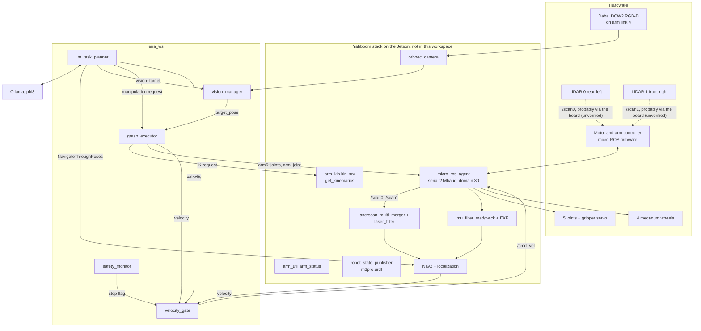
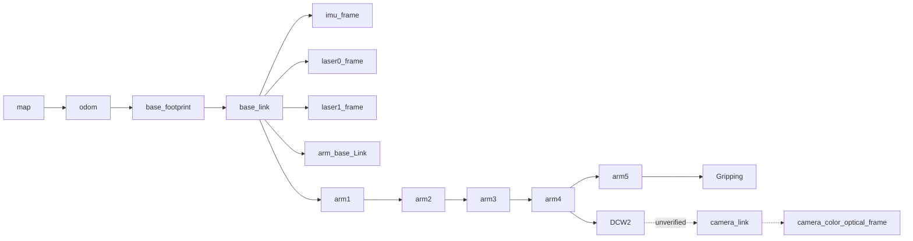
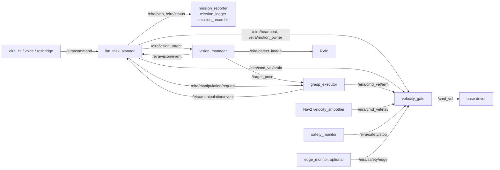
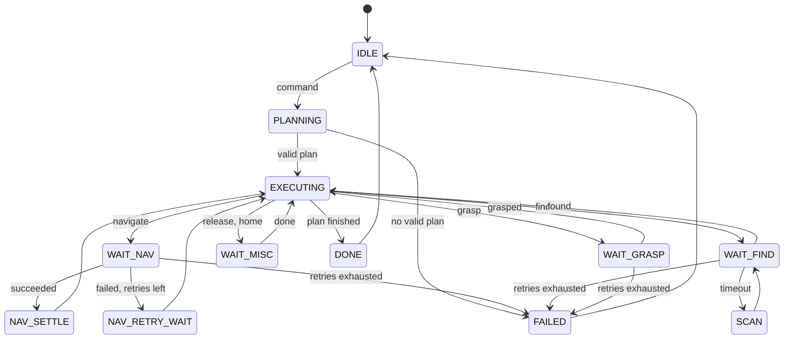

# Current system architecture

Audit date: 2026-11-17. This describes the system as the sources define it
today. Items that can only be confirmed on the robot are marked **unverified**.

## 1. Layers

The hardware transport (`start_agent.sh`) is started by hand before anything
else. No launch file in the workspace starts it.

No exercise starts a LiDAR driver, so the two raw scans most likely reach ROS
through the controller board and the agent; the inventory's live-graph
section confirms this. The board keeps non-volatile settings written by
`config_robot.py`: ROS domain (30 in the scripts), namespace, odometry scale,
motor and IMU-yaw PID, arm mid-values and offsets.

The factory software is spread over at least two colcon workspaces:

- `~/yahboomcar_ws`: `M3Pro_demo`, `arm_kin`, `yahboom_yolov8`, `slam_view`;
- `~/M3Pro_ws`: `m3pro_bringup`, `M3Pro_navigation`.

The agent has its own workspace, `~/mircoROS_agent`, and there are scripts in
the home directory. Where every other vendor package lives is pending
(`jetson_factory_image_inventory.md`). The decision to make E-AIRA
independent of these application files is assessed in
`factory_independence_assessment.md`.

## 2. Vendor bring-up, as the exercise launch files compose it

| Launch file | Starts |
|---|---|
| `M3Pro_navigation/base_bringup.launch.py` | IMU filter, scan merger (which also includes `M3Pro/display.launch.py`), scan filter, EKF |
| `M3Pro_demo/camera_arm_kin.launch.py` | Camera driver, `arm_kin/kin_srv` |
| `M3Pro_navigation/navigation2.launch.py` | `nav2_bringup/bringup_launch.py` with the vendor map and `yahboom_M3Pro.yaml` |
| `m3pro_bringup/car_base.launch.py` | Camera (as a separate process), robot state publisher, joint state publisher fed from `/arm_status/arm_joint`, scan merger and filter, EKF, static transforms, `arm_status`, AprilTag relocalization |
| `M3Pro_navigation/toolbox_location_nav.launch.py` | `car_base` + modified Nav2 bring-up + SLAM Toolbox localization |

`base_bringup.launch.py` defines an `update_costmap` node but does not add it
to the launch description. `rtab_bringup.launch.py` does start it.

Two different bring-up families exist: the older `base_bringup` family
(exercises 17–23) and the newer `car_base` family (exercises 24, 33). Which
one the robot should run under E-AIRA is an open decision; the master launch
currently mixes pieces of both.

## 3. Frames

Known from the folder-08 URDF, which mirrors the vendor model:

- `map → odom` comes from AMCL, SLAM Toolbox, Cartographer or RTAB-Map,
  depending on the exercise.
- `odom → base_footprint` comes from the EKF.
- The arm chain is published by `robot_state_publisher` from `/joint_states`.
- **Unverified:** how the camera driver's frames attach to the robot. The
  URDF has `DCW2` on `arm4`. Exercise 20 instead publishes a fixed
  `base_link → camera_link` at (0.05, 0, 0.38). The content of
  `m3pro_bringup/static_tf.launch.py` is unknown. If both a fixed and an
  arm-borne camera transform are published, the tree is inconsistent.
- **Unverified:** the frame in which `get_kinemarics` expresses positions. The
  vendor code treats it as the arm base. `grasp_executor` needs this as
  `arm_base_frame`, which is empty by default.

## 4. `eira_ws` nodes and topics

The full topic table is in `eira_ws/README.md` under "API". Points that matter
for the redesign:

- Every E-AIRA contract is `std_msgs/String` carrying JSON. There are no
  message, service or action definitions of its own.
- Long-running operations (find, grasp, release) are topic request/event
  pairs correlated by `mission_id` and `action_id`, not ROS actions. Only
  navigation uses an action, and that one belongs to Nav2.
- Names are mixed: 41 absolute (`/eira/...`) and 18 relative (`eira/...`)
  string literals. The nodes cannot be placed in a namespace consistently.
- No node is a lifecycle node. Start-up order is not enforced; nodes tolerate
  missing peers and retry.

## 5. Mission flow

Planning: prompt built from live waypoint names, detector classes and colours
→ Ollama → parse → whole-plan validation → one repair attempt → rule-based
fallback. A fetch command must match a fixed five-step template (navigate,
find, grasp, navigate to the captured start pose, release) or it is rejected.
The LLM therefore has very little freedom on the main task; this matters for
what the paper can claim (see `reuse_and_integration_plan.md` §5).

## 6. Target localization and grasp, as implemented

| Step | `eira_ws` | Vendor exercises 22/23 |
|---|---|---|
| Pixel | Centre of the YOLO box | Centre of the tag or colour blob |
| Depth | Median of a 21×21 window, registered depth requested | Single pixel; depth image resized from 640×400 to 640×480, registration off |
| Intrinsics | Live `CameraInfo` | Hard-coded matrix |
| Camera → arm | TF tree to `base_link`, then `base_link → arm_base_frame` | Hard-coded `EndToCamMat`, forward kinematics from the commanded pose, plus calibrated offsets from exercise 01 |
| IK | `get_kinemarics`, pitch 1.396 rad, x compensation −0.015 m | Same service, same pitch, same compensation |
| Servo mapping | Copied vendor formulae | Original |
| Completion | Timed steps plus "feedback" from `Curjoints` | Fixed sleeps |

The published target is the visible front surface of the object at the box
centre, with identity orientation. It is neither a centroid nor a grasp point,
and the code does not state which it is meant to be.

## 7. What the master launch starts

`eira_master.launch.py` by default starts: IMU filter, scan filter, EKF, scan
merger, static transforms, robot state publisher, camera (registration on),
`kin_srv`, `arm_status`, AMCL and map server, seven Nav2 servers and a
lifecycle manager, then the E-AIRA nodes. Each vendor piece is skipped with a
log line if its package is missing.

Things to note:

- `use_arm_state_relay` defaults to true. That replaces the vendor joint state
  source with `arm_state_relay`, which converts **commanded** servo angles to
  joint positions using offsets of 0° and signs of +1. The project's own
  simulator uses offsets of 90°. Because the camera rides on the arm, these
  joint states feed the transform used for `/target_pose` (debt item G1).
- Localization is AMCL, as in exercises 17–18 (which get it through
  `nav2_bringup/bringup_launch.py`). Exercises 19 and 24 localize with
  Cartographer and SLAM Toolbox instead. Which one the experiments use is
  open; the AprilTag relocalization of exercise 24 is built around SLAM
  Toolbox, not AMCL.
- The default map path is `~/map/map.yaml`, the location exercise 24 saves to.

## 8. Differences from the structure proposed in the master prompt

| Proposed | Present | Comment |
|---|---|---|
| `eira_bringup/launch/eira_system.launch.py` | `eira_master.launch.py` | Same role |
| `config/system_config.yaml` | `config/eira_params.yaml` | Same role |
| `eira_brain`: planner, executor, capability manager, validator, recovery manager as separate modules | One 1,546-line node plus `ollama_client.py` | Functions exist; separation does not |
| `eira_perception`: detector, tracker, depth processor, pose estimator | `vision_manager` plus pure modules `perception_core`, `depth_geometry`, `inference_worker`, `tracking_backends` | Close |
| `eira_manipulation`: arm controller, IK solver, base alignment, grasp verifier | `grasp_executor`, `grasp_policy`, `pid` | No grasp verifier; IK is the vendor service |
| `eira_navigation` | Absent; navigation client and relocalization live in `eira_brain` | |
| `eira_interfaces` | Absent | |
| `research/`, `experiments/`, `results/`, `maps/`, `models/`, `LICENSE` | Absent | |
| — | `eira_evaluation`, `eira_simulation` | Present, not in the proposal |

## 9. What cannot be known from this workspace

1. The real `m3pro.urdf` and the live TF tree.
2. Message and service definitions in `arm_msgs` and `arm_interface`.
3. Whether any topic carries measured joint positions.
4. The Nav2, EKF, scan-merge and SLAM parameter files.
5. The transformer tracker's topics and model interface.
6. Software versions on the Jetson: JetPack, PyTorch, Ultralytics, TensorRT,
   OpenCV, Ollama.
7. Whether depth-to-colour registration works at the resolutions in use.
8. Whether the robot has a hardware emergency stop and how it behaves.

The read-only script `jetson_inventory/jetson_readonly_inventory.sh` settles
items 1–7 without moving the robot (see `jetson_factory_image_inventory.md`).
Item 8 needs your answer.
