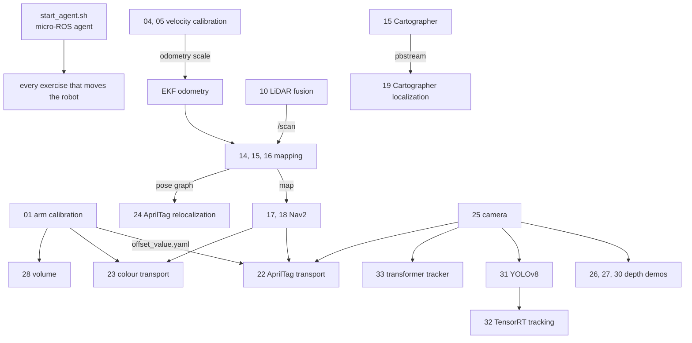

# Exercise mapping

Audit date: 2026-11-17. This maps every numbered folder to its place in
E-AIRA. It checks and extends the earlier ledger in
`docs/EXERCISE_INTEGRATION.md`, which is left unchanged.

**Update, same day.** You confirmed two things.

- All 33 exercises ran successfully on the robot. They were factory
  workflows run from the Jetson terminal.
- E-AIRA must become independent of the factory application files.

As a result, "Native" use below is now a dependency to be removed, not a
target state. Drivers are the exception. The command-by-command trace is
`exercise_factory_dependency_mapping.md`; the per-component decisions are
`factory_independence_assessment.md`.

## Reading the table

**Role** for the research task (fetch an object on a spoken or typed request):

- **Core** — the fetch pipeline cannot run without it.
- **Prerequisite** — a calibration or map that must exist first.
- **Support** — useful for operation, safety or diagnosis.
- **Outside** — not on the path to the paper.

**How `eira_ws` uses it today:**

- **Native** — the vendor package is launched or called unchanged.
- **Rewritten** — `eira_ws` contains its own code for the same behaviour.
- **Reference** — the vendor code was read for conventions; not run.

## Exercises 01–33

| # | Exercise | Files in folder | Vendor packages needed | Role | `eira_ws` use | Notes |
|---|---|---|---|---|---|---|
| 01 | Arm calibration | `arm_offset.py`, `calibrate_arm.py`, `camera_arm_kin.launch.py`, `start_agent.sh` | `M3Pro_demo`, `arm_kin`, `arm_msgs`, `arm_interface`, `orbbec_camera`, `dt_apriltags` | Prerequisite | Native (`arm_calibration` profile) | Writes `x/y/z_offset` to `arm_kin/param/offset_value.yaml`. **`grasp_executor` does not read this file**; see debt item G2 |
| 02 | Joystick | `yahboom_joy_M3Pro.py`, `start_joy_controller.py`, launch, `joy.sh` | `yahboomcar_ctrl`, `joy` | Support | Native (`joystick` profile) | Publishes `/JoyState`. The master launch does not use it as a manual override |
| 03 | Keyboard | `yahboom_keyboard.py` | `yahboomcar_ctrl` | Support | Native (`keyboard` profile) | Used while mapping |
| 04 | Angular velocity calibration | `config_robot.py`, launch | `calibration`, `imu_filter_madgwick`, `ekf_bringup` | Prerequisite | Native profile | Tunes odometry scale through the controller's serial protocol |
| 05 | Linear velocity calibration | `config_robot.py`, launch | same | Prerequisite | Native profile | No README |
| 06 | Line following | `follow_line.py` | `M3Pro_demo` | Outside | Rewritten (`exercise_skills`) | HSV line tracking with LiDAR stop |
| 07 | Obstacle avoidance | `patrol.launch.py` | `patrol` | Outside | Rewritten (`exercise_skills`) | Folder holds a launch file only |
| 08 | Robot model | `neurobotics_ws/` | none (own package) | Support | Reference; URDF reused by `eira_simulation` | The only place the robot's link tree can be read in this workspace |
| 09 | LiDAR introduction | README only | LiDAR driver | Support | — | Confirms raw topic `/scan0` |
| 10 | LiDAR fusion | `merge_multi.launch.py`, `laser_filter_node.launch.py` | `ira_laser_tools`, `yahboom_laser_filter`, `M3Pro` | Core | Native (started by master launch) | Produces the merged `/scan` Nav2 needs |
| 11 | LiDAR obstacle avoidance | `laser_Avoidance.py`, launch | `yahboom_M3Pro_laser` | Outside | Rewritten (`exercise_skills`) | |
| 12 | LiDAR tracking | `laser_Tracker.py`, launch | same | Outside | Rewritten (`exercise_skills`) | |
| 13 | LiDAR guard | `laser_Warning.py`, launch | same | Outside | Rewritten (`exercise_skills`) | |
| 14 | Gmapping | 4 launch files, teleop, line follower | `slam_gmapping`, `slam_mapping` | Prerequisite (one of 14–16) | Native profile | |
| 15 | Cartographer mapping | 5 launch files, teleop, line follower | `cartographer_ros`, `slam_mapping` | Prerequisite (one of 14–16) | Native profile | |
| 16 | SLAM Toolbox mapping | 3 launch files, teleop | `slam_mapping` | Prerequisite (one of 14–16) | Native profile | Pairs with the localization used in 24 |
| 17 | Nav2 single goal | `base_bringup`, `navigation2`, `nav_rviz` launch | `M3Pro_navigation`, `nav2_bringup` | Core | Native parameters; **Nav2 nodes recomposed** by the master launch | Vendor includes `nav2_bringup/bringup_launch.py`. E-AIRA starts the servers one by one so velocity passes through its gate |
| 18 | Nav2 multiple goals | identical files to 17 | same | Core | same | Differs from 17 only in RViz usage |
| 19 | Repositioning navigation | adds `cartographer_localization.launch.py` | `cartographer_ros`, `M3Pro_navigation` | Support (alternative localization) | Native profile | Localizes in a saved `.pbstream` |
| 20 | RTAB-Map mapping | `rtab_bringup.launch.py` | `rtabmap_launch`, `orbbec_camera` | Outside unless chosen | Native profile | Publishes a **static** `base_link → camera_link` transform valid for one arm pose only |
| 21 | RTAB-Map navigation | adds `navigation_launch.py` | `rtabmap_launch`, `nav2_bringup` | Outside unless chosen | Native profile | |
| 22 | Machine-code (AprilTag) handling | `apriltag_transport_V2.py`, `grasp_transport.py`, 3 launch files | `M3Pro_demo`, `arm_kin`, `yahboom_nav2_bringup`, `dt_apriltags` | Core reference | Reference; orchestration rewritten | The vendor's own navigate–find–grasp–carry–unload demo. `grasp_executor` copies its IK-to-servo formulae |
| 23 | Colour block transport | `color_transport.py`, `grasp_transport.py`, 3 launch files | same | Core reference | Reference; rewritten | Source of the stand-off and PID alignment idea |
| 24 | Navigation with visual relocalization | `record_tag`, `toolbox_location_nav`, `save_slamtoolbox_map`, `slam_toolbox` launch | `apriltag_localization`, `m3pro_bringup`, `slam_mapping` | Support (recovery) | Native recording profile; **relocalization rewritten with ArUco** | The vendor method is AprilTag plus SLAM Toolbox localization |
| 25 | Dabai DCW2 camera | `dabai_dcw2.launch.py` | `orbbec_camera` | Core | Native, with registration turned on and point clouds off | Vendor default has registration off |
| 26 | Depth pseudo-colour | `GetDepthColor.py` | `yahboom_M3Pro_DepthCam` | Support | Rewritten (optional output of `vision_manager`) | |
| 27 | Depth distance | `Measure_Distance.py` | same | Support | Rewritten (optional output) | |
| 28 | Wood block volume | `estimate_volume.py`, launch | `M3Pro_demo`, `arm_kin` | Outside | Rewritten (metadata in found event) | Uses the same hand-eye chain as 22 |
| 29 | MediaPipe gestures | `mediapipe_gesture.py` | `M3Pro_demo.media_library`, MediaPipe | Support (optional interaction) | Rewritten (`gesture_node`) | |
| 30 | Edge detection | `edge_detection.py` | `yahboom_M3Pro_DepthCam` | Support (optional safety) | Rewritten (`edge_monitor`) | Vendor version is a single-pixel depth threshold |
| 31 | YOLOv8 detection | `yolov8_detect.py` | `yahboom_yolov8`, Ultralytics | Core | Rewritten around the same `model.track(persist=True)` call and weights path | |
| 32 | Deep-learning tracking | `yolov8_track.py`, launch | `yahboom_yolov8`, TensorRT, `tracker_trt` | Support | **Not reused** | Runs a TensorRT engine (`yolov8s.trt`). E-AIRA runs the slower PyTorch `.pt` path; relevant to the latency research question |
| 33 | Transformer tracking | `car_base.launch.py`, `super_tracker.launch.py` | `smart_tracker`, `m3pro_bringup` | Core for the stated title | Adapter interface only | Node source, topics and model input/output are not in the workspace |

## Work after exercise 33

| Item | Location | State |
|---|---|---|
| E-AIRA workspace | `eira_ws/` | Six packages; see `existing_work_audit.md` §8 |
| City autopilot simulation | folder 08 | Source files gone; compiled `.pyc` and broken symlinks remain. Not part of E-AIRA |

## How the exercises depend on each other

## Coverage of the E-AIRA pipeline by existing work

| Pipeline step | Vendor exercise | `eira_ws` module | Gap |
|---|---|---|---|
| Receive instruction | — | `eira_cli`, `voice_activation`, rosbridge | Voice and mobile input are untested extras |
| Plan with a local LLM | — | `llm_task_planner`, `ollama_client` | No measured LLM behaviour yet |
| Validate against capabilities | — | `validate_actions` | Capabilities are static lists, not discovered from the running system |
| Navigate | 17, 18 | Nav2 action client in the planner | Waypoints are example values |
| Detect | 31 | `vision_manager` | |
| Track | 32, 33 | YOLO tracking; transformer adapter | Vendor transformer tracker not integrated |
| 3D position | 22, 23, 27 | `vision_manager` depth fusion | Camera-to-base chain unverified |
| Align base | 22, 23 | `grasp_executor` PID | Gains are untuned defaults |
| Inverse kinematics | 22, 23 (`arm_kin`) | Vendor service called by `grasp_executor` | Arm frame and exercise-01 offsets not connected |
| Grasp and carry | 22, 23 | `grasp_executor` sequence | No collision checking, no approach path |
| Verify grasp | — | — | Missing; no sensor identified |
| Deliver and release | 22, 23 | planner + `grasp_executor` | |
| Report | — | status topic, speech, buzzer, `mission_reporter` | |
| Recover | 24 | retries, scan sweep, ArUco relocalization | Recovery is not yet measured |

## Where the master prompt and the workspace differ

| Master prompt says | Workspace shows |
|---|---|
| Exercises continue after 33 | Folders stop at 33 |
| "ArUco-based visual relocalization" exists | The existing exercise uses AprilTag (`tag36h11`). ArUco code exists only as new, unrun code in `eira_ws` |
| "Existing Transformer tracking implementation" | A vendor binary with an ONNX model; no source or interface description here |
| "6-DoF robotic arm" | Six servos: five positioning joints and a gripper |
| "2D LiDAR" | Two 2D LiDARs, merged |
| `eira_ws` is to be created | It exists, with different file and launch names from the proposed tree |
| Existing Nav2 configuration can be inspected | The parameter file is on the robot only |
| Modules are tested on hardware or in simulation | All 33 exercises ran on the robot (your report, 2026-11-17); E-AIRA tested only in part; no recorded results of either |
| E-AIRA builds on the existing Yahboom components | Clarified 2026-11-17: application-level factory software is to be recreated in `eira_ws`; only drivers stay external |
