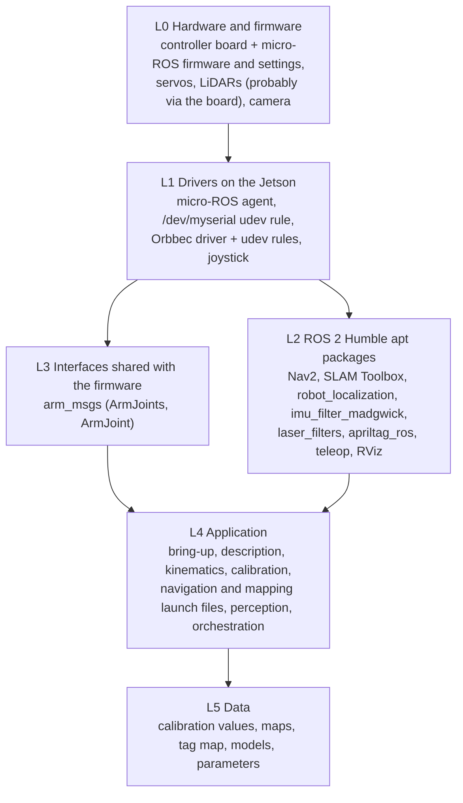

# Factory-independence assessment

Audit date: 2026-11-17. Planning document; nothing has been changed.

## 1. Goal and boundary

**Goal (from the user).** E-AIRA must not depend on Yahboom factory
*application* files. The application-level functionality it needs is to be
recreated and maintained in `~/NeuroBotics/eira_ws` on the laptop and
`~/eira_ws` on the Jetson. Low-level hardware drivers are kept where that is
technically required. Any driver that cannot be brought into `eira_ws` is
documented as an explicit system-level dependency, never silently relied on.

**Factory application files** are, for this assessment:

- every package in `~/yahboomcar_ws`, `~/M3Pro_ws` and `/root/M3Pro_ws`;
- the home-directory scripts `start_agent.sh`, `joy_control/`,
  `calibrate_arm.py`, `config_robot.py`;
- models under `~/MODELS` or inside vendor packages;
- maps and parameter files stored inside vendor packages.

**Allowed system-level dependencies** are:

- JetPack (CUDA, cuDNN, TensorRT) and Jetson builds of PyTorch;
- ROS 2 Humble and packages from its apt repository;
- the micro-ROS agent, the camera driver and their udev rules;
- the controller firmware;
- Ollama;
- Python wheels such as Ultralytics.

Each one is named, version-pinned and installed by a documented procedure.

**Target state.** On the Jetson, these suffice to run E-AIRA:
`/opt/ros/humble`, the agent workspace, the documented system packages,
`~/eira_ws/install` and an E-AIRA data directory. No factory workspace is
sourced.

## 2. Layers

| Layer | Owner after migration |
|---|---|
| L0 | Yahboom; kept unchanged |
| L1 | System-level; documented and pinned; not in `eira_ws` |
| L2 | ROS apt; declared as E-AIRA dependencies |
| L3 | E-AIRA, as an exact compatible copy |
| L4 | E-AIRA |
| L5 | E-AIRA data directory, with origin recorded |

## 3. Decision for each factory component

Effort: S = up to a day, M = a few days, L = a week or more.

| # | Component | Layer | E-AIRA uses it today | Decision | Reason | Effort | How the replacement is validated |
|---|---|---|---|---|---|---|---|
| 1 | Controller firmware and its settings (odometry scale, PID, arm mid-values, domain ID) | L0 | Yes, implicitly | **Retain – external** | Hardware; replacing it is out of scope and unsafe | — | Record firmware version and settings, read-only, with approval |
| 2 | `config_robot.py`, `calibrate_arm.py` | L0 tool | No | **Retain – maintenance tool**, outside E-AIRA | Writes firmware and servo settings | — | — |
| 3 | micro-ROS agent (`~/mircoROS_agent`) | L1 | Yes, started by hand | **Retain – system dependency**. E-AIRA adds a pinned source list, build instructions and a headless start unit | Open source (Apache-2.0); must match the firmware's micro-ROS release; not in apt | S | Agent from the documented build reaches the board; topic list unchanged |
| 4 | `/dev/myserial` udev rule | L1 | Yes, implicitly | **Retain – system dependency**; E-AIRA keeps a copy of the rule with instructions | System configuration | S | Symlink appears after reboot |
| 5 | Orbbec driver (`orbbec_camera`) | L1 | Yes (master launch includes its `dabai_dcw2.launch.py`) | **Retain – system dependency**. Prefer apt `ros-humble-orbbec-camera` (2.10.7, Apache-2.0, ships `dabai_dcw2.launch.py`); else pin the factory source build | Hardware driver with SDK and udev rules | S–M | A/B against the factory build: topics, encodings, resolution, intrinsics, frame names, registration quality |
| 6 | LiDAR path (`/scan0`, `/scan1`) | L0/L1 | Yes, indirectly | **Retain** whatever produces them (probably the firmware) | Hardware | — | Confirm the publisher (inventory §9.12 and §10) |
| 7 | `arm_msgs` | L3 | Yes (manipulation, bring-up, simulation) | **Recreate – interface-compatible** in `eira_ws`, same package and type names and field layout | The firmware (inferred) uses these types; DDS matching needs the same names and fields | S | Definitions identical to the installed ones; `ros2 topic info -v` shows one matching type; one supervised arm command (needs authorization) |
| 8 | `arm_interface` (`ArmKinemarics`, `CurJoints`, `AprilTagInfo`) | L3 | Yes (`grasp_executor` calls `get_kinemarics`, reads `Curjoints`) | **Drop** once E-AIRA has its own IK; until then a factory dependency | Used only between vendor nodes, unless the firmware publishes `Curjoints` (no evidence) | — | Inventory §10 shows who publishes `Curjoints` |
| 9 | Robot description `M3Pro` (URDF and meshes) | L4/L5 | Yes (master launch and simulation) | **Recreate** as `eira_description`: joint origins, limits and frames from the real URDF; meshes only if redistribution is allowed, otherwise simple shapes with an optional path to locally installed meshes | Needed for TF and simulation. CAD meshes are Yahboom's work | M | TF tree equal to the factory `robot_state_publisher` at several arm poses, within 1 mm and 0.1° |
| 10 | `m3pro_bringup` (`static_tf`, `common.yaml`, `car_base` composition) | L4 | Yes (master launch includes `static_tf.launch.py`; `arm_status` reads `common.yaml`) | **Recreate** in `eira_bringup` | Application launch and configuration | M | Same frames, topics and parameters as `car_base` (graph and TF comparison) |
| 11 | Base pipeline: `ekf_bringup`, `yahboom_laser_filter`, IMU filter launch, `ira_laser_tools` configuration | L4 (+L2) | Yes (master launch) | **Recreate** with apt `robot_localization`, `imu_filter_madgwick` and `laser_filters`, using E-AIRA parameter files. For the merger node: vendor the BSD ROS 2 port as third-party code with its licence, or write an E-AIRA merger | Configuration and small nodes; upstream apt packages exist | M | Replay a recorded factory bag of raw topics through both pipelines and compare `/odom` and `/scan` |
| 12 | `M3Pro_navigation` (Nav2 parameters, launch, RViz, map) | L4/L5 | Yes (Nav2 parameter default) | **Recreate**: E-AIRA-owned Nav2 parameter file (values copied once, origin noted, then tuned); E-AIRA launch (exists); E-AIRA RViz file | Configuration | S–M | Simulation; then supervised navigation trials |
| 13 | `slam_mapping` (SLAM Toolbox launch and parameters; map and pose-graph saving) | L4 | Through exercise profiles only | **Recreate** on apt `slam_toolbox` | Configuration | S | New map built and saved by the E-AIRA pipeline |
| 14 | Maps (`yahboom_map`, `~/map`) | L5 | Master launch default `~/map/map.yaml` | **Re-map** with the E-AIRA pipeline into the E-AIRA data directory; keep factory maps untouched | Origin and arena state known | S | Map loads; navigation trials |
| 15 | `arm_kin` (IK/FK service) and `offset_value.yaml` | L4/L5 | Yes (`grasp_executor`) | **Recreate**: E-AIRA IK/FK from `eira_description` (the simulator already has a URDF-based solver to start from) plus the vendor servo-angle conventions; offsets from an E-AIRA calibration | The largest application dependency on the grasp path | L | Record `get_kinemarics` answers over a grid of targets (a service call; the arm does not move) and require agreement within tolerance, including agreement on unreachable targets |
| 16 | `arm_util/arm_status` | L4 | Yes (master launch) | **Recreate** only if a measured joint source exists; otherwise a clearly labelled commanded-pose relay (exists) | Depends on what the firmware publishes | S–M | Inventory §9.13 and §10 |
| 17 | `M3Pro_demo/arm_offset` (hand-eye calibration) | L4 | Profile only | **Recreate** as an E-AIRA calibration procedure writing E-AIRA configuration | Needed for grasp accuracy | M | Repeat the 01 procedure; compare with the factory offsets |
| 18 | `yahboomcar_ctrl` (joystick, keyboard) | L4 | Profiles only | **Replace** with apt `teleop_twist_joy` and `teleop_twist_keyboard` through the velocity gate, plus a joystick takeover flag | Standard packages exist | S | Manual drive through the gate; takeover stops the mission |
| 19 | `calibration` (odometry routines) | L4 | Profiles only | **Not required now**; results already live in firmware. Optional E-AIRA routine later | Done once | — | — |
| 20 | `apriltag_localization`, `record_tag` | L4 | Profile only (E-AIRA has a separate ArUco path) | **Recreate if relocalization is kept**: apt `apriltag_ros` plus an E-AIRA tag-map recorder feeding the existing relocalization node; otherwise drop | Optional recovery feature | M | Relocalization trials with a deliberately wrong initial pose |
| 21 | `yahboom_yolov8` weights and TensorRT engine | L5 | Yes (default `model_path`) | **Recreate**: E-AIRA model directory with official weights and an engine exported on the Jetson | The model is data; the default path must not point into a factory workspace | S–M | Same detections on a recorded image set |
| 22 | `smart_tracker` and its ONNX model | L4/L5 | No (adapter only) | **Cannot be recreated** without source. Replace with an open tracker, or remove the claim | Probably a closed binary (pending §9.2) | M if replaced | Tracking benchmark against YOLO-only tracking |
| 23 | RViz configurations (`slam_view`, `nav_rviz`, `slam_mapping`) | L4 | No | **Recreate** E-AIRA RViz files | Trivial | S | — |
| 24 | Desktop scripts (`start_agent.sh` with `gnome-terminal`, `joy.sh`, `start_joy_controller.py`) | L4 | Agent start, by hand | **Recreate headless**: launch file or systemd user unit | E-AIRA must run without a desktop session | S | Robot boots and connects with no desktop |
| 25 | `patrol`, `yahboom_M3Pro_laser` behaviours, `M3Pro_demo` demos (line, colour and AprilTag transport, volume, gestures), `yahboom_M3Pro_DepthCam`, `yahboom_nav2_bringup`, `updatecostmap`, GMapping, Cartographer and RTAB-Map configurations | L4 | No, or through profiles | **Not required** | Outside the research path; exercise folders keep them as reference | — | — |

## 4. Where E-AIRA depends on factory software today

Taken from `eira_workspace_dependency_matrix.md`:

| Place in `eira_ws` | Factory dependency | Fixed by component # |
|---|---|---|
| `eira_bringup/launch/eira_master.launch.py` | `imu_filter_madgwick` launch, `yahboom_laser_filter`, `ekf_bringup`, `ira_laser_tools` configuration, `m3pro_bringup/static_tf.launch.py` and `common.yaml`, `M3Pro` URDF, `orbbec_camera` launch, `arm_kin`, `arm_util`, `M3Pro_navigation` parameters | 5, 9–12, 15, 16 |
| `eira_bringup/package.xml` | Nine factory packages declared as `exec_depend` that `rosdep` cannot resolve on a clean Jetson: `arm_msgs`, `arm_kin`, `arm_util`, `ira_laser_tools`, `yahboom_laser_filter`, `ekf_bringup`, `M3Pro_navigation`, `M3Pro`, `m3pro_bringup` | all |
| `eira_bringup/eira_bringup/profiles.py`, `exercise_profiles.launch.py` | Eight factory packages started on request: `M3Pro_demo`, `yahboomcar_ctrl`, `calibration`, `M3Pro`, `ira_laser_tools`, `slam_mapping`, `M3Pro_navigation`, `m3pro_bringup` | Stays as an optional, clearly separate "factory profiles" launch, or is removed |
| `eira_manipulation/grasp_executor.py` | `arm_interface` (`get_kinemarics`, `CurJoints`), `arm_msgs` | 7, 8, 15 |
| `eira_perception/vision_manager.py`, `eira_params.yaml` | default `model_path` inside `/home/jetson/yahboomcar_ws`; default transformer model in `~/MODELS` | 21, 22 |
| `eira_simulation` | `arm_msgs`, `arm_interface` types; URDF lookup in `M3Pro`, then `neurobotics`, then exercise folder 08 | 7, 8, 9 |
| `eira_bringup/eira_bringup/arm_state_relay.py` | `arm_msgs` | 7 |

## 5. What must stay outside `eira_ws`

Each item becomes an entry in an E-AIRA system-requirements document with its
version and install steps.

| Dependency | Why it stays outside | Install source |
|---|---|---|
| Controller firmware and settings | Hardware | Already on the board |
| micro-ROS agent | Driver; built per platform; must match the firmware | Source (Apache-2.0), pinned |
| `/dev/myserial` udev rule | System configuration | Rule file kept by E-AIRA, installed with `sudo` once |
| Orbbec driver and udev rules | Hardware driver with SDK | apt (preferred) or pinned source |
| LiDAR driver | Only if one exists on the Jetson (pending) | — |
| JetPack (CUDA, cuDNN, TensorRT), Jetson PyTorch | NVIDIA platform | JetPack, NVIDIA wheels |
| ROS 2 Humble and the apt packages listed in the inventory §7 | Standard distribution | apt, via `rosdep` |
| Python wheels: Ultralytics (and optionally Whisper, MediaPipe) | Not in apt for Jetson | pip, pinned versions |
| Ollama and the model file | Separate runtime | Ollama installer; `ollama pull` |

## 6. Licensing

| Component | Licence | Consequence for E-AIRA |
|---|---|---|
| Yahboom application code, URDF, meshes, message definitions | Unknown (pending inventory §9.2) | Do not copy into a public repository without permission. Recreate independently. Field lists of the firmware message types are needed for interoperability; ask Yahboom if possible. Use simple geometry unless mesh redistribution is allowed |
| Yahboom code already in this repository's exercise folders | Unknown | The GitHub remote exists; whether it is public is open question Q9 |
| Ultralytics and YOLOv8 weights | AGPL-3.0 | A distributed E-AIRA that imports it must comply; acceptable for an open academic release; state it in the paper artifact |
| `imu_filter_madgwick` | GPL-3.0-or-later | Used as an apt program in its own process; nothing copied |
| PyQt5 (factory joystick GUI only) | GPL v3 | Not used by E-AIRA |
| `slam_toolbox` | LGPL | Used as an apt program; nothing copied |
| Nav2, micro-ROS agent, Orbbec driver, Cartographer, `robot_localization` | Apache-2.0 | Vendoring permitted with notice |
| `ira_laser_tools` (upstream), `laser_filters`, RTAB-Map, AprilTag, `joy`, teleop, RViz | BSD family | Vendoring permitted with notice |

## 7. Feasibility verdict

**E-AIRA can run on a cleanly prepared Jetson with only `eira_ws` plus
documented system-level dependencies. Three conditions must be met first.**

1. The firmware's message types are reproduced exactly in `eira_ws`
   (`arm_msgs`), and a live check confirms the types match.
2. An E-AIRA IK/FK replaces `arm_kin` and agrees with it on recorded test
   targets. The alternative is that Yahboom's source turns out to be
   licensable and gets vendored.
3. The robot description is resolved: E-AIRA-owned URDF facts, with meshes
   only if redistribution is allowed.

Two facts from the Jetson may change the plan:

- where the LiDAR scans come from (if a Jetson-side driver exists, it joins
  the system-level list);
- whether any topic reports measured servo angles (this affects grasp
  verification and the joint-state source).

Nothing suggests that a clean Jetson needs anything else from the factory
image. That has not been demonstrated yet; the test is migration step M13.

## 8. Risks of recreating vendor functionality

| Risk | Mitigation |
|---|---|
| A recreation behaves differently from the tested vendor component | Record the vendor behaviour first (bags, IK answers, TF trees) and require the E-AIRA version to match before switching; keep the factory workspaces installed for rollback |
| Effort competes with the research schedule | Recreate only the core path; leave the 15 or so non-required exercises as reference |
| Master-prompt rule against duplicate implementations | Each recreation replaces the vendor component in E-AIRA's run time; it does not run beside it. Reason: a research artifact that builds from its own repository |
| Hidden couplings, for example firmware QoS or topic names | Capture the live graph (inventory §10) before changing anything |
| A "clean" test that is not clean | Use an isolated shell that sources nothing from the factory workspaces, plus a dependency audit that fails on any factory path; ideally a second boot medium for a true fresh-image test |

## 9. Per-exercise status

"Represented" means E-AIRA contains something for the exercise.

| Representation | Meaning |
|---|---|
| Called | E-AIRA launches the vendor component itself |
| Own code | E-AIRA has its own implementation |
| Profile | Reachable only through `exercise_profiles.launch.py`, which starts the vendor tool |
| None | Not represented |

No column means validated. Per the user, E-AIRA has been tested on the robot
only in part, and nothing is recorded.

| Ex. | Represented in E-AIRA | Still depends on factory application software in E-AIRA | Planned end state |
|---|---|---|---|
| 01 | Called (`kin_srv`); Profile (`arm_offset`); Own code (servo conventions copied from 22) | Yes: `arm_kin`, `M3Pro_demo` | Own IK and calibration; offsets captured |
| 02 | Profile (`yahboom_joy_M3Pro`) | Yes: `yahboomcar_ctrl` | apt teleop + gate + takeover |
| 03 | Profile (keyboard instructions) | Yes: `yahboomcar_ctrl` | apt teleop |
| 04 | Profile | Yes: `calibration` | Results stay in firmware |
| 05 | Profile | Yes: `calibration` | Results stay in firmware |
| 06 | Own code (frozen) | No | Not required |
| 07 | Own code (LiDAR avoidance; the original is a patrol) | No | Not required |
| 08 | Called (`M3Pro` URDF); Profile (display, own simulation) | Yes: `M3Pro` | `eira_description` |
| 09 | Profile (RViz) | No | apt only |
| 10 | Called (merger configuration, filter launch) | Yes: `ira_laser_tools`, `yahboom_laser_filter` | E-AIRA scan pipeline |
| 11 | Own code (frozen) | Only through the scan pipeline | Not required |
| 12 | Own code (frozen) | Only through the scan pipeline | Not required |
| 13 | Own code (frozen) | Only through the scan pipeline | Not required |
| 14 | Profile | Yes: `slam_mapping` | Not required |
| 15 | Profile | Yes: `slam_mapping` | Not required |
| 16 | Profile | Yes: `slam_mapping` | E-AIRA mapping launch |
| 17 | Called (Nav2 parameters); Own code (navigation client) | Yes: `M3Pro_navigation` | E-AIRA Nav2 parameters |
| 18 | as 17 | as 17 | as 17 |
| 19 | Profile | Yes: `M3Pro_navigation` | Not required |
| 20 | Profile (apt `rtabmap_launch` with E-AIRA arguments) | No | Not required |
| 21 | Profile (apt `rtabmap_launch` with E-AIRA arguments; needs an existing database) | No | Not required |
| 22 | Own code (orchestration, grasp sequence); Profile (tag recording) | Yes: `arm_kin`, `arm_interface` | Own IK |
| 23 | Own code (colour filter, colour plans) | Yes: `arm_kin`, `arm_interface` | Own IK |
| 24 | Own code (ArUco, a different method); Profile (tag recording) | Yes for AprilTag recording | apt `apriltag_ros` + E-AIRA, or drop |
| 25 | Called (driver launch with overrides) | Driver only (system-level) | apt or pinned driver |
| 26 | Own code (optional output) | No | — |
| 27 | Own code (optional output) | No | — |
| 28 | Own code (metadata) | No | — |
| 29 | Own code (frozen) | No | — |
| 30 | Own code (frozen) | No | — |
| 31 | Own code (`vision_manager`) | Yes: default weights path | E-AIRA model directory |
| 32 | Own code in part (tracking without TensorRT) | Yes: default weights path | E-AIRA TensorRT export |
| 33 | None (adapter interface only) | — | Open tracker or drop |
