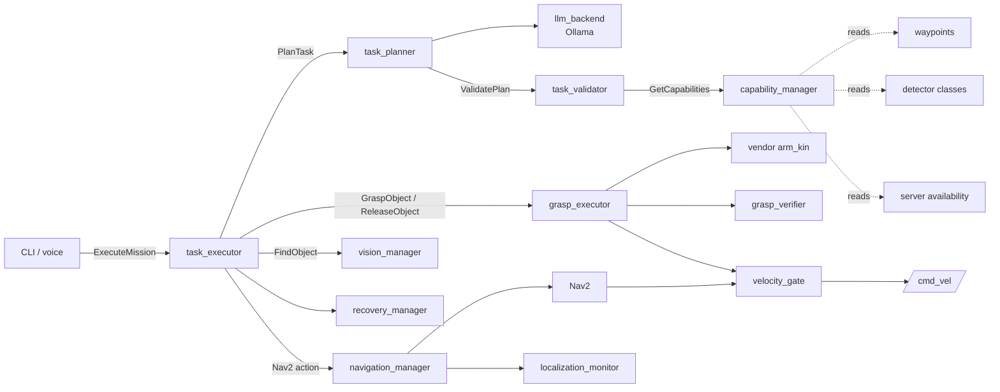

# Reuse and integration plan

Audit date: 2026-11-17. This is a proposal for review. Nothing in it has been
implemented, and every step that changes code or touches the robot needs
approval first.

## 1. Principles

From the master prompt, revised by your clarification of 2026-11-17:

1. Hardware drivers are kept, not rewritten: the controller firmware, the
   micro-ROS agent and the camera driver.
2. Yahboom *application* software is recreated inside `eira_ws`: launch
   files, configurations, URDF, kinematics, calibration and demo packages.
   The vendor version serves as reference and test oracle. This replaces the
   earlier principle of reusing calibrated vendor chains unchanged. Details:
   `factory_independence_assessment.md` and
   `eira_self_contained_migration_plan.md`.
3. The existing `eira_ws` is the starting point; it is consolidated, not replaced.
4. No new package, file or feature without a research or reliability reason.
5. Nothing is called working until a recorded run shows it.

## 2. Reusable modules

### Vendor stack — role after the factory-independence decision

| Component | Used for | Decision (2026-11-17) |
|---|---|---|
| micro-ROS agent and controller firmware | All actuation and low-level sensing | Kept as a system-level dependency; E-AIRA adds a headless start unit |
| Camera driver (25) | RGB-D | Kept as a system-level dependency; apt build preferred after an A/B comparison; registration to be verified |
| Scan merge and filter (10) | `/scan` for navigation | Recreated: apt `laser_filters` plus the merger (BSD port vendored, or own node) |
| IMU filter and EKF | Odometry | Recreated as E-AIRA configuration of the apt packages; the firmware's odometry calibration (04/05) is kept |
| Mapping (16) | The experiment map | Recreated on apt `slam_toolbox` |
| Nav2 with vendor parameters (17, 18) | Navigation | Parameters copied once into E-AIRA with their origin noted, then owned and tuned |
| AprilTag relocalization (24) | Localization recovery | Recreated on apt `apriltag_ros` if kept (decision N2); preferred over the unrun ArUco code |
| `arm_kin` IK/FK service | All arm kinematics | Used until an E-AIRA IK matches it on recorded test targets, then dropped |
| Exercise-01 calibration and `offset_value.yaml` | Camera-to-arm accuracy | Current values captured as reference; E-AIRA calibration procedure recreated (debt G2) |
| Hand-eye matrix and servo formulae from 22/23 | Target in arm frame; IK-to-servo mapping | Re-expressed in E-AIRA code; already done for the servo mapping |
| TensorRT engine path (32) | Faster detection for the latency study | E-AIRA exports its own engine from official weights |
| Joystick `/JoyState` (02) | Human takeover | Recreated on apt `teleop_twist_joy`, with a takeover input to the gate |

### `eira_ws` — keep, refactor or freeze

| Module | Decision | Reason |
|---|---|---|
| `ollama_client` (prompt, parsing, validation) | Keep; extend validation | Core of the planning research; add graspable-class and size rules |
| `llm_task_planner` state machine | Keep behaviour; split the file | Works at unit level; too large to review as one node |
| `velocity_gate`, `safety_monitor` | Keep | Single point of base control is the right design |
| `vision_manager` and its pure modules | Keep; fix pose definition and frame chain | Good structure; geometry unverified |
| `grasp_executor`, `pid`, `grasp_policy` | Keep; add vendor calibration chain, workspace limits, verification | |
| `waypoint_recorder`, `waypoint_store`, `eira_cli` | Keep | Needed to run experiments |
| `eira_evaluation` | Keep | Directly serves Phase 7 |
| `eira_simulation` | Keep; make it runnable | Needed for Phase 5 |
| `mission_recorder`, `mission_logger`, `mission_reporter` | Keep | Evidence collection |
| `visual_relocalization` (ArUco) | Freeze | Unrun; vendor AprilTag path exists |
| `exercise_skills`, `profiles`, `exercise_profiles.launch.py` | Freeze | Outside the research path |
| `voice_activation`, `gesture_node`, rosbridge option, `edge_monitor`, `mission_replayer`, `visualization_markers`, `arm_state_relay` | Freeze; relay off by default | Unverified extras; the relay is implicated in debt G1 |

"Freeze" means: leave the code in place, exclude it from the experiment launch
profile, do not develop it further until the core pipeline is measured.

## 3. Missing components

| Missing | Needed for | Size |
|---|---|---|
| A Git checkpoint of the current state | Everything | Minutes |
| Facts from the robot (interfaces, TF tree, parameter files, versions) | Design decisions; typed interfaces | One read-only session |
| E-AIRA's interface-compatible `arm_msgs`, and Nav2 on the development laptop | Simulation, graph-level tests | Hours |
| E-AIRA-owned bring-up, robot description, IK and calibration (factory independence) | Running on a Jetson without the factory workspaces | Weeks; see the migration plan |
| A verified camera-to-arm transform | Any grasp | Days, with the robot |
| A defined target reference point | Grasp accuracy | Small |
| Grasp verification | Honest success reporting | Small to medium |
| Workspace and collision limits for the arm | Safe hardware testing | Small |
| Graspable-object and size rules in plan validation | Safety; capability grounding | Small |
| Run-time capability discovery | Capability grounding | Medium |
| Typed interfaces and actions | Master prompt rules 10–12 | Medium, incremental |
| Graph-level and simulation tests | Phase 5 | Medium |
| Resource logging on the Jetson (CPU, GPU, memory, power) | Research question 4 | Small |
| A fault-injection harness | Research question 5 | Medium |
| A labelled detection test set and position ground truth | Experiments C and E | Days, with the robot |
| `research/` directory and literature review | Phase 1 | Days |
| Licence, CI | Publication artifact | Small |

## 4. Proposed architecture

### 4.1 Packages

Keep the six existing packages. Add one now and one by extraction.

| Package | Build type | Status | Content |
|---|---|---|---|
| `eira_interfaces` | `ament_cmake` | **New** | Messages, services, actions listed in §4.3 |
| `eira_brain` | `ament_python` | Existing, to be split internally | `llm_backend` (replaceable; Ollama first), `task_planner`, `task_validator`, `capability_manager`, `task_executor`, `recovery_manager` |
| `eira_perception` | `ament_python` | Existing | `vision_manager`, detector, tracker, depth and pose modules |
| `eira_manipulation` | `ament_python` | Existing | `grasp_executor`, base alignment, vendor kinematics adapter, `grasp_verifier` |
| `eira_navigation` | `ament_python` | **New by extraction** from `eira_brain` | `navigation_manager` (Nav2 client), `localization_monitor`, AprilTag relocalization adapter |
| `eira_bringup` | `ament_python` | Existing | `eira_master.launch.py`, one experiment profile, `eira_params.yaml` |
| `eira_evaluation` | `ament_python` | Existing | Logger, metrics, benchmark, fault injection |
| `eira_simulation` | `ament_python` | Existing | Gazebo world, arm bridge, oracle |

`eira_navigation` should be created only when the navigation code is actually
moved. An empty package adds nothing.

### 4.2 Corrections to the tree in the master prompt

1. `eira_interfaces/package.xml/` is drawn as a directory. It is a file.
2. An interface package needs `rosidl_default_generators` and
   `rosidl_interface_packages` membership, and must build before the Python
   packages that import it.
3. Each `ament_python` package also needs `resource/<name>` and `setup.cfg`,
   which the tree omits.
4. Five per-package `config/` directories plus a workspace `config/` would
   scatter parameters, against rule 7. One parameter file in `eira_bringup`
   already holds everything; keep that.
5. Workspace-level `maps/`, `models/`, `rviz/`, `scripts/` sit outside any
   package, so they are not installed and cannot be found through the package
   index. Maps and model weights are large binaries: keep them out of Git and
   point to them by parameter.
6. `eira_system.launch.py` and `system_config.yaml` would duplicate the
   existing `eira_master.launch.py` and `eira_params.yaml`. Keep the existing
   names.
7. `research/`, `experiments/`, `results/` at workspace level are fine.
   `results/` should hold raw data under a clear naming scheme and be excluded
   from Git or stored with large-file support.

### 4.3 Proposed typed interfaces

Names and fields are a starting point for discussion.

| Kind | Name | Purpose |
|---|---|---|
| Action | `ExecuteMission` | Text or plan in; feedback is the current step and state; result is success, failure reason, per-step outcomes |
| Action | `FindObject` | Class and optional colour in; result is a stamped pose with confidence, track ID and the reference-point definition |
| Action | `GraspObject` | Target pose in; feedback is the stage; result includes whether the grasp was verified and how |
| Action | `ReleaseObject` | Optional place pose in |
| Service | `PlanTask` | Text in, plan out, nothing executed; used for the planning experiments |
| Service | `ValidatePlan` | Plan in; valid or the list of violations |
| Service | `GetCapabilities` | Current actions, waypoints, detectable and graspable classes |
| Message | `PlanStep`, `TaskPlan`, `MissionStatus`, `DetectedObject`, `CapabilityManifest` | Shared data |

Navigation keeps using Nav2's own actions. Continuous data (images, poses,
status) stays on topics.

### 4.4 Target node graph

The LLM proposes; the validator and executor decide. The LLM has no path to an
actuator. That is already true today and must stay true.

### 4.5 Decisions that need approval before any refactor

| # | Decision | Recommendation |
|---|---|---|
| D1 | How the target reaches the arm frame | An E-AIRA chain: `eira_description`, E-AIRA IK and E-AIRA hand-eye calibration. Trust it only once it matches the vendor chain's outputs and the exercise-01 offsets; until then the vendor chain is the reference *(revised 2026-11-17)* |
| D2 | Joint state source on hardware | Decide once the inventory shows whether any topic reports measured servo angles; meanwhile keep the commanded-pose relay off on hardware (debt G1) *(revised)* |
| D3 | Localization for experiments | AMCL, as in exercises 17–18 and as E-AIRA's monitoring already expects, with AprilTag relocalization rebuilt on apt `apriltag_ros` feeding `/initialpose`. Revisit SLAM Toolbox localization (exercise 24) if AMCL proves unreliable in the arena *(revised)* |
| D4 | Bring-up | E-AIRA's own bring-up reproducing the `car_base` composition (exercise 33) with E-AIRA files *(revised)* |
| D5 | Interfaces | Introduce `eira_interfaces` and migrate one operation at a time; add `vendor_compat/arm_msgs` for the firmware |
| D6 | Scope | Freeze the modules marked in §2 |
| D7 | Factory independence | **Decided by you (2026-11-17):** drivers kept, application software recreated, following `eira_self_contained_migration_plan.md` |

## 5. Research opportunities

This is a preliminary view. The 22 references below were checked against
their arXiv pages during the audit. The search for the closest overlapping
work could not be run and comes first in Phase 1; conclusions here may change.

### 5.1 Assessment of the eight candidate contributions

| Candidate from the master prompt | Prior work checked | Assessment |
|---|---|---|
| A. Task planning with a locally hosted LLM | SayCan [1], Code as Policies [2], ProgPrompt [3], ChatGPT for Robotics [11] use large hosted models; Phi-3 [17] targets on-device use | The planning method is not new. **Measuring** small on-board models on a robot — validity, latency, memory, power — may be a useful empirical contribution, if not already published |
| B. Grounding instructions in robot capabilities | SayCan [1], LLM-Planner [10], SayPlan [8] | Known idea. A run-time capability manifest feeding both the prompt and a deterministic validator, with an ablation, is incremental but measurable |
| C. Detection, transformer tracking, RGB-D localization | ByteTrack [20], OSTrack [21], TransT [22] | Standard components. Not a contribution unless a measured comparison is made. Tracker integration is currently missing |
| D. Integrating navigation and manipulation | OK-Robot [7], HomeRobot [14], TidyBot [6] | Done on more capable platforms. A reproducible, fully on-board implementation on a low-cost robot, with a failure breakdown, is a credible systems contribution |
| E. Failure detection and recovery | Inner Monologue [4], ROS-LLM [9] | A fault-injection study comparing fixed recovery rules with LLM replanning would be a real experiment. Today recovery is rule-based only |
| F. Multimodal interaction and explainable status | — | Voice and gesture exist as unrun extras. Claims about interaction quality need a user study. Recommend leaving this out of the first paper |
| G. Resource-aware execution on the Jetson | — | The LLM, detector, navigation and camera share one memory pool and one GPU. Scheduling models by mission phase and measuring the effect is concrete and specific to this platform. Demand-driven vision already exists |
| H. Safety-aware planning | Jailbreaking LLM-controlled robots [16] | The closed vocabulary plus validator is a sound base with a known hole (debt S6). Measuring rejection of unsafe, unsupported and ambiguous instructions across defence layers is feasible and can be done without moving the robot |

### 5.2 A defensible framing

A fully on-board language-to-manipulation system on a low-cost mobile
manipulator, with three measured results:

1. **Validated planning with small on-device models.** Plan validity and
   unsafe-instruction rejection for several local models, with and without
   capability grounding and deterministic validation, against a rule-based
   baseline. (A, B, H)
2. **Phase-aware model scheduling on a shared-memory edge computer.** Latency,
   memory and power with models loaded on demand versus always loaded. (G)
3. **End-to-end reliability with injected faults on real hardware.** Success
   rates per stage, a failure taxonomy, recovery rate and recovery time. (D, E)

What this framing does not claim: a new planning algorithm, a new tracker, or
better manipulation than existing systems.

### 5.3 Title

The current title promises "multimodal human-robot interaction" and the text
elsewhere promises transformer tracking. Neither is implemented and measured.
Either build and measure them or change the wording. This is question Q6.

### 5.4 What decides whether this is publishable

Measured results on the robot, with enough trials to report uncertainty. No
outcome can be promised before those exist.

## 6. Roadmap

Each step ends at a gate. No step starts without approval of the previous one.

| Step | Work | Touches | Gate |
|---|---|---|---|
| 0 | Commit the present `eira_ws` state on a branch and tag it. Add ignore rules for stray logs and caches | Git only | Approval to commit |
| 1 | Answers to the questions in §7 | — | — |
| 2 | Robot fact-finding, read-only: run `jetson_inventory/jetson_readonly_inventory.sh`, optionally with the live-graph section while the agent runs. Then migration steps M3–M4: reference capture and oracle recordings, robot stationary | Robot, no motion | You run the script; approval and stationary authorization for M3–M4 |
| 3 | Phase 1: literature review from verifiable sources, research questions, contribution statement, `research/` directory | Documents | Review of the contribution statement |
| 4 | Phase 2: final interfaces, frame and calibration design using the facts from step 2 | Documents | Approval of decisions D1–D7 and N1–N9 |
| 5 | Development environment: Nav2, SLAM Toolbox, `laser_filters`, `imu_tools`, `apriltag_ros` and Ollama on the laptop; E-AIRA's interface-compatible `arm_msgs`; simulation running; first graph-level tests | Laptop | Simulation mission recorded |
| 6 | Factory-independence migration M5–M14 interleaved with consolidation, in small verified changes: interface compatibility, robot description, base pipeline, camera, navigation, E-AIRA IK and calibration, startup; plus safety rules in validation, capability manifest, target reference point, grasp verification, typed interfaces, planner split | `eira_ws` | Tests, oracle comparisons and simulation pass after each change; clean-environment audit (M13) passes |
| 7 | Hardware validation in stages, each needing explicit authorization: sensors and TF only → planner dry run → navigation only → arm in free space → grasp at a fixed pose → full fetch | Robot | Authorization per stage |
| 8 | Experiments, analysis, paper and thesis | Robot, documents | — |

## 7. Questions that need your input

The first four block further work.

**Q1. Which exercises worked on your robot?** *Answered 2026-11-17: all 33.*
Still open: how reliably did the grasp demos (22, 23) pick objects up, for
example how many successes out of ten attempts? That is the baseline E-AIRA
has to reach.

**Q2. How far has E-AIRA itself got on the robot?** *Partly answered: tested
in part, not end to end.* Still open: the furthest stage reached (plan,
navigate, detect, grasp), and whether logs or bags exist on the Jetson.

**Q3. May I commit the current uncommitted `eira_ws` state, together with
these audit documents, on a branch as the baseline?** Open. Section 9.15 of
the inventory will show whether the Jetson's copy matches the laptop's.

**Q4. How do I obtain facts from the robot?** *Answered: SSH, or monitor and
keyboard.* At audit time the Jetson was offline and this laptop holds no SSH
key for it. Please run the inventory script from a terminal on the laptop
once the Jetson is on; the command is in `jetson_factory_image_inventory.md`
§2. The 8 GB or 16 GB question and the JetPack version are answered by its
section 1.

Migration-specific decisions N1–N9 are listed in
`eira_self_contained_migration_plan.md` §6.

**Q5. Target and deadline.** Which venue or journal, which degree, and when?
This sets how many experiments are realistic.

**Q6. Scope.** (a) Transformer tracking: do you have source or documentation
for `smart_tracker`? If not, replace it with an open tracker or drop the term.
(b) Multimodal: is voice input required for the thesis? (c) Relocalization:
vendor AprilTag, or is ArUco a requirement?

**Q7. Test arena and safety.** Is there a fixed space that can be mapped and
left unchanged? Which objects should be fetched? Can object positions be
measured for ground truth? Does the robot have a hardware emergency stop?

**Q8. Models.** One local model (`phi3`) or a comparison of several? May a
hosted model be used once as an upper-bound baseline?

**Q9. Vendor material.** May copies of vendor interface definitions and
parameter files be kept in the repository for reference, and is the GitHub
repository public?

**Q10. Housekeeping.** Were the folder-08 autopilot sources deleted on
purpose? Is `~/ros2_ws` relevant to this project?

## 8. References checked during the audit

Each entry was confirmed by fetching `arxiv.org/abs/<id>` on 2026-11-17 and
comparing the title. Venue is given only where that page states it; the rest
are to be completed in Phase 1.

1. M. Ahn et al., "Do As I Can, Not As I Say: Grounding Language in Robotic Affordances," arXiv:2204.01691, 2022.
2. J. Liang et al., "Code as Policies: Language Model Programs for Embodied Control," arXiv:2209.07753, 2022.
3. I. Singh et al., "ProgPrompt: Generating Situated Robot Task Plans using Large Language Models," arXiv:2209.11302, 2022.
4. W. Huang et al., "Inner Monologue: Embodied Reasoning through Planning with Language Models," arXiv:2207.05608, 2022.
5. W. Huang et al., "Language Models as Zero-Shot Planners: Extracting Actionable Knowledge for Embodied Agents," arXiv:2201.07207, 2022.
6. J. Wu et al., "TidyBot: Personalized Robot Assistance with Large Language Models," Autonomous Robots special issue and IROS 2023, arXiv:2305.05658.
7. P. Liu et al., "OK-Robot: What Really Matters in Integrating Open-Knowledge Models for Robotics," arXiv:2401.12202, 2024.
8. K. Rana et al., "SayPlan: Grounding Large Language Models using 3D Scene Graphs for Scalable Robot Task Planning," CoRL 2023, arXiv:2307.06135.
9. C. E. Mower et al., "ROS-LLM: A ROS framework for embodied AI with task feedback and structured reasoning," Nature Machine Intelligence 8, 313–325 (2026), arXiv:2406.19741.
10. C. H. Song et al., "LLM-Planner: Few-Shot Grounded Planning for Embodied Agents with Large Language Models," ICCV 2023, arXiv:2212.04088.
11. S. Vemprala et al., "ChatGPT for Robotics: Design Principles and Model Abilities," arXiv:2306.17582, 2023.
12. A. Brohan et al., "RT-2: Vision-Language-Action Models Transfer Web Knowledge to Robotic Control," arXiv:2307.15818, 2023.
13. M. J. Kim et al., "OpenVLA: An Open-Source Vision-Language-Action Model," arXiv:2406.09246, 2024.
14. S. Yenamandra et al., "HomeRobot: Open-Vocabulary Mobile Manipulation," arXiv:2306.11565, 2023.
15. W. Huang et al., "VoxPoser: Composable 3D Value Maps for Robotic Manipulation with Language Models," arXiv:2307.05973, 2023.
16. A. Robey et al., "Jailbreaking LLM-Controlled Robots," arXiv:2410.13691, 2024.
17. M. Abdin et al., "Phi-3 Technical Report: A Highly Capable Language Model Locally on Your Phone," arXiv:2404.14219, 2024.
18. S. Macenski et al., "The Marathon 2: A Navigation System," IROS 2020, arXiv:2003.00368.
19. S. Macenski et al., "Robot Operating System 2: Design, Architecture, and Uses In The Wild," Science Robotics 7(66), 2022, arXiv:2211.07752.
20. Y. Zhang et al., "ByteTrack: Multi-Object Tracking by Associating Every Detection Box," arXiv:2110.06864, 2021.
21. B. Ye et al., "Joint Feature Learning and Relation Modeling for Tracking: A One-Stream Framework," ECCV 2022, arXiv:2203.11991.
22. X. Chen et al., "Transformer Tracking," CVPR 2021, arXiv:2103.15436.

Not yet sourced: citations for YOLOv8 (distributed as software), SLAM Toolbox,
Cartographer, AprilTag, robot_localization, and any paper on small language
models running on robots.
